# Local Selection WMS: user manual

For warehouse staff, managers, purchasing and administrators.

This manual describes the app as it is built today. The screenshots use made-up demo data: the cafés, suppliers, products and people are invented.

**Contents**

- [Quick reference by role](#quick-reference-by-role)
- [1. Getting started](#1-getting-started)
- [2. Roles: who can do what](#2-roles-who-can-do-what)
- [3. Dashboard](#3-dashboard)
- [4. Products](#4-products)
- [5. Locations and bins](#5-locations-and-bins)
- [6. Purchasing and receiving](#6-purchasing-and-receiving)
- [7. Stock](#7-stock)
- [8. Stocktakes and count tasks](#8-stocktakes-and-count-tasks)
- [9. Orders](#9-orders)
- [10. Pick & pack (handheld)](#10-pick--pack-handheld)
- [11. Delivery runs and areas](#11-delivery-runs-and-areas)
- [12. Sync screen (Ordermentum and portal)](#12-sync-screen-ordermentum-and-portal)
- [13. Admin](#13-admin)
- [14. Troubleshooting and FAQ](#14-troubleshooting-and-faq)

**Words used in this manual**

| Word | Meaning |
|---|---|
| Base unit | The smallest unit stock is counted in, for example one can or one bottle. All stock figures are in base units. |
| Pack | A pack size of a product, for example a Carton of 24 cans. |
| Bin | A place on a shelf where stock sits. Each bin has a label with a barcode. |
| Run | One delivery date plus one delivery area, for example "Thu 29 Oct · Zone 1". |
| Reserved | Stock promised to an order that hasn't left the warehouse yet. |
| Sellable | Stock in sellable bins, not in quarantine and not past its best-before. |

---

## Quick reference by role

### Warehouse staff

| Task | Where | Section |
|---|---|---|
| Pick a run on the handheld | **Pick & pack** → run → **Pick N new order(s)** or **Continue** | [10](#10-pick--pack-handheld) |
| Pack orders and print packing slips | Finish picking → **Go to packing** | [10.5](#105-pack) |
| Dispatch a run | **Manifest** → **Dispatch run** | [10.6](#106-dispatch-the-run) |
| Receive a delivery against a PO | **Purchase orders** → PO → **Receive** | [6.4](#64-receive-a-delivery) |
| Move stock between bins | **Stock on hand** → product → **Move between bins** | [7.4](#74-move-stock-between-bins) |

You can also enter counts in a stocktake a manager has started ([8.2](#82-count)).

### Warehouse manager

| Task | Where | Section |
|---|---|---|
| Check the dashboard and act on count tasks and negative bins | **Dashboard** | [3](#3-dashboard) |
| Create, send and close purchase orders | **Purchase orders** | [6](#6-purchasing-and-receiving) |
| Adjust or write off stock | **Stock on hand** → product → **Adjust / write off** | [7.3](#73-adjust-or-write-off-stock) |
| Run a stocktake and post it | **Stocktakes** | [8](#8-stocktakes-and-count-tasks) |
| Deal with oversold orders and orders without a run | **Orders** → order | [9](#9-orders) |

### Purchasing

| Task | Where | Section |
|---|---|---|
| Create a purchase order | **Purchase orders** → **New purchase order** | [6.2](#62-create-a-purchase-order) |
| Email a PO to the supplier | PO → **Email supplier** | [6.3](#63-send-the-po) |
| Close a PO short | PO → **Close short** | [6.5](#65-close-short-or-cancel) |
| Accept an over-receipt | Receive screen → **Accept the over-receipt** (with the person receiving) | [6.4](#64-receive-a-delivery) |
| Keep supplier details up to date | **Suppliers** | [6.1](#61-suppliers) |

### Read-only

| Task | Where | Section |
|---|---|---|
| Look up stock for a product | **Stock on hand** → search → **Detail** | [7](#7-stock) |
| Check an order's status | **Orders** → order | [9](#9-orders) |
| Check a purchase order | **Purchase orders** → PO | [6](#6-purchasing-and-receiving) |
| See product costs | **Product costs** | [4.6](#46-costs) |
| Check the sync status | **Sync** | [12](#12-sync-screen-ordermentum-and-portal) |

### Admin

| Task | Where | Section |
|---|---|---|
| Invite a user | **Users** → **Invite a user** | [13.1](#131-invite-a-user) |
| Change someone's roles or email, or deactivate them | **Users** | [13.2](#132-change-roles-email-or-deactivate) |
| Reset someone's two-factor | **Users** → **Reset 2FA** | [13.3](#133-reset-someones-two-factor) |
| Edit company details and logo | **Company settings** | [13.4](#134-company-settings) |
| Edit delivery areas | **Delivery areas** | [11.3](#113-edit-delivery-areas) |

An admin can also do everything a warehouse manager can.

---

## 1. Getting started

There is no sign-up page. Every account starts with an invitation from an administrator.

### 1.1 Accept your invitation

1. Open the invitation email and click **Set your password**.
2. Check your name.
3. Choose a password (at least 8 characters) and type it again.
4. Click **Create account**.

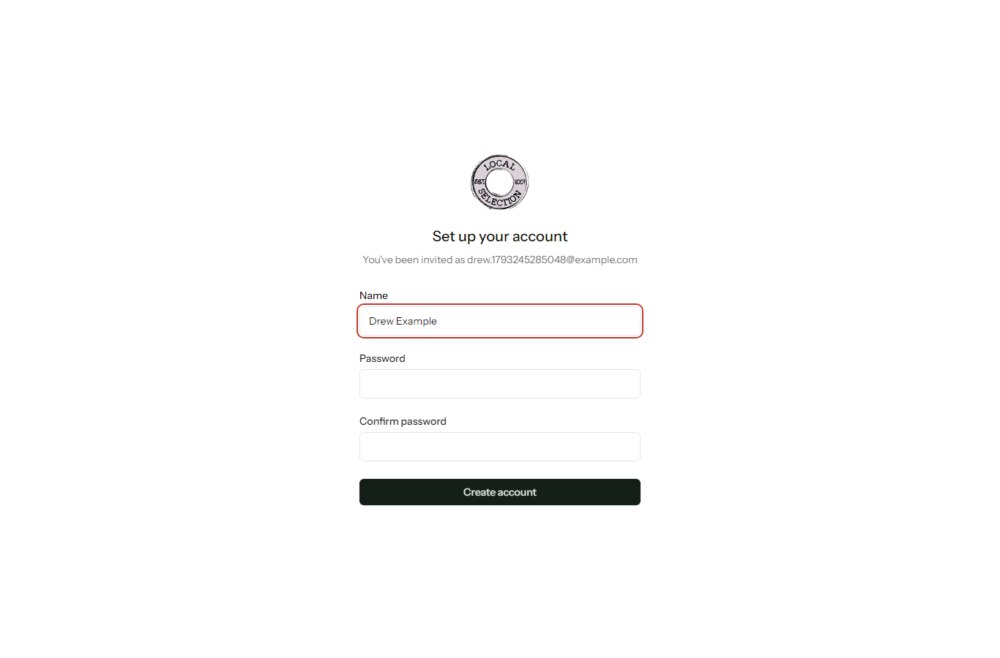

The link works once and expires after 7 days. If it has expired, ask an administrator to **Resend** it.

### 1.2 Log in

1. Go to the Local Selection WMS address your administrator gave you.
2. Enter your email address and password.
3. Tick **Remember me** on a device only you use.
4. Click **Log in**.

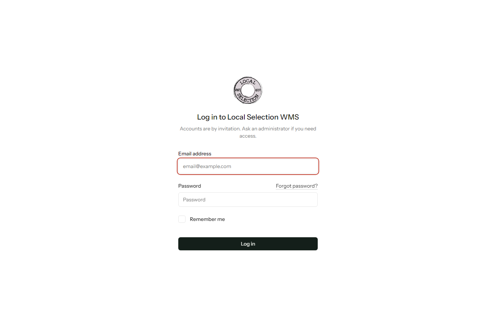

If you've turned on two-factor, you're asked for a code next ([1.5](#15-log-in-with-two-factor)).

You're signed out after 2 hours without activity. Your name in the bottom-left corner opens a menu with **Settings** and **Log out**.

### 1.3 Set up two-factor authentication

Two-factor means you need a code from your phone as well as your password.

- **Administrators must set it up.** Until they do, the app sends them to this screen and nothing else works.
- **Everyone else can choose** to turn it on.

You need an authenticator app on your phone, such as Google Authenticator, Microsoft Authenticator or 1Password.

1. Open your name (bottom left) → **Settings** → **Two-factor**.
2. Click **Set up two-factor**.

   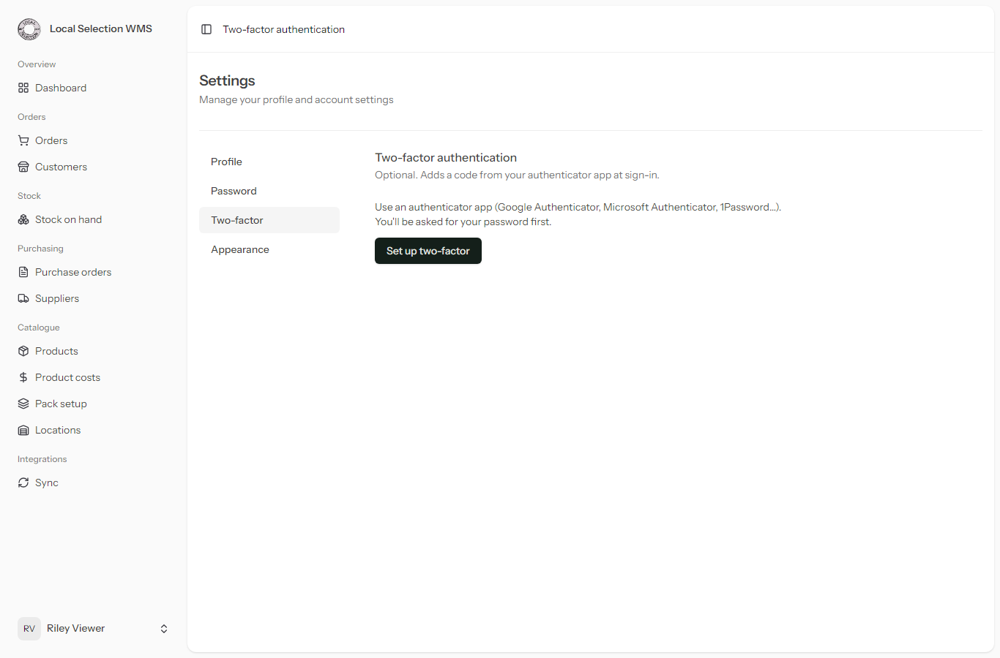

3. Enter your password if asked, and click **Confirm Password**.

   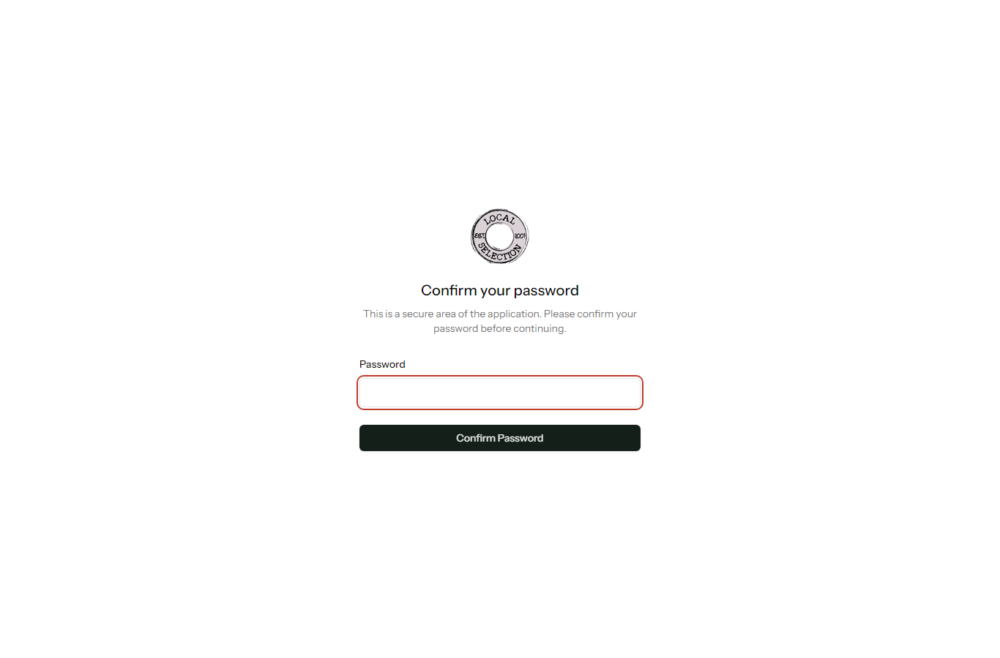

4. Click **Set up two-factor** again if the button is still showing.
5. Scan the QR code with your authenticator app. If you can't scan it, type in the key shown under it.
6. Enter the 6-digit code from the app and click **Confirm**.

   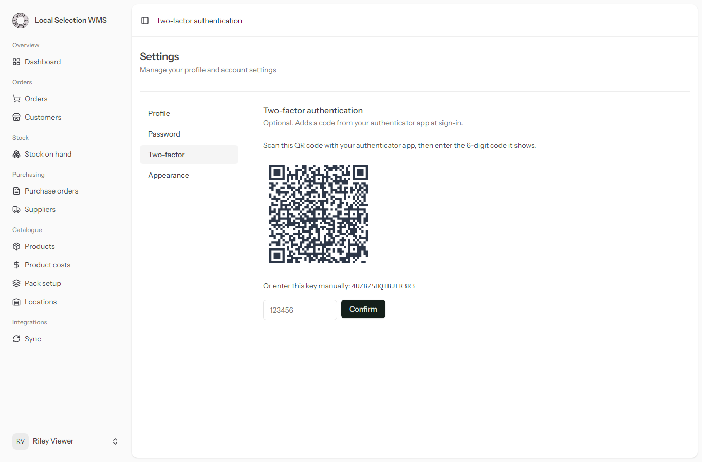

7. "Two-factor authentication is on" appears.

### 1.4 Save your recovery codes

Recovery codes get you in if you lose your phone. Each code works once.

1. On the **Two-factor** page, click **Show recovery codes**.
2. Write them down, or save them in a password manager. Keep them away from your phone.

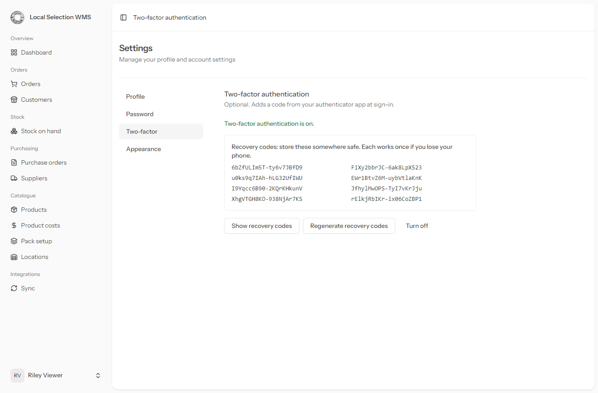

- **Regenerate recovery codes** makes a new set. The old ones stop working.
- **Turn off** is only shown to non-administrators. Administrators can't turn two-factor off.

### 1.5 Log in with two-factor

1. Log in with your email and password.
2. Enter the 6-digit code from your authenticator app.
3. Click **Continue**.

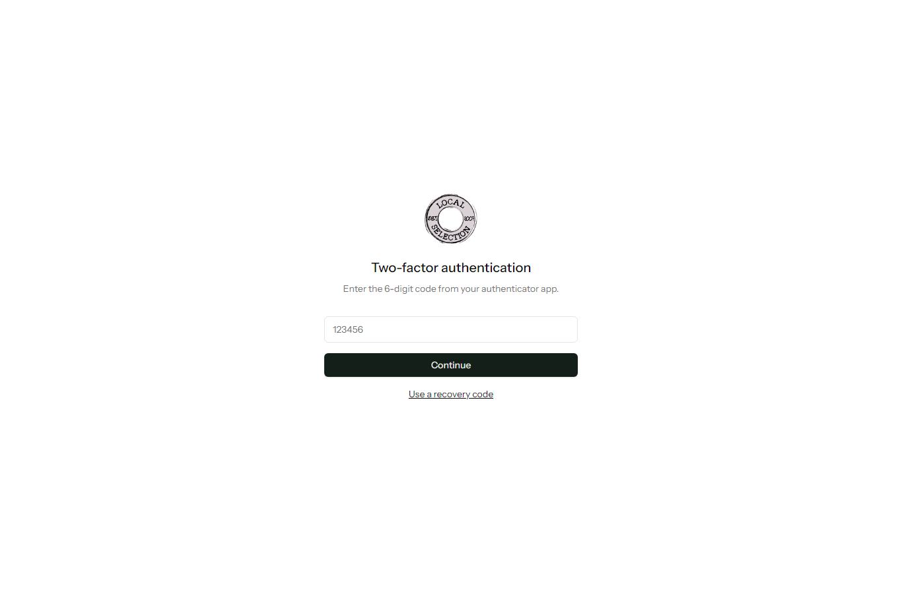

Lost your phone? Click **Use a recovery code** and enter one of your saved codes. If you have none left, ask an administrator to reset your two-factor ([13.3](#133-reset-someones-two-factor)).

### 1.6 Forgot your password

1. On the login page, click **Forgot password?**
2. Enter your email address and click **Email password reset link**.
3. Open the email and follow the link to choose a new password.

### 1.7 Your settings

Open your name (bottom left) → **Settings**.

- **Profile:** change your display name. To change your email address, ask an administrator ([13.2](#132-change-roles-email-or-deactivate)).
- **Password:** change your password. You need your current one.
- **Two-factor:** see [1.3](#13-set-up-two-factor-authentication).
- **Appearance:** Light, Dark or System.

---

## 2. Roles: who can do what

Each user has one or more roles. The menu on the left only shows what your roles allow.

| | Admin | Warehouse manager | Warehouse staff | Purchasing | Read-only |
|---|:-:|:-:|:-:|:-:|:-:|
| See products, locations, stock, POs, orders | ✓ | ✓ | ✓ | ✓ | ✓ |
| See suppliers, product costs, the Sync screen | ✓ | ✓ | | ✓ | ✓ |
| Edit products, packs, costs | ✓ | ✓ | | | |
| Edit locations and bins | ✓ | ✓ | | | |
| Print bin labels | ✓ | ✓ | ✓ | ✓ | ✓ |
| Move stock between bins | ✓ | ✓ | ✓ | | |
| Adjust or write off stock | ✓ | ✓ | | | |
| Enter counts in a stocktake | ✓ | ✓ | ✓ | | |
| Start, post or cancel a stocktake; dismiss count tasks | ✓ | ✓ | | | |
| Edit suppliers; create, send, close and cancel POs | ✓ | ✓ | | ✓ | |
| Receive deliveries | ✓ | ✓ | ✓ | | |
| Accept an over-receipt | ✓ | ✓ | | (✓)¹ | |
| Create orders and customers; cancel orders; change runs | ✓ | ✓ | | | |
| Pick & pack, pick lists, dispatch | ✓ | ✓ | ✓ | | |
| Sync actions (push, retry, replay, map, enable) | ✓ | ✓ | | | |
| See users and the audit log | ✓ | ✓ | | | |
| Invite users, change roles or email, deactivate, reset 2FA | ✓ | | | | |
| Company settings, delivery areas | ✓ | | | | |

¹ Purchasing may accept over-receipts but can't open the receive screen. In practice, someone who can receive enters the delivery and a manager or admin ticks the box.

Other rules:

- Only an admin can give someone the Admin role, or change an admin's roles.
- Nobody can change their own roles, or deactivate or reset themselves.
- Admins must use two-factor.

---

## 3. Dashboard

The dashboard is the first page after you log in. Each tile shows only if your role can see that area.

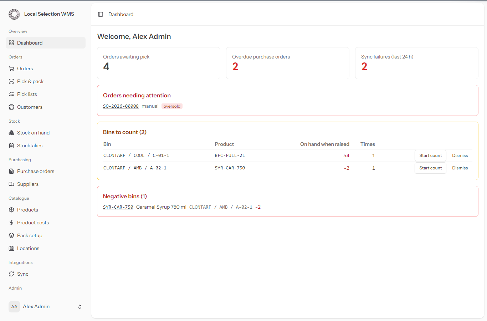

| Tile | What it means | What to do |
|---|---|---|
| **Orders awaiting pick** | Orders that are open or partly dispatched. | Click it to open **Orders**. Pick them from **Pick & pack**. |
| **Overdue purchase orders** | POs sent (or partly received) whose "Required by" date has passed. Red when above 0. | Chase the supplier, receive what arrived, or close the PO short ([6.5](#65-close-short-or-cancel)). |
| **Sync failures (last 24 h)** | Ordermentum and portal stock pushes or order fetches that failed in the last 24 hours. Red when above 0. Shown if you can see the Sync screen. | Click it to open **Sync** and check **Push failures** and **Inbound events** ([12](#12-sync-screen-ordermentum-and-portal)). |
| **Stock lines awaiting put-away** | Stock sitting in a receiving bin that isn't sellable. Only shows if your site receives into such a bin. | Move it to a sellable bin ([7.4](#74-move-stock-between-bins)). |
| **Orders needing attention** | **Oversold:** accepted beyond available stock. **Review:** the channel changed the order while it was being picked. | Open the order and decide ([9.5](#95-oversold-and-review-flags)). |
| **Bins to count** | Count tasks: a bin went below zero at dispatch, or a picker reported a short pick. "Times" counts how often it was raised. | Managers: **Start count** or **Dismiss** ([8.4](#84-count-tasks)). |
| **Negative bins** | Bins where the system shows less than zero. Goods left the warehouse that the system didn't think were there. | Count the bin. Click the SKU to see its movements. |

Warehouse staff see fewer tiles:

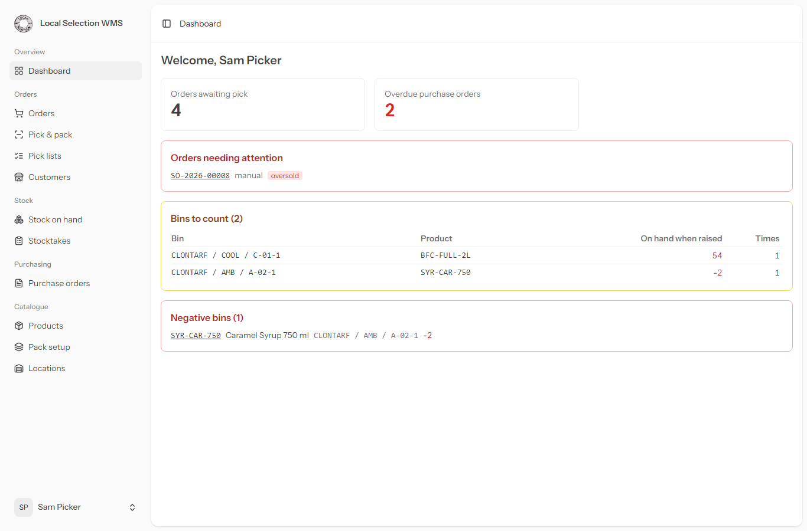

Warehouse staff can't see the Sync screen, so they don't get the sync-failures tile.

---

## 4. Products

**Catalogue → Products** lists every product. Search by SKU or name, or scan a barcode into the search box. Filter by **Active / Inactive / All** and by range.

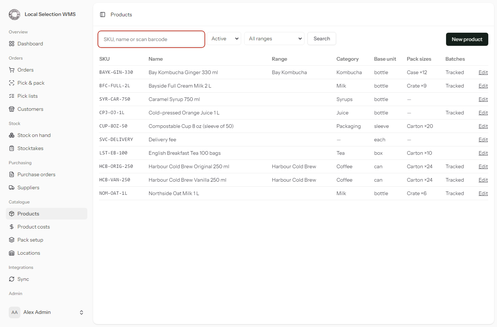

Managers and admins see **New product** and **Edit**. Everyone else sees **View**.

### 4.1 Create or edit a product

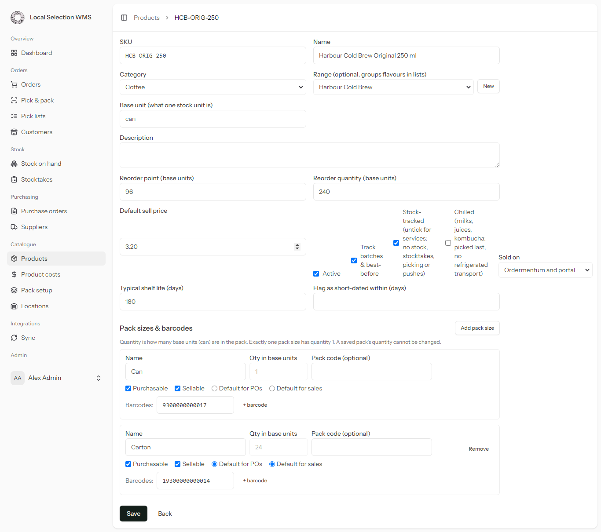

1. Click **New product**, or **Edit** on a product.
2. Fill in the main details:
   - **SKU:** your product code, capitals.
   - **Name.**
   - **Category** (optional).
   - **Range** (optional): see [4.2](#42-ranges).
   - **Base unit:** what one stock unit is, for example "can" or "bottle".
   - **Description**, **Reorder point** and **Reorder quantity** (in base units), **Default sell price**.
3. Set the flags ([4.4](#44-flags-and-sell-channels)).
4. Set up the pack sizes and barcodes ([4.3](#43-pack-sizes-and-barcodes)).
5. Click **Create product** or **Save**.

### 4.2 Ranges

A range groups related products, for example all flavours of one brand. It's for display only: you can filter the product list by range.

To add one, click **New** next to **Range** on the product form.

### 4.3 Pack sizes and barcodes

Each product has one or more pack sizes. The quantity is how many base units are in the pack.

- Exactly one pack has quantity 1 (the base unit).
- **Once a pack is saved, its quantity can't be changed.** Add a new pack instead.
- **Purchasable:** can be used on purchase orders.
- **Sellable:** can be used on orders.
- **Default for POs** and **Default for sales:** the pack chosen first.
- **Pack code** (optional).
- **Barcodes:** click **+ barcode** and scan or type it. Add the barcode of each pack, for example the can and the carton. When a picker scans a pack barcode, it counts that pack's quantity.

Before go-live, packs can also be set up in bulk on **Pack setup** ([4.5](#45-pack-setup-before-go-live)).

### 4.4 Flags and sell channels

| Setting | Effect |
|---|---|
| **Active** | Inactive products are hidden from the default product list. |
| **Track batches & best-before** | Receiving asks for a lot and best-before date. Picking takes the earliest best-before first. Expired batches aren't sellable. |
| **Typical shelf life (days)** | Shown when batches are tracked. |
| **Flag as short-dated within (days)** | Saved with the product. No screen uses it yet. |
| **Stock-tracked** | Untick for services such as a delivery fee. They have no stock, aren't counted or picked, and no stock is pushed for them. |
| **Chilled** | For milks, juices and kombucha. A CHILLED badge shows when picking, and chilled lines are always picked last. |
| **Sold on** | None, Ordermentum, Portal, or both. Stock is only pushed to the channels a product is sold on. Mapping a channel item to a product ([12.4](#124-map-a-channel-item)) adds that channel automatically. |

### 4.5 Pack setup (before go-live)

**Catalogue → Pack setup** is for setting up packs in bulk, before the opening stocktake. Products imported from the old system start with one pack called "Unit".

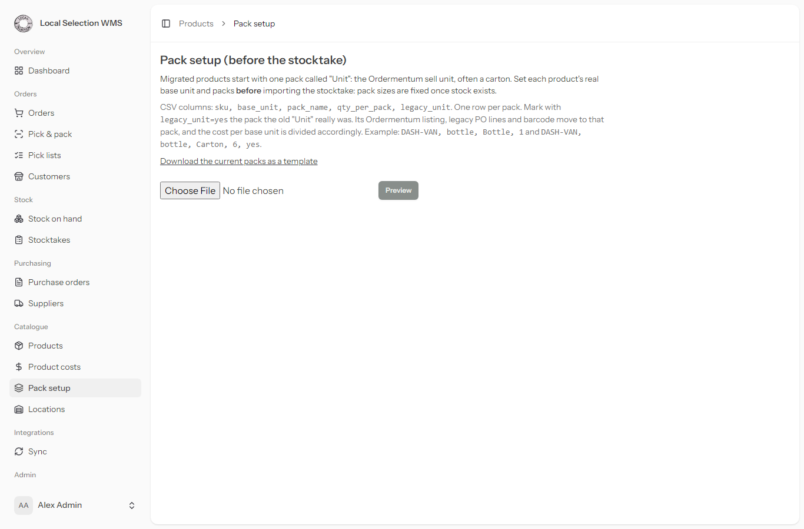

1. Click **Download the current packs as a template**.
2. Fill in one row per pack: `sku, base_unit, pack_name, qty_per_pack, legacy_unit`.
3. On the pack that the old "Unit" really was, put `yes` in `legacy_unit`.
4. Choose the file and click **Preview**.
5. Check the preview, including the cost per base unit before and after.
6. Click **Apply**.

The amber box lists products still on the single "Unit" pack. That's fine if they really are bought, counted and sold as one unit.

### 4.6 Costs

**Catalogue → Product costs** shows each product's cost per base unit. Costs drive stock valuation (weighted average). Receipts update the cost automatically.

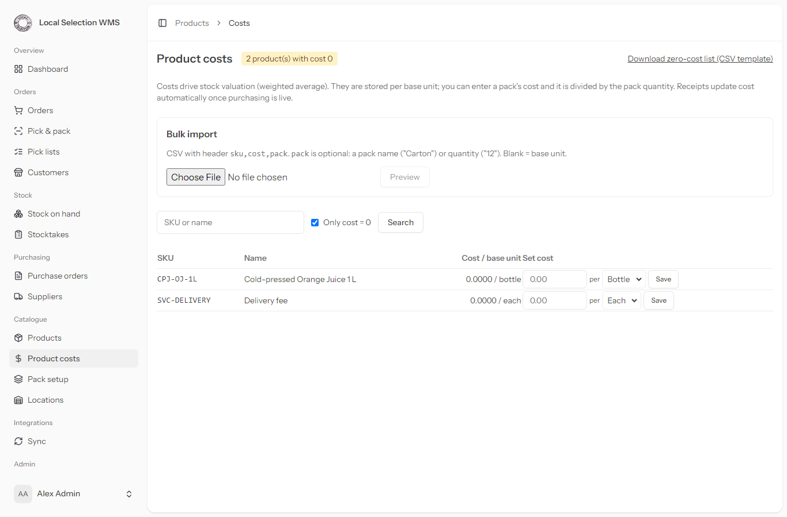

**Set one cost**

1. Find the product.
2. Enter the cost and choose the pack it's for, for example "per Carton ×24". The app divides by the pack quantity.
3. Click **Save**.

**Import costs from a CSV**

1. Click **Download zero-cost list (CSV template)**. It lists every product with a cost of 0.
2. Fill in the `cost` column. The `pack` column is optional: a pack name ("Carton") or a quantity ("12"). Blank means the base unit.
3. Under **Bulk import**, choose the file and click **Preview**.
4. Check the rows. Rows with problems are red and show why.
5. Click **Apply N change(s)**. Only valid rows are applied.

A preview expires after 30 minutes. If it has expired, upload the file again.

---

## 5. Locations and bins

**Catalogue → Locations** shows your sites, zones and bins as a tree.

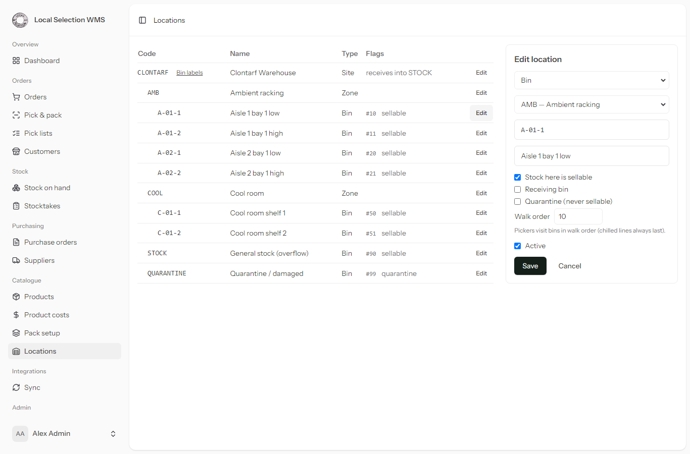

- **Site:** a warehouse, for example Clontarf Warehouse.
- **Zone:** an area inside a site, for example the cool room. Optional.
- **Bin:** a shelf location. Stock always sits in a bin.

### 5.1 Add or edit a location

1. Click **Edit** on a row, or use the **Add location** form on the right.
2. Choose **Site**, **Zone** or **Bin**. Zones and bins need a parent.
3. Enter a **Code** (capital letters, numbers, `.`, `_` or `-`, for example `COOL-A1`) and a **Name**.
4. For a bin, set:
   - **Stock here is sellable:** untick for stock that shouldn't be sold.
   - **Receiving bin.**
   - **Quarantine (never sellable):** for damaged stock. Each site needs one for damaged goods at receiving.
   - **Walk order:** the order pickers visit bins, lowest first.
5. For a site (when editing), **Received stock goes into** picks the bin that deliveries land in. "Automatic" uses the first sellable bin. A bin marked "not sellable: needs put-away" makes received stock show on the dashboard until it's moved.
6. Untick **Active** to retire a location.
7. Click **Add** or **Save**.

### 5.2 Walk order

Pickers are sent through bins in walk order, lowest number first. Chilled products are always picked last, whatever their bin. The walk order shows as `#10` and so on in the list.

### 5.3 Print bin labels

1. On the site row, click **Bin labels**.
2. An A4 PDF opens with every active bin of that site, in walk order. Labels are 90 × 38 mm and carry the bin code and a barcode (for example `B000042`).
3. Print it and stick each label on its bin.

Pickers scan these labels, so every bin needs one.

---

## 6. Purchasing and receiving

### 6.1 Suppliers

**Purchasing → Suppliers** lists your suppliers.

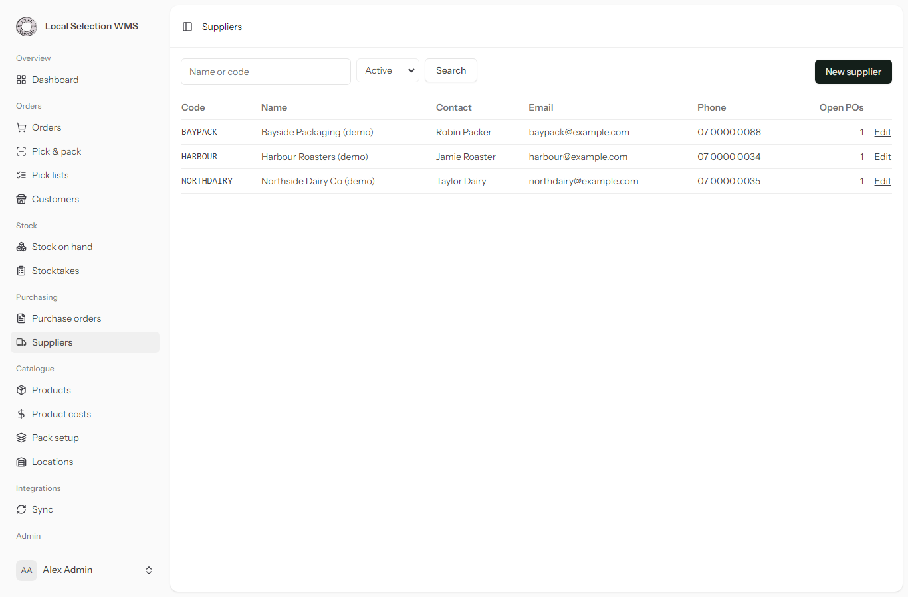

Each supplier has a code, name, contact, phone, **order email** (POs are emailed here), **CC emails**, payment terms, lead time, address and notes.

### 6.2 Create a purchase order

**Purchasing → Purchase orders** lists POs. Filter by **Open**, **All** or a status, and by supplier.

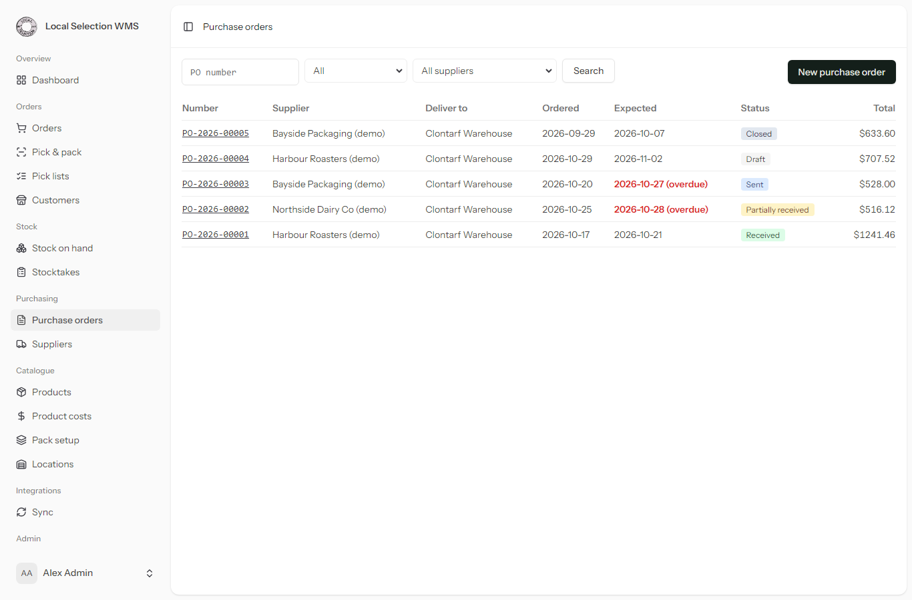

1. Click **New purchase order**.
2. Choose the **Supplier** and **Deliver to** site. Add the **Supplier reference**, **Order date** and **Required by** date.
3. Search for each product and add it.
4. For each line, choose the **Pack**, then enter the **Qty**, the **Cost / pack (ex GST)** and the **GST %**. The base-unit quantity shows under the pack.
5. Add **Notes** if needed. They're printed on the PO.
6. Click **Create draft**.

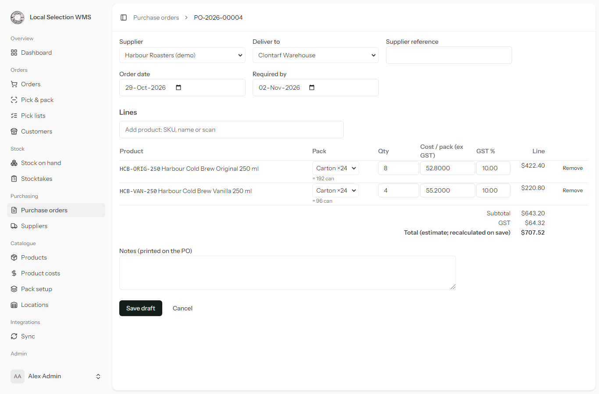

You can change a PO only while it's a draft.

### 6.3 Send the PO

**By email**

1. Open the PO and click **Email supplier**.
2. Check **To**, **CC**, **Subject** and the optional message. The PDF is attached automatically.
3. Click **Queue email**.

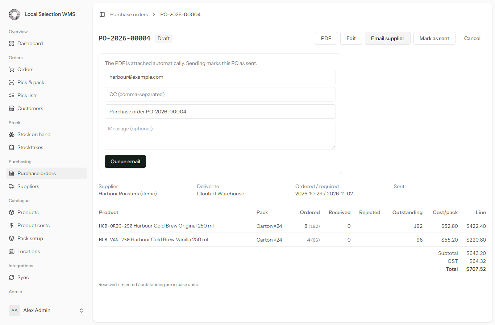

Sending a draft marks it as **Sent**. The **Emails** section on the PO shows each email as queued, sent or failed. If one failed, click **Retry**.

**Another way** (phone, supplier portal): click **Mark as sent**.

**PDF** opens the PO as a PDF at any time.

PO statuses: **Draft → Sent → Partially received → Received**. A PO can also be **Closed** (closed short) or **Cancelled**.

### 6.4 Receive a delivery

You can receive against a PO that is Sent or Partially received.

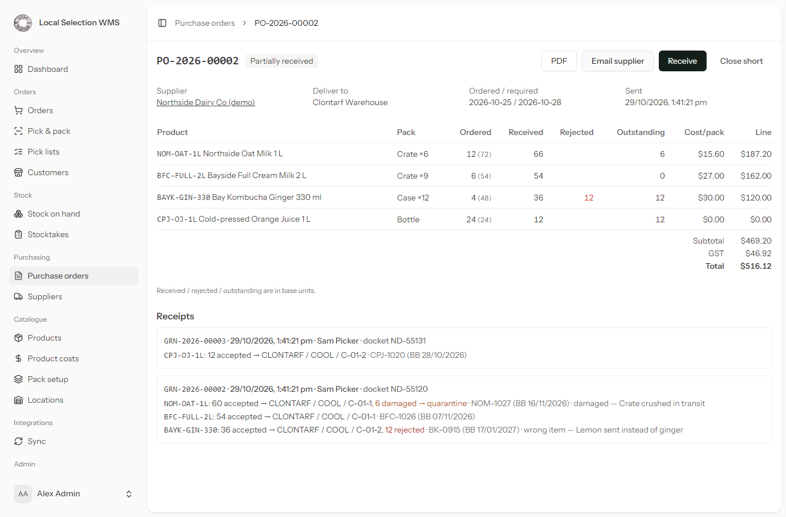

1. Open the PO and click **Receive**.
2. Enter the **Delivery docket / invoice no.** and any notes.
3. For each line, enter what arrived:
   - **Accepted (packs + loose):** good stock. Enter whole packs, and loose units if any. The total in base units shows underneath.
   - **Damaged:** booked into quarantine. It's counted but not sellable.
   - **Rejected:** went back with the driver. It isn't stocked. **A reason is required.**
   - **Bin:** where accepted stock goes. The site's receiving bin is chosen first.
   - **Lot / best-before:** required for batch-tracked products. Click **+ lot** to split a line over several lots.
   - **Reason / note:** damaged, wrong item, expired, short dated, quality, over or other. Damaged stock gets "damaged" automatically.
4. **Fill all outstanding** fills in everything still owed. Change any line that's different.
5. Click **Post receipt**.

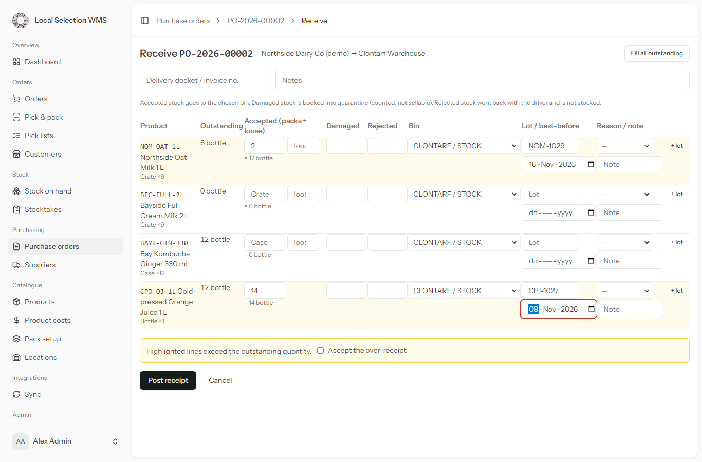

**More than ordered?** The line turns amber. Only a user who manages POs (admin, manager or purchasing) can tick **Accept the over-receipt**. Without that tick, the receipt is refused.

After posting:

- Stock goes up straight away.
- The PO becomes **Partially received** or **Received**.
- The receipt is listed on the PO with who, when and the docket number.

Clicking **Post receipt** twice doesn't book the stock twice.

### 6.5 Close short or cancel

- **Close short:** for a partly received PO when the rest won't come. Enter why (required). The PO becomes **Closed**.
- **Cancel:** only for a draft or sent PO with nothing received. The reason is optional.

---

## 7. Stock

### 7.1 On hand, sellable, reserved and available

| Figure | Meaning | Where you see it |
|---|---|---|
| **On hand** | Everything in every bin, including quarantine and expired batches. | Stock on hand, product stock page |
| **Sellable** | On hand in sellable bins, not quarantine, not past best-before. | Stock on hand, product stock page |
| **Reserved** | Promised to open orders, not yet dispatched. | Stock on hand, product stock page, each order's lines |
| **Available** | Sellable minus reserved. This is what Ordermentum and the portal see. Can be negative after an oversold order. | Stock on hand, product stock page |

Stock leaves the system at dispatch. Until then it's reserved.

### 7.2 Stock on hand

**Stock → Stock on hand** lists every product with **On hand**, **Sellable**, **Reserved** and **Available**, in base units. Hover over **Available** to see "What Ordermentum and the portal see".

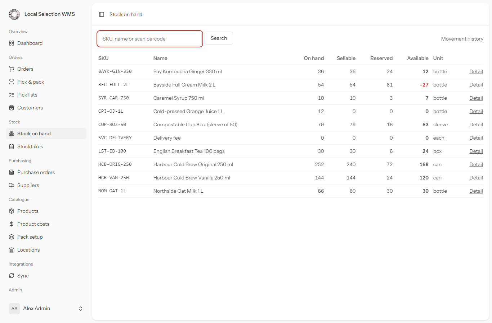

- A **red** on-hand figure is below zero.
- An **amber** sellable figure is at or below the product's reorder point.
- A **red** available figure is below zero: more is promised to orders than you have to sell.

Click **Detail** for one product:

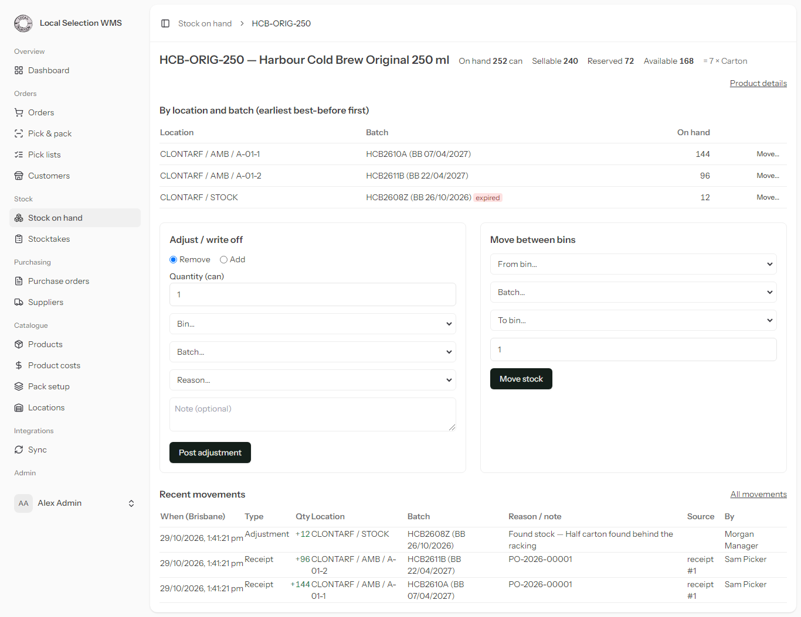

- **By location and batch:** each bin and batch, earliest best-before first. **quarantine**, **not sellable** and **expired** tags show why stock isn't sellable.
- **Recent movements:** the last changes. **All movements** opens the full history.

### 7.3 Adjust or write off stock

For admins and warehouse managers.

1. Open the product's stock page.
2. Under **Adjust / write off**, choose **Remove** or **Add**.
3. Enter the quantity in base units.
4. Choose the bin. For batch-tracked products, choose the batch. When adding, you can create a new batch with a lot code and best-before date.
5. Choose a reason:

   | Reason | Direction | Note required |
   |---|---|:-:|
   | Damaged / broken | Remove | |
   | Past best-before | Remove | |
   | Spoiled (cold chain / quality) | Remove | ✓ |
   | Samples / tastings | Remove | |
   | Internal use | Remove | ✓ |
   | Lost / missing | Remove | ✓ |
   | Found stock | Add | ✓ |
   | Data-entry correction | Either | ✓ |

6. Add a note if needed, and click **Post adjustment**.

Adjustments can't be edited or deleted. To undo one, post the opposite adjustment.

### 7.4 Move stock between bins

Warehouse staff can do this too.

1. Open the product's stock page.
2. Click **Move…** on the row you're moving from, or fill in **Move between bins**:
   - **From bin**
   - **Batch** (batch-tracked products)
   - **To bin**
   - **Quantity**
3. Click **Move stock**.

Use this to put away stock from a receiving bin, or to move damaged stock to quarantine.

### 7.5 Movement history

**Stock on hand → Movement history** lists every stock change. Filter by SKU, type and dates.

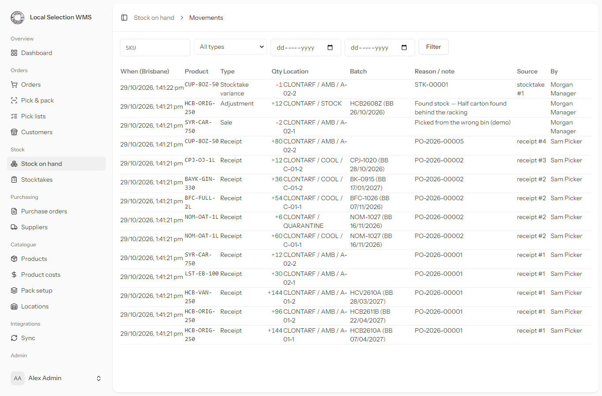

Types include receipt, sale (dispatch), adjustment, write-off, transfer out/in, stocktake variance and opening balance. Each row shows who did it and why.

### 7.6 Expiry

For batch-tracked products:

- Each batch has a lot code and a best-before date, entered at receiving.
- Picking takes the earliest best-before first.
- A batch is sellable up to and including its best-before date (Brisbane date). From the next day it stops being sellable and isn't picked. It stays on hand with an **expired** tag.
- Write expired stock off with the reason **Past best-before** ([7.3](#73-adjust-or-write-off-stock)).

---

## 8. Stocktakes and count tasks

**Stock → Stocktakes.** Warehouse staff can count. Managers and admins start, post and cancel.

### 8.1 Start a stocktake

1. Under **Count what**, choose a site, zone or bin.
2. Add a note if you want, for example "Monthly cycle count".
3. Click **Start stocktake**.

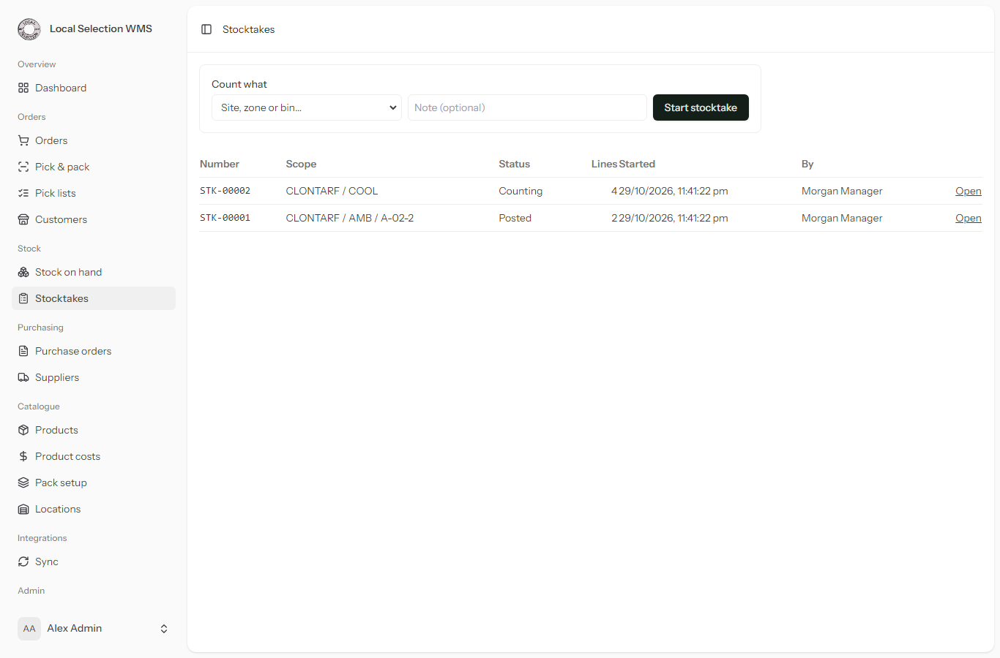

The app lists every product and batch in that area, with its quantity at that moment (the **Snapshot**).

### 8.2 Count

1. Open the stocktake.
2. Count each line and type the figure into **Counted**. It saves when you press Enter or leave the box.
3. Found something that isn't listed? Under **Found something not listed?**, enter the SKU and bin (plus lot and best-before for batch-tracked products) and click **Add line**.

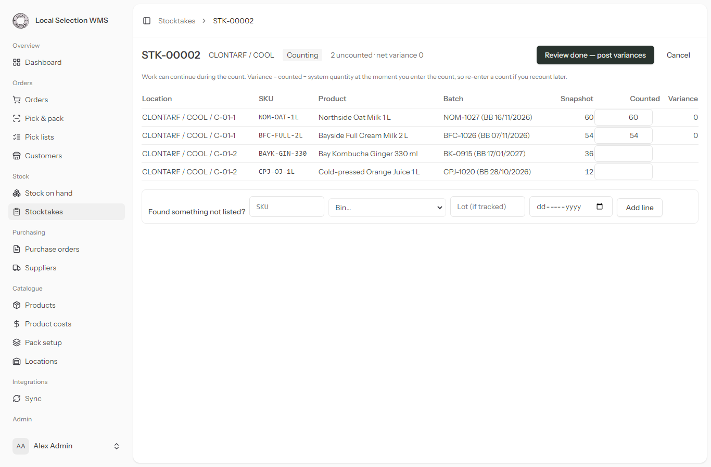

Work can carry on during the count. The **Variance** is your count minus the system quantity at the moment you enter it. If stock moves after you count a line, count it again and re-enter the figure.

### 8.3 Post or cancel

For managers and admins.

1. Check the variances. Red is less than the system, green is more.
2. Click **Review done — post variances**.
3. If some lines are uncounted, you're asked whether to post them as **zero**. Say no if you haven't counted them yet.
4. Confirm. **Posting can't be undone.** Each variance becomes a stock movement.

**Cancel** closes the stocktake without changing any stock.

### 8.4 Count tasks

A count task asks someone to count one bin. The app raises one when:

- a dispatch takes a bin below zero, or
- a picker reports a short pick.

If it's raised again before it's done, **Times** goes up.

Count tasks show on the dashboard under **Bins to count** ([3](#3-dashboard)). Managers and admins can:

- **Start count:** starts a stocktake for that bin. Posting a stocktake that covers the bin closes the task.
- **Dismiss:** when no count is needed. You must say why.

---

## 9. Orders

**Orders → Orders.** Filter by status, channel (Manual, Portal, Ordermentum) and flag (Oversold, Needs review).

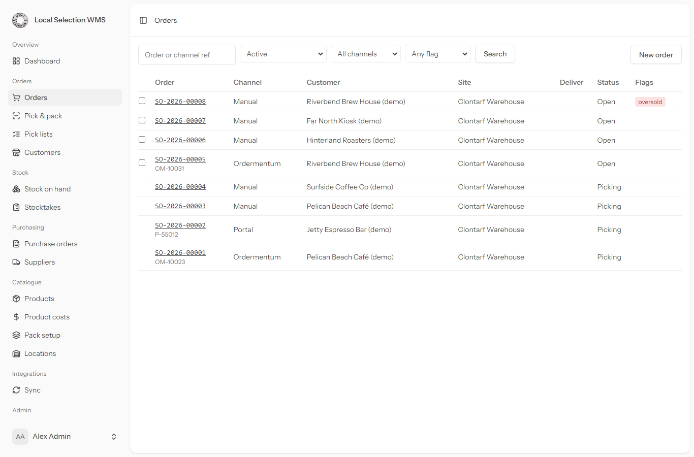

### 9.1 Where orders come from

| Channel | How it arrives | If there isn't enough stock |
|---|---|---|
| **Ordermentum** | Automatically, when Ordermentum order ingestion is switched on. Ordermentum has already taken the stock off its own count. | Always accepted, and flagged **oversold** if beyond available stock. |
| **Portal** | Automatically, when a café checks out on the portal (if the portal link is switched on). | Refused. The portal shows the café what's available. |
| **Manual** | Created here by a manager or admin. | Refused, unless you tick **Accept even if not enough stock is available**. It's then flagged oversold. |

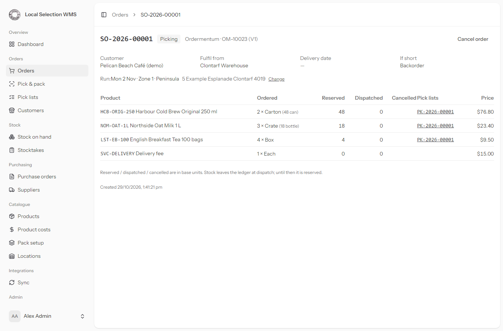

### 9.2 Reservations

When an order is created, its stock is **reserved**. Reserved stock stays in the bin but is no longer available to other orders or channels.

- Dispatch removes the stock and clears the reservation.
- Cancelling an order releases what wasn't dispatched.

The order page shows **Reserved**, **Dispatched** and **Cancelled** per line, in base units.

### 9.3 Create a manual order

For managers and admins.

1. Click **New order**.
2. Choose the **Customer** and the **Fulfil from** site.
3. Set a **Delivery date** if the customer asked for one. Leave it blank to get the next available run.
4. Choose **If short at picking**: **Backorder the rest** or **Cancel the rest**.
5. Search for each product and add it. Choose the pack, quantity and unit price.
6. Tick **Accept even if not enough stock is available** only if you want the order anyway. It will be flagged oversold.
7. Click **Create order & reserve stock**.

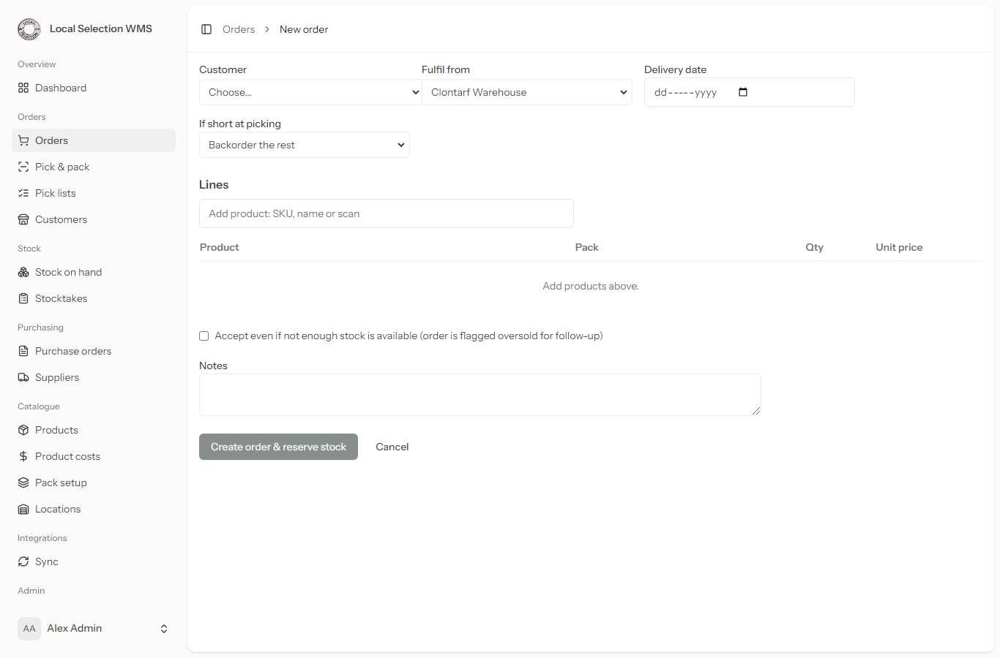

### 9.4 Backorders

If a picker can't find everything, the order's **If short** rule applies at dispatch:

- **Backorder** (the default for Ordermentum and portal orders): what was picked is dispatched. The order becomes **Partially dispatched**, and the rest stays reserved for a later pick.
- **Cancel the rest:** what was picked is dispatched, and the rest is cancelled.

Order statuses: **Open** (reserved, waiting) → **Picking** (on a pick list) → **Partially dispatched** or **Dispatched**. An order can also be **Cancelled**.

### 9.5 Oversold and review flags

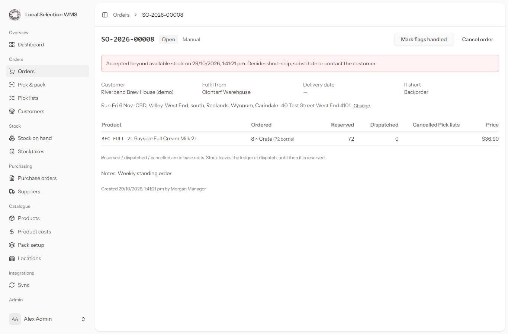

- **Oversold:** the order was accepted beyond available stock. Decide: short-ship, substitute, or contact the customer.
- **Review:** the channel changed the order while it was being picked, or reduced it below what was already dispatched. Check the pick list.

When it's dealt with, click **Mark flags handled**.

### 9.6 Cancel an order

For managers and admins. Click **Cancel order** and give a reason. Undispatched stock is released.

### 9.7 Customers

**Orders → Customers** lists customers. Managers and admins can add and edit them.

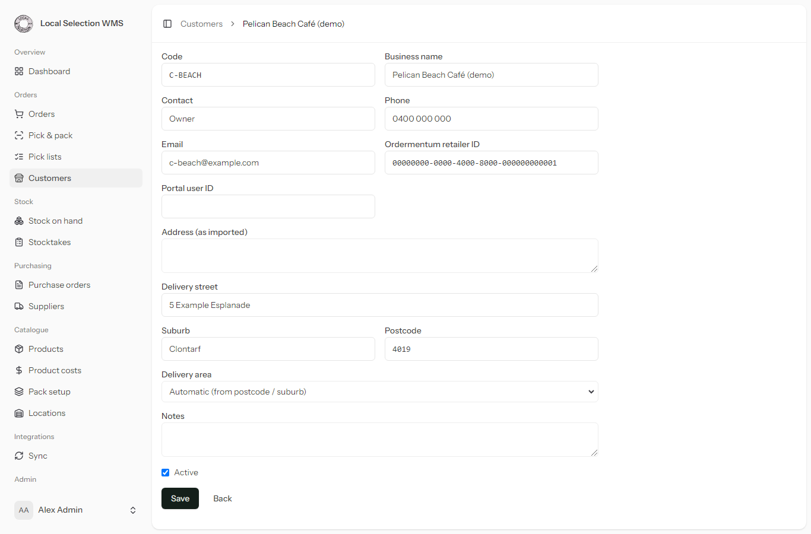

The delivery fields decide the delivery run:

- **Delivery street**, **Suburb**, **Postcode**.
- **Delivery area:** leave it on **Automatic (from postcode / suburb)**, or choose an area to override it.

Also on the customer: **Ordermentum retailer ID** and **Portal user ID**, which link channel orders to the customer.

### 9.8 Pick lists without scanning (desktop)

Most picking is done on the handhelds ([10](#10-pick--pack-handheld)). There is also a desktop pick list:

1. On **Orders**, tick orders from the same site and click **Create pick list**.
2. The pick list opens, sorted by bin, earliest best-before first. **Print** prints it.
3. Enter the quantity picked on each line. Less than asked is a short pick.
4. Click **Dispatch** when every line is confirmed. **Mark all picked** fills every line you haven't entered yet with the full quantity.

**Cancel** puts the orders back to ready-to-pick. All pick lists are under **Orders → Pick lists**.

---

## 10. Pick & pack (handheld)

For warehouse staff, managers and admins. Built for Android handhelds with a built-in scanner.

### 10.1 Before you start

- The scanner must be in keyboard mode with an Enter after each scan.
- Open Local Selection WMS on the handheld over **https**, and add it to the home screen.
- Every bin needs its label ([5.3](#53-print-bin-labels)), and every product its pack barcodes ([4.3](#43-pack-sizes-and-barcodes)).

The scan box has two buttons:

- **⌨** shows the phone's keyboard, if you need to type.
- **📷** uses the camera as a scanner. It only appears on phones and browsers that support it, and needs https.

### 10.2 Pick queue

Open **Pick & pack** from the menu. Runs are grouped by delivery day.

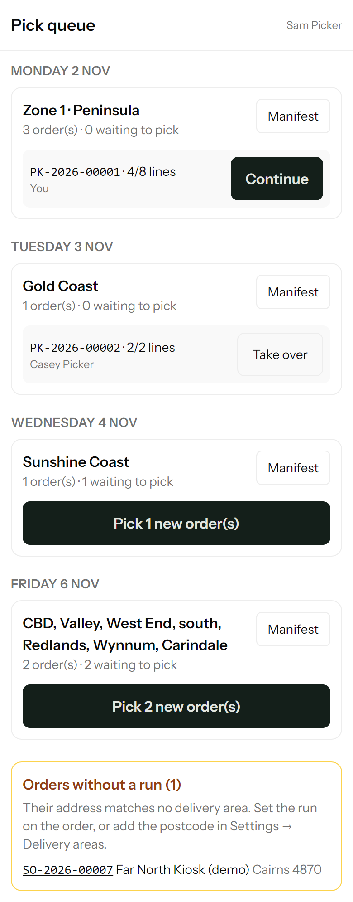

Each run shows how many orders it has and how many are waiting to pick.

- **Pick N new order(s):** makes a pick list from the waiting orders and gives it to you.
- **Continue:** goes back to your own list.
- **Take over:** takes someone else's list. You're asked to confirm, and it's recorded.
- **Manifest:** the run's order list for dispatch ([10.6](#106-dispatch-the-run)).

**Orders without a run** at the bottom are orders whose address matches no delivery area. A manager sets the run on the order, or an admin adds the postcode to an area ([11](#11-delivery-runs-and-areas)).

### 10.3 Pick a line

The screen shows one line at a time, in walk order. Chilled lines come last.

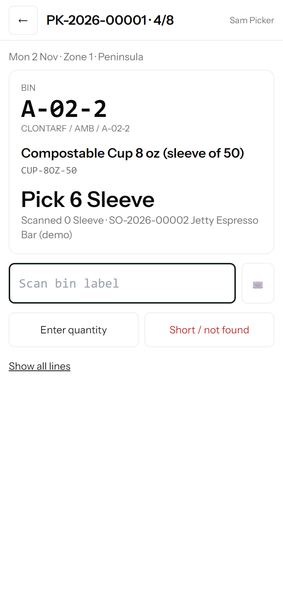

You see:

- the **bin** in large letters
- the product, with a **CHILLED** badge if it's chilled
- the lot and best-before date (batch-tracked products)
- how many to pick, in packs
- the order and customer

Then:

1. Go to the bin and **scan the bin label**. "Bin ✓" shows in green.

   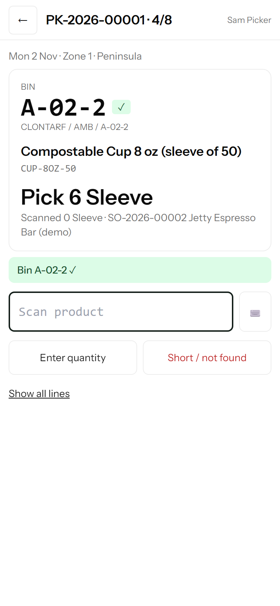

2. **Scan the product.** Each scan adds that pack's quantity.
3. When the count matches, the line confirms itself and the next one opens.

**Wrong scan?** A red message shows and the handheld buzzes twice. It says what was expected, for example "That is bin A-01-1; this line is in A-02-2", or "Not this product". Scanning more than needed gives "Too many".

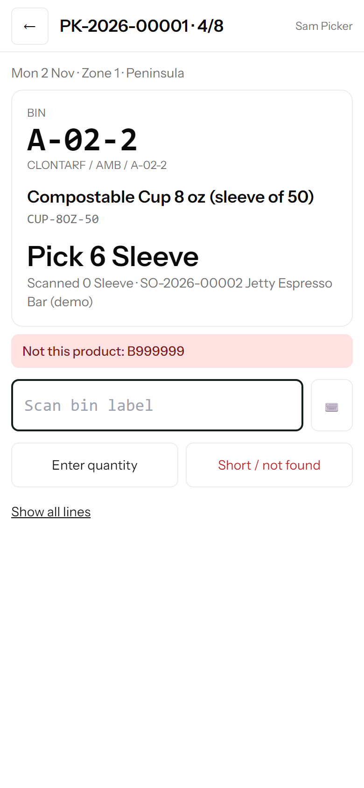

Both scans are checked by the server as well.

**Show all lines** lists the whole pick list. Tap a line to jump to it.

### 10.4 No scan, or not enough stock

**Label missing or scanner not working**

1. Tap **Enter quantity**.
2. Enter how many you picked.
3. Choose why there was no scan: Label missing, Label damaged, Scanner not working, or Other. This is recorded.
4. Tap **Confirm**.

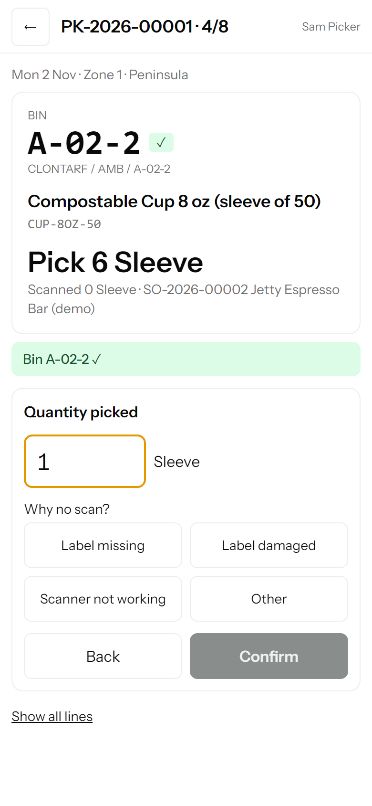

**Not enough in the bin**

1. Tap **Short / not found**.
2. Enter how many you actually found (0 if none).
3. Tap **Confirm**.

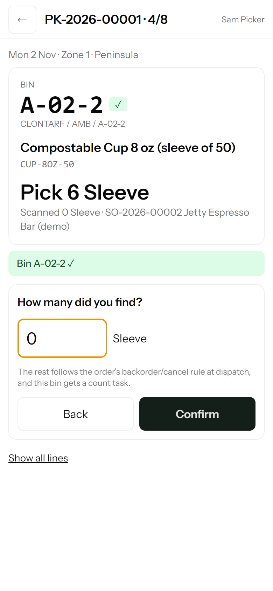

The bin gets a count task. At dispatch, the rest of the order follows its backorder or cancel rule ([9.4](#94-backorders)).

### 10.5 Pack

When every line is picked, "All lines picked" shows. Tap **Go to packing**.

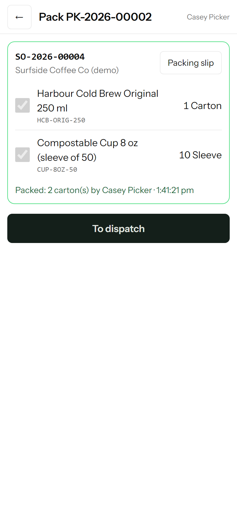

For each order:

1. Tick each line as it goes into the carton(s). You can't pack an order until all its lines are picked. Once an order is packed, its lines stay ticked and can't be changed.
2. Enter the number of **Cartons**.
3. Tap **Packed**. Who and when are recorded.
4. Tap **Packing slip** to open an A5 PDF. Print it and put it in the carton.

When every order is packed, tap **To dispatch**.

### 10.6 Dispatch the run

The manifest lists every order on the run, with its address, carton count and whether it's packed.

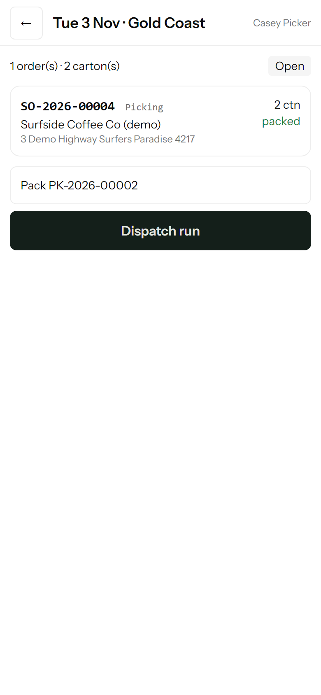

1. Check every order shows **packed**. Open lists show a **Pack PK-…** link.
2. Tap **Dispatch run** and confirm.

Dispatch:

- takes the picked stock off the system,
- completes or part-completes the orders,
- notifies the portal for portal orders (when portal dispatch events are switched on),
- closes the run when nothing is left on it.

Dispatch is refused until every order on the run's open pick lists is packed.

---

## 11. Delivery runs and areas

### 11.1 How an order gets its run

A run is a **delivery date** plus a **delivery area**.

1. **Area:** the customer's area override if set. Otherwise the postcode and suburb of the order's delivery address (Ordermentum and portal orders). Otherwise the customer's delivery address.
2. **Date:** the requested delivery date if there is one. Otherwise the next run for that area after the cutoff.
3. **No match:** the order has no run and shows under **Orders without a run**.

### 11.2 Cutoff

- Orders must be in by **1:00 pm on the business day before** delivery.
- Business days are Monday to Friday.
- Public holidays aren't taken into account yet.
- Areas marked **next-day** also deliver on any weekday.

**Change the run of one order** (managers and admins): on the order page, next to **Run**, click **Change**, choose the area and date, and click **Save**. A run set by hand stays put.

Runs are worked out again when an order changes, or when a customer's address or area changes. An order already on a pick list keeps its run.

### 11.3 Edit delivery areas

For admins: **Admin → Delivery areas**.

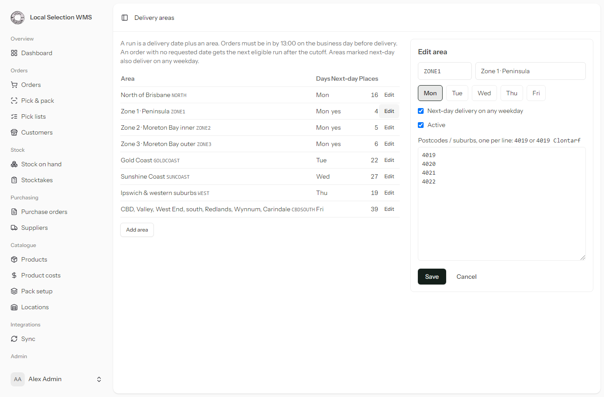

1. Click **Edit** on an area, or **Add area**.
2. Enter the **Code** and **Name**.
3. Tap the delivery weekdays.
4. Tick **Next-day delivery on any weekday** if it applies.
5. List the places, one per line:
   - `4019` for the whole postcode, or
   - `4019 Clontarf` for one suburb, when a postcode is split between areas.

   A suburb line beats a whole-postcode line. Each place can belong to only one area.
6. Untick **Active** to stop using an area.
7. Click **Save**.

---

## 12. Sync screen (Ordermentum and portal)

**Integrations → Sync** shows how Local Selection WMS is talking to Ordermentum and the portal.

- **Who sees it:** admins, managers, purchasing and read-only.
- **Who can press its buttons:** admins and warehouse managers only.

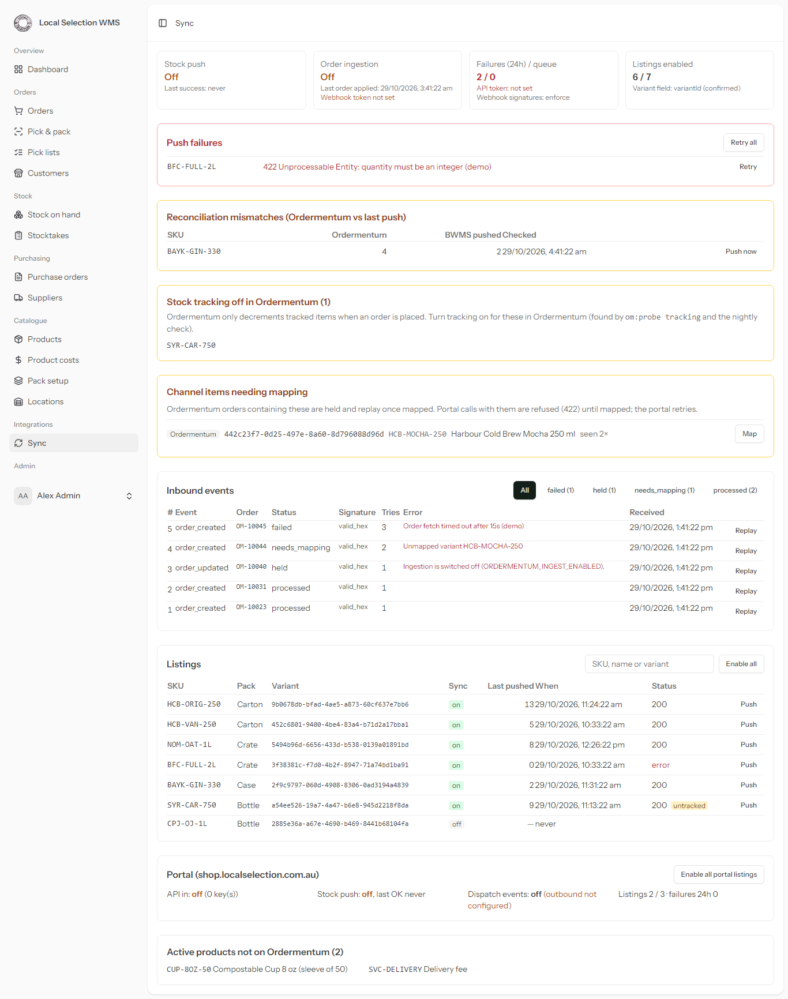

> **⚠ Take care.** Buttons on this screen change what cafés see and can order on Ordermentum and the portal. Each one first asks you to confirm, and the message says what will happen and how many items it affects. Read it before clicking **OK**. If you're not sure, click **Cancel** and ask an administrator.

### 12.1 The switches

The four boxes at the top show:

- **Stock push:** On or Off, and the last success.
- **Order ingestion:** On or Off, and the last order applied.
- **Failures (24h) / queue.**
- **Listings enabled.**
- **Variant field:** which field of an Ordermentum order line holds the product. It shows **(confirmed)** when it's the field checked on a live order. **(unconfirmed)** in amber means the server setting was changed: tell an administrator.

The switches are set on the server by an administrator, not on this screen. While **Stock push** is Off, nothing is sent to Ordermentum, whatever the buttons below say.

### 12.2 Sections

| Section | Meaning | Action |
|---|---|---|
| **Push failures** | Ordermentum refused or failed a stock update for these products. | **Retry** one, or **Retry all**. |
| **Reconciliation mismatches** | The nightly check found Ordermentum's figure differs from what was last pushed. | **Push now** sends the current figure. |
| **Stock tracking off in Ordermentum** | Ordermentum doesn't count stock down for these items. | Turn tracking on in Ordermentum (outside this app). |
| **Channel items needing mapping** | An Ordermentum or portal item that isn't linked to a product. Ordermentum orders with it are held; portal calls with it are refused until mapped. | **Map** ([12.4](#124-map-a-channel-item)). |
| **Inbound events** | Each Ordermentum order event received. Filter by status. | **Replay** processes it again. |
| **Listings** | Each product's link to Ordermentum: pack, variant, sync on/off, last figure pushed. | Toggle **on/off**, **Push**, **Enable all**. |
| **Portal** | Portal switches, listings, push failures, and refused or invalid portal calls. | **Enable all portal listings**. |
| **Active products not on Ordermentum** | Products sold on Ordermentum with no listing. | Map them, or change **Sold on** ([4.4](#44-flags-and-sell-channels)). |

Inbound event statuses:

- **processed:** applied to an order.
- **held:** ingestion was off. Replay it once ingestion is on.
- **needs_mapping:** waiting for an item to be mapped.
- **failed:** an error. Read it, then **Replay**.

A refused portal call may be for an order the portal already accepted while Local Selection WMS was unreachable. Decide: short-ship, substitute, or contact the café.

### 12.3 Risky actions (admins and managers)

Every button below asks you to confirm first. The confirmation says what will happen and how many items it affects, and warns you if the server switch for that channel is off. For example, **Enable all** asks:

> Switch on stock sync for every Ordermentum listing that is off?
>
> Affects 1 listing(s). Their current available figures are sent to Ordermentum straight away, and cafés see them.

| Button | What it does | Risk |
|---|---|---|
| **Enable all** / **Enable all portal listings** | Switches stock sync on for every listing and queues a full push. | Every café sees new stock figures at once. |
| Listing **on/off** | Starts or stops pushing stock for one product. | Off: the channel keeps its last figure and can oversell. |
| **Push** / **Push now** / **Retry** | Sends the current available figure for one product. | Low if the figure is right; check stock first. |
| **Retry all** | Sends the current available figure for every product with a push error, on Ordermentum and the portal. | As above, for all of them at once. |
| **Replay** | Re-processes an Ordermentum order event. | Creates or changes that order and its reservation. |
| **Map** | Links a channel item to a product and pack. Tick **push stock** to start pushing for it. | A wrong product or pack means wrong orders and wrong stock figures. |

### 12.4 Map a channel item

1. Under **Channel items needing mapping**, click **Map**. A green **suggest** tag shows a likely match.
2. Search for the product.
3. Choose the pack the channel sells.
4. Tick **push stock** only if its stock should be pushed now.
5. Click **Confirm**, check the message, and click **OK**.

Held Ordermentum orders containing the item are processed again. The product's **Sold on** setting gains that channel.

---

## 13. Admin

### 13.1 Invite a user

**Admin → Users.** Managers can see this page but can't invite or change anyone.

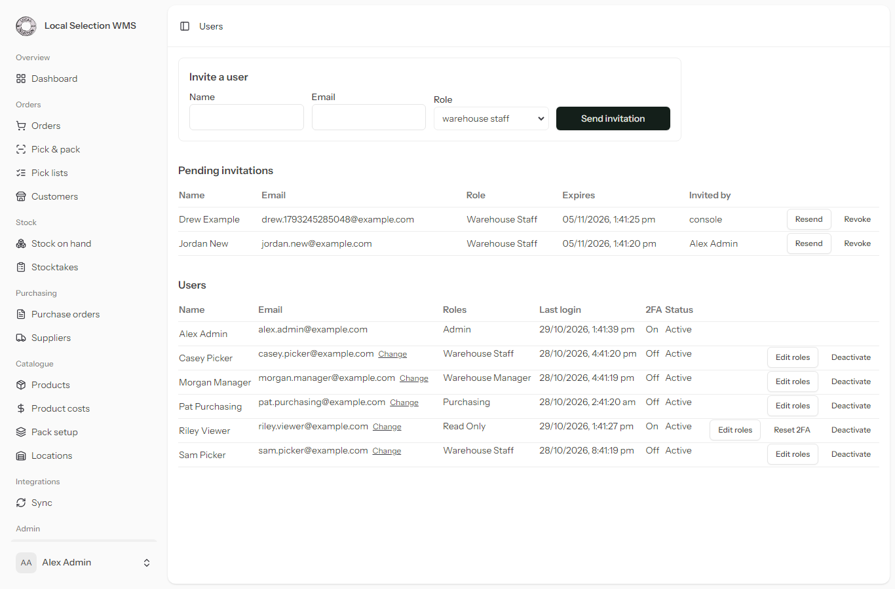

1. Under **Invite a user**, enter the name and email.
2. Choose the role. Only admins can invite admins.
3. Click **Send invitation**.

The invitation is listed under **Pending invitations** until it's accepted. It expires after 7 days.

- **Resend** sends a new link.
- **Revoke** cancels it.

### 13.2 Change roles, email or deactivate

On the user's row:

- **Edit roles:** tick the roles and click **Save**.
- **Change** (next to the email): type the new address, click **Save**, and confirm. The person logs in with the new address straight away, and password resets go there. The change is recorded in the audit log as `email_changed` with the old and new address. No confirmation email is sent to the new address, so check it carefully.

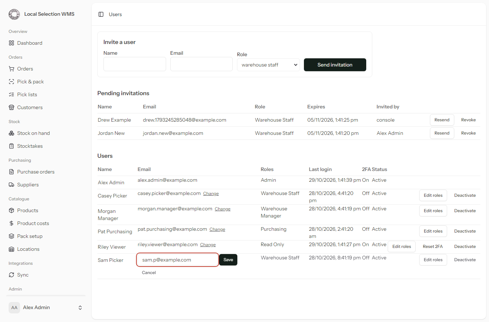

You can't change your own email. Ask another admin.
- **Deactivate:** the person is signed out at once and can't log in.
- **Activate:** lets them back in.

You can't change your own roles or deactivate yourself.

The **2FA** column shows **On**, **Off**, or **Required — not set up** for admins who haven't done it yet.

### 13.3 Reset someone's two-factor

When someone has lost their phone and their recovery codes:

1. Click **Reset 2FA** on their row and confirm.
2. They log in with just their password, and set two-factor up again ([1.3](#13-set-up-two-factor-authentication)). An admin is sent straight to the set-up page.

You can't reset your own two-factor. Ask another admin.

### 13.4 Company settings

**Admin → Company settings.** For admins.

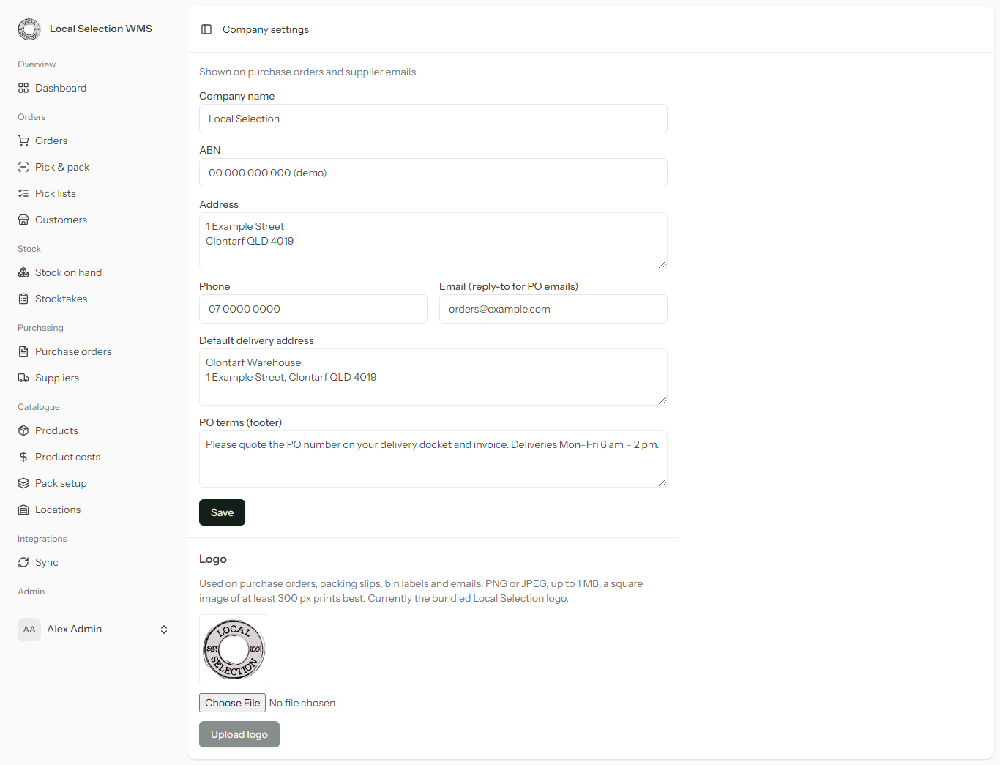

1. **Company details** (name, ABN, address, phone, email, default delivery address, PO terms) are printed on purchase orders. The email is the reply-to address for PO emails. Click **Save**.
2. **Logo:** shown on purchase orders, packing slips, bin labels and emails.
   - Choose a PNG or JPEG of up to 1 MB. A square image of at least 300 px prints best.
   - Click **Upload logo**.
   - **Use the bundled logo** goes back to the standard Local Selection logo.

### 13.5 Audit log

**Admin → Audit log** (admins and managers) lists important actions with who, when, before and after. Examples: role changes, stock adjustments, pick overrides and take-overs, two-factor resets.

Filter by event (for example `roles_changed`) or subject (for example `User`).

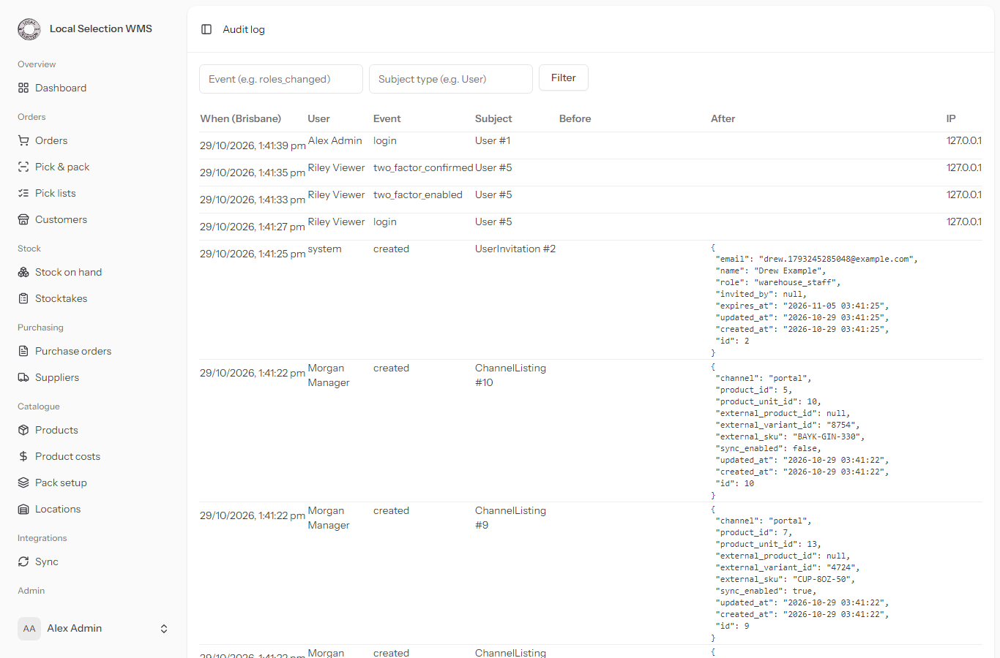

---

## 14. Troubleshooting and FAQ

**I can't see a menu item a colleague has.**
Your role doesn't include it. See [2](#2-roles-who-can-do-what), and ask an admin to change your roles.

**I'm an admin and every page sends me to Two-factor.**
Admins must set up two-factor first ([1.3](#13-set-up-two-factor-authentication)).

**I lost my phone.**
Log in with a recovery code ([1.5](#15-log-in-with-two-factor)). No codes left? Ask an admin to **Reset 2FA**.

**My invitation link doesn't work.**
It has expired (7 days) or was already used. Ask an admin to **Resend** it.

**The scanner types into the wrong place, or nothing happens.**
Tap the scan box first. Check the scanner adds Enter after each scan. Use **Enter quantity** with a reason if you can't scan.

**"Wrong bin" or "Not this product".**
You're at the wrong bin, or the product's barcode isn't on file. Check the bin code on screen. If the barcode really is missing, use **Enter quantity**, choose **Label missing**, and ask a manager to add the barcode to the product.

**"… is being picked by someone else".**
Another picker has the list. Use **Take over** if they've stopped.

**"Finish picking every line of this order first" when packing.**
Go back and pick, or short-pick, the remaining lines.

**"Pack every order on … before dispatch".**
Open the **Pack** link on the manifest and pack the orders shown as "not packed".

**An order is under "Orders without a run".**
Its postcode isn't in any delivery area. A manager can set the run on the order, or an admin can add the postcode ([11.3](#113-edit-delivery-areas)).

**A bin shows a negative quantity.**
Goods left that the system didn't know were there, usually stock put in a different bin. Count the bin ([8.4](#84-count-tasks)), and move or adjust as needed.

**"… is batch-tracked: enter lot and best-before" when receiving.**
Enter the lot code and best-before date from the carton.

**"More than ordered … Confirm the over-receipt".**
Check the delivery. If you're keeping it, someone who manages POs ticks **Accept the over-receipt**.

**"… has no quarantine bin for damaged stock".**
Damaged stock needs a quarantine bin at that site. Ask a manager to add one ([5.1](#51-add-or-edit-a-location)).

**"… must be sent before receiving".**
The PO is still a draft. Click **Mark as sent** or **Email supplier** first.

**The cost import says the preview expired.**
Previews last 30 minutes. Upload the file again.

**A PO email shows "failed".**
Check the supplier's email address, then click **Retry**.

**Ordermentum and the app show different stock.**
Check the **Sync** screen ([12](#12-sync-screen-ordermentum-and-portal)) for push failures and mismatches. Remember Ordermentum is told the **available** figure (sellable minus reserved), in the pack it sells.

**Can I undo a stocktake, adjustment or dispatch?**
No. Stock movements can't be edited or deleted. Post a correcting adjustment with the reason **Data-entry correction** ([7.3](#73-adjust-or-write-off-stock)).

**How do I change my email address?**
Ask an administrator. They change it on **Admin → Users** ([13.2](#132-change-roles-email-or-deactivate)).
