# Local Selection WMS: user manual

For warehouse staff, managers, purchasing and administrators.

This manual describes the app as it is built today. The screenshots use made-up demo data: the cafés, suppliers, products and people are invented.

**Contents**

- [Quick reference by role](#quick-reference-by-role)
- [Weekly purchasing routine](#weekly-purchasing-routine)
- [1. Getting started](#1-getting-started)
- [2. Roles: who can do what](#2-roles-who-can-do-what)
- [3. Dashboard](#3-dashboard)
- [4. Products](#4-products)
- [5. Locations and bins](#5-locations-and-bins)
- [6. Purchasing and receiving](#6-purchasing-and-receiving)
- [7. Stock](#7-stock)
- [8. Stocktakes and count tasks](#8-stocktakes-and-count-tasks)
- [9. Orders](#9-orders)
- [10. Pick & pack (phone/handheld)](#10-pick--pack-phonehandheld)
- [11. Delivery runs and areas](#11-delivery-runs-and-areas)
- [12. Sync screen (Ordermentum and portal)](#12-sync-screen-ordermentum-and-portal)
- [13. Admin](#13-admin)
- [14. Reports](#14-reports)
- [15. Troubleshooting and FAQ](#15-troubleshooting-and-faq)
- [Appendix: Admin setup](#appendix-admin-setup)

**Words used in this manual**

| Word | Meaning |
|---|---|
| Base unit | The smallest unit stock is counted in, for example one can or one bottle. All stock figures are in base units. |
| Pack | A pack size of a product, for example a Carton of 24 cans. |
| Bin | A place on a shelf where stock sits. Each bin has a label with a barcode. |
| Run | One delivery date plus one delivery area, for example "Thu 29 Oct · Zone 1". |
| Reserved | Stock promised to an order that hasn't left the warehouse yet. |
| Sellable | Stock in sellable bins, not in quarantine and not past its best-before. |
| Budget week | Monday to Sunday, Brisbane time. Each week has its own purchasing budget. |
| Ex GST / inc GST | Without GST / with GST added. Budgets are ex GST; Cash out shows both. |

---

## Quick reference by role

### Warehouse staff

| Task | Where | Section |
|---|---|---|
| Pick a run on the handheld | **Pick & pack (phone/handheld)** → run → **Pick N new order(s)** or **Continue** | [10](#10-pick--pack-phonehandheld) |
| Pack orders and print packing slips | Finish picking → **Go to packing** | [10.5](#105-pack) |
| Dispatch a run | **Manifest** → **Dispatch run** | [10.6](#106-dispatch-the-run) |
| Receive a delivery against a PO | **Purchase orders** → PO → **Receive** | [6.4](#64-receive-a-delivery) |
| Move stock between bins | **Stock on hand** → product → **Move between bins** | [7.4](#74-move-stock-between-bins) |

You can also enter counts in a stocktake a manager has started ([8.2](#82-count)).

### Warehouse manager

| Task | Where | Section |
|---|---|---|
| Check the dashboard and act on count tasks and negative bins | **Dashboard** | [3](#3-dashboard) |
| Create, approve, send and close purchase orders | **Purchase orders** | [6](#6-purchasing-and-receiving) |
| Substitute a product for a short line | **Orders** → order → **Substitute** | [9.5b](#95b-substitutions) |
| Adjust or write off stock | **Stock on hand** → product → **Adjust / write off** | [7.3](#73-adjust-or-write-off-stock) |
| Write off, return or release what's in quarantine | **Stock → Quarantine** | [7.8](#78-quarantine) |
| See what's about to pass its best-before | **Stock → Expiring soon** | [7.7](#77-expiring-soon) |
| Run a stocktake and post it | **Stocktakes** | [8](#8-stocktakes-and-count-tasks) |
| Deal with oversold orders and orders without a run | **Orders** → order | [9](#9-orders) |

### Purchasing

| Task | Where | Section |
|---|---|---|
| The weekly routine: suggestions, approve, send, pay | See the one-page guide | [Weekly purchasing routine](#weekly-purchasing-routine) |
| Review the suggested POs | **Purchase orders** → status **Suggested** | [6.6](#66-suggested-pos-and-reorder-suggestions) |
| Create a purchase order | **Purchase orders** → **New purchase order** | [6.2](#62-create-a-purchase-order) |
| Approve a PO against the week's budget | PO → **Approve** | [6.2a](#62a-approve-the-po) |
| Email a PO to the supplier | PO → **Email supplier** | [6.3](#63-send-the-po) |
| Record that a supplier has been paid | PO → **Mark paid** | [6.5a](#65a-mark-paid) |
| Set the week's budget | **Purchasing → Budgets** | [6.7](#67-budgets) |
| See what's due to suppliers | **Purchasing → Cash out** | [6.8](#68-cash-out) |
| Find stock that isn't selling | **Purchasing → Slow movers** | [6.9](#69-slow-movers) |
| Chase credits for stock returned to suppliers | **Purchasing → Supplier credits** | [6.10](#610-supplier-credits) |
| Close a PO short | PO → **Close short** | [6.5](#65-close-short-or-cancel) |
| Accept an over-receipt | Receive screen → **Accept the over-receipt** (with the person receiving) | [6.4](#64-receive-a-delivery) |
| Keep supplier details up to date | **Suppliers** | [6.1](#61-suppliers) |

### Read-only

| Task | Where | Section |
|---|---|---|
| Look up stock for a product | **Stock on hand** → search → **Detail** | [7](#7-stock) |
| Check an order's status | **Orders** → order | [9](#9-orders) |
| Check a purchase order | **Purchase orders** → PO | [6](#6-purchasing-and-receiving) |
| See product costs | **Product costs** | [4.6](#46-costs) |
| Check the sync status | **Sync** | [12](#12-sync-screen-ordermentum-and-portal) |

### Admin

| Task | Where | Section |
|---|---|---|
| Invite a user | **Users** → **Invite a user** | [13.1](#131-invite-a-user) |
| Change someone's roles or email, or deactivate them | **Users** | [13.2](#132-change-roles-email-or-deactivate) |
| Reset someone's two-factor | **Users** → **Reset 2FA** | [13.3](#133-reset-someones-two-factor) |
| Edit company details and logo | **Company settings** | [13.4](#134-company-settings) |
| Edit delivery areas | **Delivery areas** | [11.3](#113-edit-delivery-areas) |

An admin can also do everything a warehouse manager can.

---

## Weekly purchasing routine

For whoever does the buying (purchasing, warehouse managers, admins). The owner sets each week's budget; the rest is shared. The detail is in [6](#6-purchasing-and-receiving).

**Monday morning**

1. **Check this week's budget is set.** **Purchasing → Budgets** ([6.7](#67-budgets)). The owner sets it each week from Xero receipts. If it still says "auto-estimate – check against Xero", it hasn't been checked yet: ask before approving large orders.
2. **Review the suggested POs.** At 6 am every Monday the app drafts one suggested PO per supplier from what's been selling. Open **Purchase orders**, choose the **Suggested** status, and open each one ([6.6](#66-suggested-pos-and-reorder-suggestions)).
   - Change quantities with **Edit** if you know something the sales history doesn't (a promotion, a closure, a new café).
   - An amber note means the PO is below the supplier's minimum order. Add to it or wait a week.
   - Lines in red have a gross margin under 26%. Check the cost and the sell price.
3. **Approve what fits the budget.** Click **Approve** on each PO you want ([6.2a](#62a-approve-the-po)). The bar at the top shows **Budget**, **Committed** and **Remaining**. If a PO goes over, you can still approve it, but you must tick **Approve over budget anyway** and give a reason.
4. **Send.** On each approved PO, click **Email supplier**, or **Mark as sent** if you ordered by phone ([6.3](#63-send-the-po)).

Need something before Monday? **Generate suggestions** on **Purchase orders** runs the same check at any time.

**When you pay a supplier in Xero**

- Open the PO and click **Mark paid** ([6.5a](#65a-mark-paid)). It drops off **Cash out**. This works before delivery too, for suppliers you pay up front.

**Before a big order**

- Open **Purchasing → Cash out** ([6.8](#68-cash-out)). Check the **Net** row for the weeks the payment falls due. Red weeks mean more going out to suppliers than the indicative sales coming in.

**Once a month**

- Open **Purchasing → Slow movers** ([6.9](#69-slow-movers)). Decide what to do with stock that isn't selling: a special, a return to the supplier, or stop ordering it (untick **Include in suggested POs** on the product).

---

## 1. Getting started

There is no sign-up page. Every account starts with an invitation from an administrator.

### 1.1 Accept your invitation

1. Open the invitation email and click **Set your password**.
2. Check your name.
3. Choose a password (at least 8 characters) and type it again.
4. Click **Create account**.

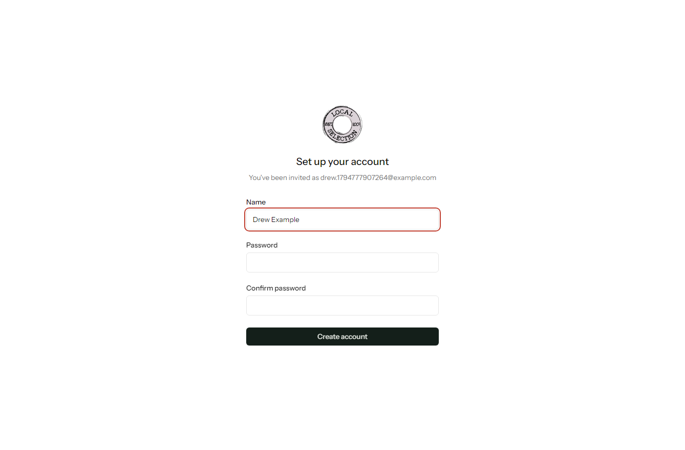

The link works once and expires after 7 days. If it has expired, ask an administrator to **Resend** it.

### 1.2 Log in

1. Go to the Local Selection WMS address your administrator gave you.
2. Enter your email address and password.
3. Tick **Remember me** on a device only you use.
4. Click **Log in**.

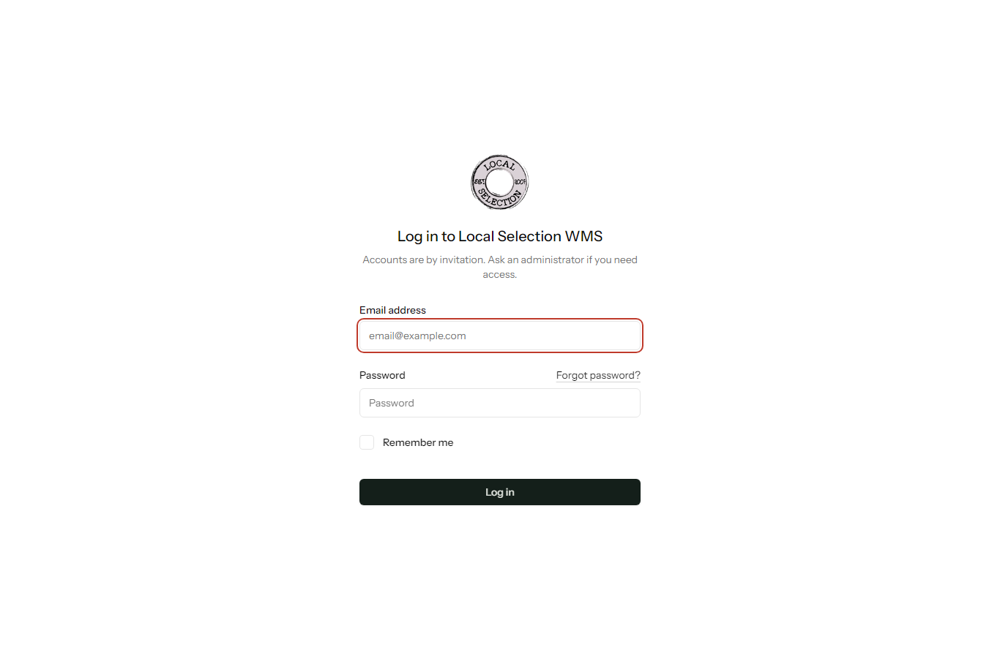

If you've turned on two-factor, you're asked for a code next ([1.5](#15-log-in-with-two-factor)).

You're signed out after 2 hours without activity. Your name in the bottom-left corner opens a menu with **Settings** and **Log out**.

### 1.3 Set up two-factor authentication

Two-factor means you need a code from your phone as well as your password.

- **Administrators must set it up.** Until they do, the app sends them to this screen and nothing else works.
- **Everyone else can choose** to turn it on.

You need an authenticator app on your phone, such as Google Authenticator, Microsoft Authenticator or 1Password.

1. Open your name (bottom left) → **Settings** → **Two-factor**.
2. Click **Set up two-factor**.

   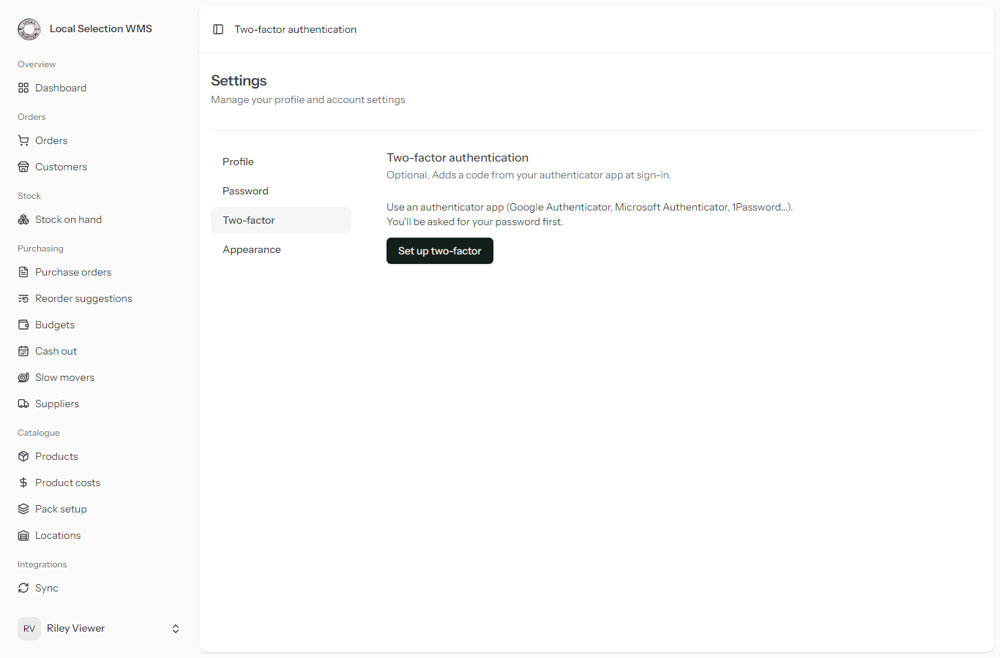

3. Enter your password if asked, and click **Confirm Password**.

   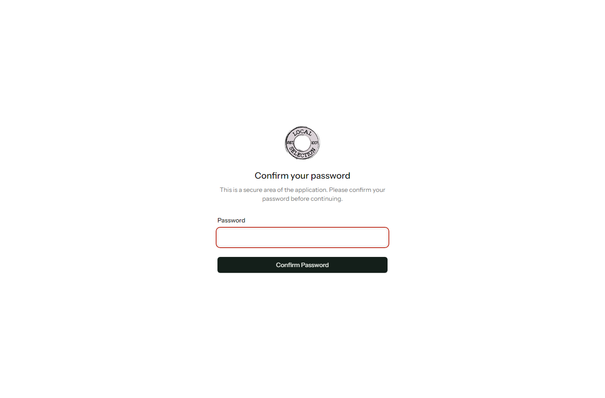

4. Click **Set up two-factor** again if the button is still showing.
5. Scan the QR code with your authenticator app. If you can't scan it, type in the key shown under it.
6. Enter the 6-digit code from the app and click **Confirm**.

   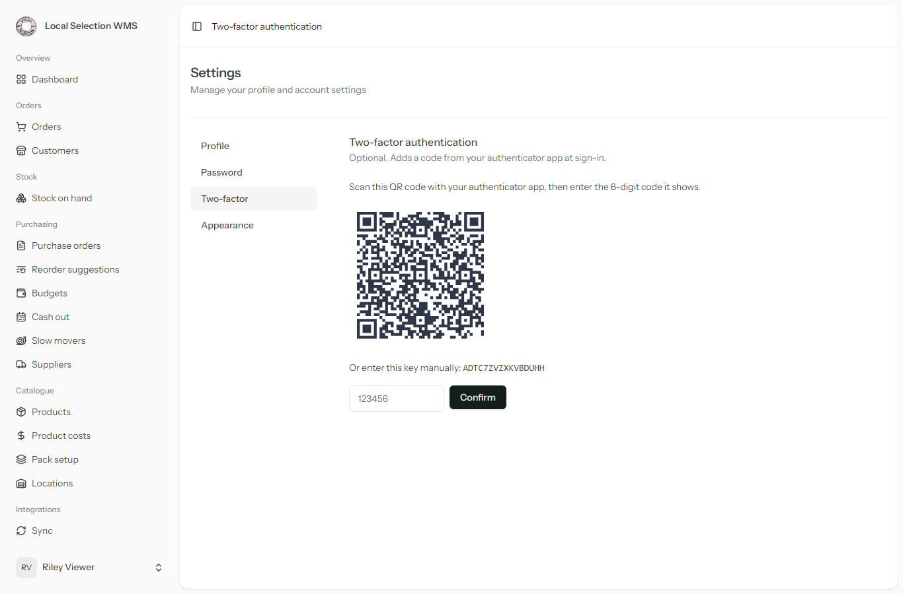

7. "Two-factor authentication is on" appears.

### 1.4 Save your recovery codes

Recovery codes get you in if you lose your phone. Each code works once.

1. On the **Two-factor** page, click **Show recovery codes**.
2. Write them down, or save them in a password manager. Keep them away from your phone.

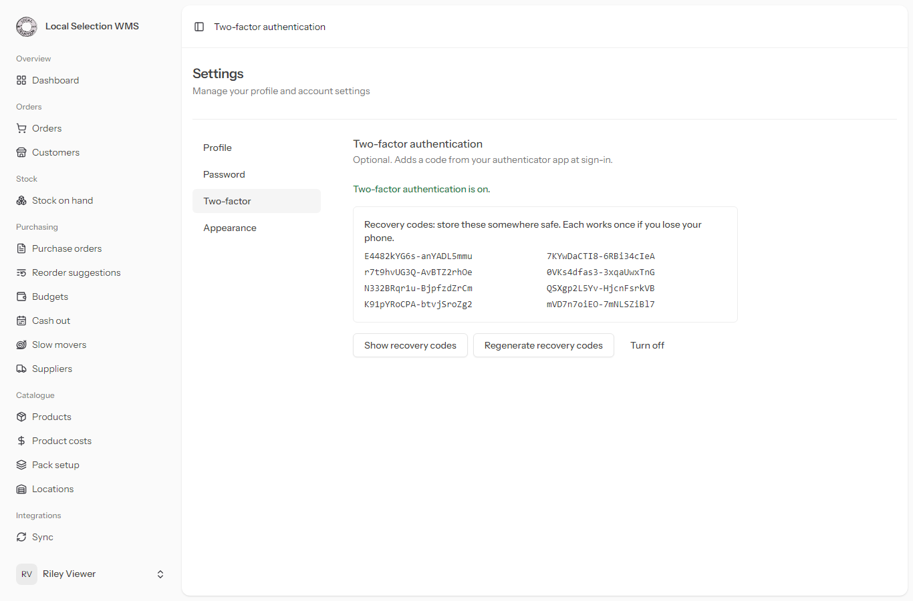

- **Regenerate recovery codes** makes a new set. The old ones stop working.
- **Turn off** is only shown to non-administrators. Administrators can't turn two-factor off.

### 1.5 Log in with two-factor

1. Log in with your email and password.
2. Enter the 6-digit code from your authenticator app.
3. Click **Continue**.

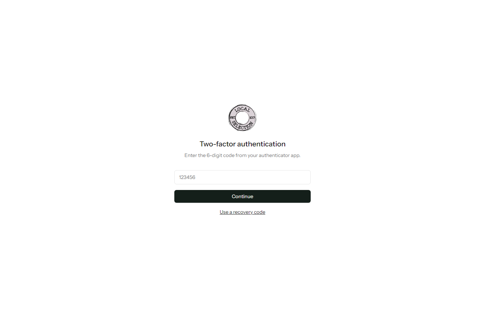

Lost your phone? Click **Use a recovery code** and enter one of your saved codes. If you have none left, ask an administrator to reset your two-factor ([13.3](#133-reset-someones-two-factor)).

### 1.6 Forgot your password

1. On the login page, click **Forgot password?**
2. Enter your email address and click **Email password reset link**.
3. Open the email and follow the link to choose a new password.

### 1.7 Your settings

Open your name (bottom left) → **Settings**.

- **Profile:** change your display name. To change your email address, ask an administrator ([13.2](#132-change-roles-email-or-deactivate)).
- **Password:** change your password. You need your current one.
- **Two-factor:** see [1.3](#13-set-up-two-factor-authentication).
- **Appearance:** Light, Dark or System.

---

## 2. Roles: who can do what

Each user has one or more roles. The menu on the left only shows what your roles allow.

| | Admin | Warehouse manager | Warehouse staff | Purchasing | Read-only |
|---|:-:|:-:|:-:|:-:|:-:|
| See products, locations, stock, POs, orders | ✓ | ✓ | ✓ | ✓ | ✓ |
| See suppliers, product costs, the Sync screen | ✓ | ✓ | | ✓ | ✓ |
| Edit products, packs, costs; import products; turn on batch tracking | ✓ | ✓ | | | |
| Edit locations and bins | ✓ | ✓ | | | |
| Print bin labels | ✓ | ✓ | ✓ | ✓ | ✓ |
| Move stock between bins | ✓ | ✓ | ✓ | | |
| Adjust or write off stock | ✓ | ✓ | | | |
| Enter counts in a stocktake | ✓ | ✓ | ✓ | | |
| Start, post or cancel a stocktake; dismiss count tasks | ✓ | ✓ | | | |
| Edit suppliers; create, send, close and cancel POs | ✓ | ✓ | | ✓ | |
| Approve POs, mark paid, set budgets, generate suggestions | ✓ | ✓ | | ✓ | |
| See Reorder suggestions, Budgets, Cash out, Slow movers | ✓ | ✓ | ✓ | ✓ | ✓ |
| Receive deliveries | ✓ | ✓ | ✓ | | |
| Accept an over-receipt | ✓ | ✓ | | (✓)¹ | |
| Create orders and customers; cancel orders; change runs; substitute | ✓ | ✓ | | | |
| Reports: Stock value & margin, Substitutions | ✓ | ✓ | | | |
| Pick & pack (phone/handheld), Pick lists (desktop), dispatch | ✓ | ✓ | ✓ | | |
| Sync actions (push, retry, replay, map, enable) | ✓ | ✓ | | | |
| See users and the audit log | ✓ | ✓ | | | |
| Invite users, change roles or email, deactivate, reset 2FA | ✓ | | | | |
| Company settings, delivery areas | ✓ | | | | |

¹ Purchasing may accept over-receipts but can't open the receive screen. In practice, someone who can receive enters the delivery and a manager or admin ticks the box.

Other rules:

- Only an admin can give someone the Admin role, or change an admin's roles.
- Nobody can change their own roles, or deactivate or reset themselves.
- Admins must use two-factor.

---

## 3. Dashboard

The dashboard is the first page after you log in. Each tile shows only if your role can see that area.

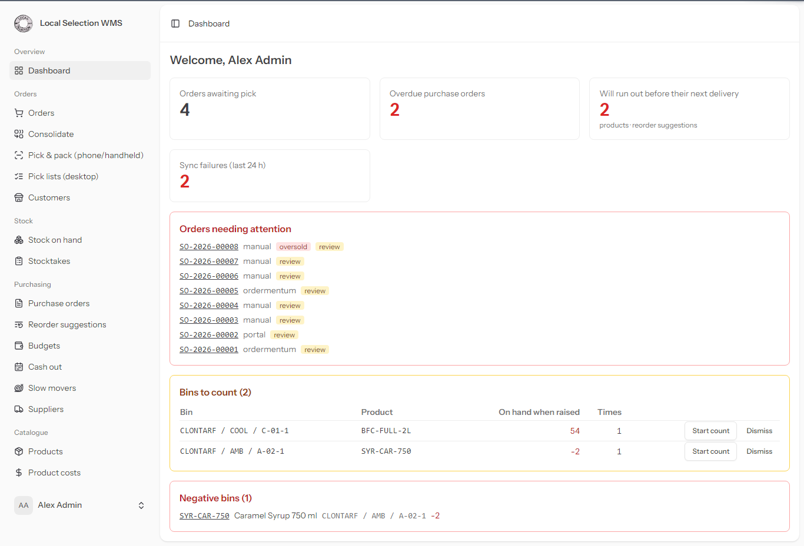

| Tile | What it means | What to do |
|---|---|---|
| **Orders awaiting pick** | Orders that are open or partly dispatched. | Click it to open **Orders**. Pick them from **Pick & pack (phone/handheld)**. |
| **Overdue purchase orders** | POs sent (or partly received) whose "Required by" date has passed. Red when above 0. | Chase the supplier, receive what arrived, or close the PO short ([6.5](#65-close-short-or-cancel)). |
| **Sync failures (last 24 h)** | Ordermentum and portal stock pushes or order fetches that failed in the last 24 hours. Red when above 0. Shown if you can see the Sync screen. | Click it to open **Sync** and check **Push failures** and **Inbound events** ([12](#12-sync-screen-ordermentum-and-portal)). |
| **Stock lines awaiting put-away** | Stock sitting in a receiving bin that isn't sellable. Only shows if your site receives into such a bin. | Move it to a sellable bin ([7.4](#74-move-stock-between-bins)). |
| **Orders needing attention** | **Oversold:** accepted beyond available stock. **Review:** the channel changed the order while it was being picked. | Open the order and decide ([9.5](#95-oversold-and-review-flags)). |
| **Bins to count** | Count tasks: a bin went below zero at dispatch, or a picker reported a short pick. "Times" counts how often it was raised. | Managers: **Start count** or **Dismiss** ([8.4](#84-count-tasks)). |
| **Will run out before their next delivery** | Products whose stock won't last until a delivery ordered today could arrive, at the rate they're selling. Red when above 0. | Click it to open **Reorder suggestions** filtered to those products, and order them ([6.6](#66-suggested-pos-and-reorder-suggestions)). |
| **Expiring within 14 days** | Batches in sellable bins whose best-before is within the next 14 days (a setting), or has passed. The small print says how many won't sell in time. Amber when any won't. | Click it to open **Expiring soon** ([7.7](#77-expiring-soon)): push them, or move what can't sell to quarantine. |
| **Negative bins** | Bins where the system shows less than zero. Goods left the warehouse that the system didn't think were there. | Count the bin. Click the SKU to see its movements. |

Warehouse staff see fewer tiles:

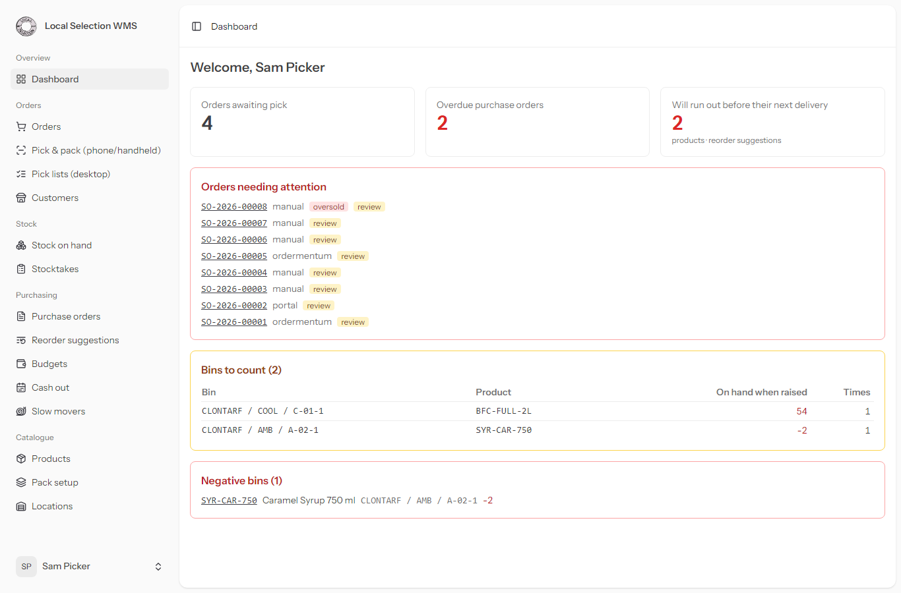

Warehouse staff can't see the Sync screen, so they don't get the sync-failures tile.

---

## 4. Products

**Catalogue → Products** lists every product. Search by SKU or name, or scan a barcode into the search box. Filter by **Active / Inactive / All**, by range, and by GST (**GST: all**, **GST-free**, **Taxable (10%)**). The **GST** column shows "GST-free" or "10%".

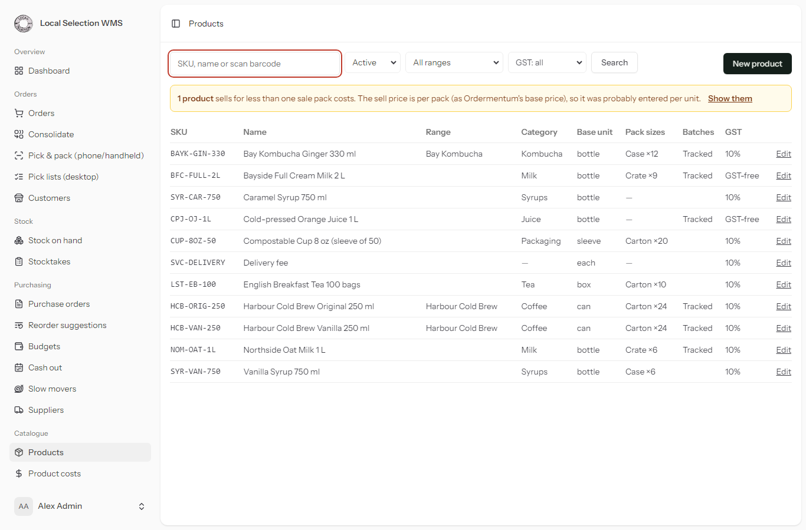

Managers and admins see **New product** and **Edit**. Everyone else sees **View**.

### 4.1 Create or edit a product

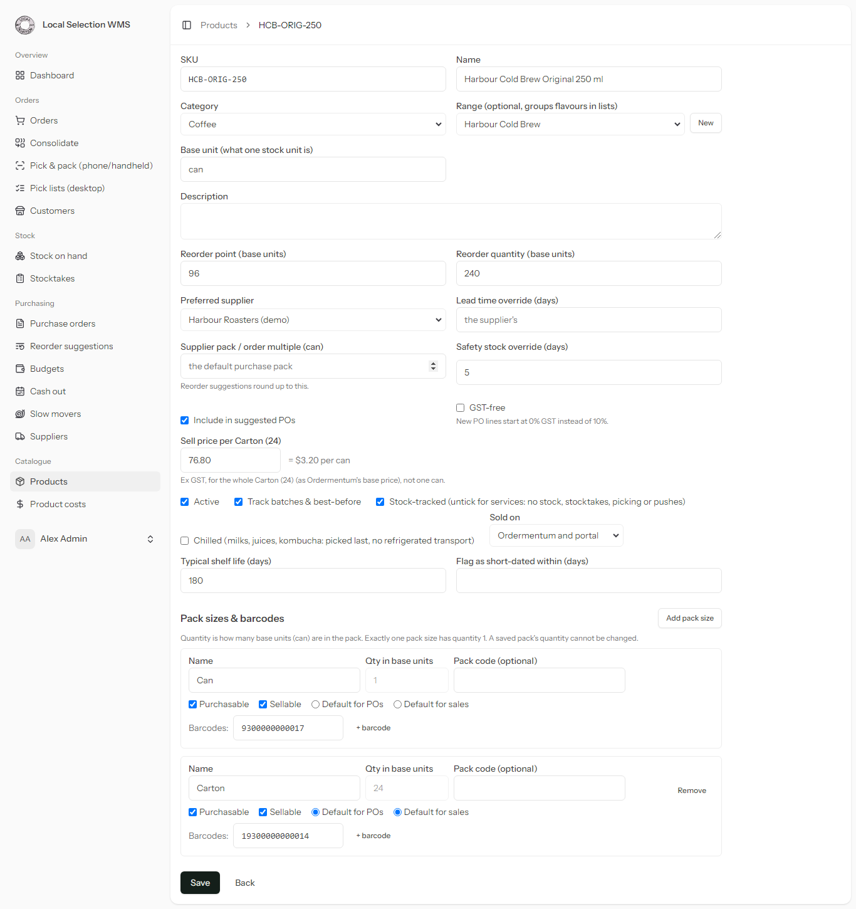

1. Click **New product**, or **Edit** on a product.
2. Fill in the main details:
   - **SKU:** your product code, capitals.
   - **Name.**
   - **Category** (optional).
   - **Range** (optional): see [4.2](#42-ranges).
   - **Base unit:** what one stock unit is, for example "can" or "bottle".
   - **Description**, **Reorder point** and **Reorder quantity** (in base units).
   - **Sell price per** (pack): ex GST, for the whole sale pack, the same as Ordermentum's base price. The label names the pack, for example **Sell price per Case (12)**: it's the pack ticked **Default for sales**, else the largest sellable pack. The price per base unit shows beside it, for example "= $3.20 per can", so you can check it. Reports, Cash out and the GM % on purchase orders all read it this way.

**Sell price check.** Above the product list, an amber note counts active products whose sell price is less than one sale pack costs. That almost always means the price was typed per unit (per can, not per Case). Click **Show them** to see each one with its cost per pack and what the price would be if the figure was per unit, then **Fix** to open the product. The note and the list are only shown to roles that can see costs.

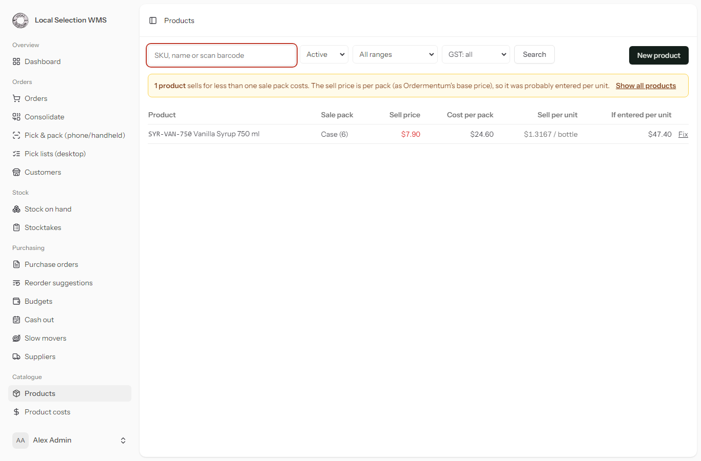
3. Set the flags ([4.4](#44-flags-and-sell-channels)) and the purchasing fields ([4.4a](#44a-purchasing-fields)).
4. Set up the pack sizes and barcodes ([4.3](#43-pack-sizes-and-barcodes)).
5. Click **Create product** or **Save**.

### 4.2 Ranges

A range groups related products, for example all flavours of one brand. It's for display only: you can filter the product list by range.

To add one, click **New** next to **Range** on the product form.

### 4.3 Pack sizes and barcodes

Each product has one or more pack sizes. The quantity is how many base units are in the pack.

- Exactly one pack has quantity 1 (the base unit).
- **Once a pack is saved, its quantity can't be changed.** Add a new pack instead.
- **Purchasable:** can be used on purchase orders.
- **Sellable:** can be used on orders.
- **Default for POs** and **Default for sales:** the pack chosen first.
- **Pack code** (optional).
- **Barcodes:** click **+ barcode** and scan or type it. Add the barcode of each pack, for example the can and the carton. When a picker scans a pack barcode, it counts that pack's quantity.

Before go-live, packs can also be set up in bulk on **Pack setup** ([4.5](#45-pack-setup-before-go-live)).

### 4.4 Flags and sell channels

| Setting | Effect |
|---|---|
| **Active** | Inactive products are hidden from the default product list. |
| **Track batches & best-before** | Receiving asks for a lot and best-before date. Picking takes the earliest best-before first. Expired batches aren't sellable. |
| **Typical shelf life (days)** | Shown when batches are tracked. |
| **Flag as short-dated within (days)** | Saved with the product. No screen uses it yet. |
| **Stock-tracked** | Untick for services such as a delivery fee. They have no stock, aren't counted or picked, and no stock is pushed for them. |
| **Chilled** | For milks, juices and kombucha. A CHILLED badge shows when picking, and chilled lines are always picked last. |
| **Sold on** | None, Ordermentum, Portal, or both. Stock is only pushed to the channels a product is sold on. Mapping a channel item to a product ([12.4](#124-map-a-channel-item)) adds that channel automatically. |
| **GST-free** | For GST-free goods such as fresh milk. A new purchase order line for the product starts at 0% GST instead of 10% (you can still change it on the PO), and Cash out adds no GST to its sales. An admin can set it for the whole catalogue at once from Xero ([Appendix](#appendix-admin-setup)). |

### 4.4a Purchasing fields

These drive the suggested POs and reorder suggestions ([6.6](#66-suggested-pos-and-reorder-suggestions)).

| Field | What it does |
|---|---|
| **Preferred supplier** | Who the product is bought from. Left empty, the supplier of its last PO is used. |
| **Lead time override (days)** | Days from ordering to delivery, if different from the supplier's lead time. |
| **Supplier pack / order multiple** | The pack the supplier sells, in base units, for example 24 for a carton of 24 cans. Suggestions are rounded up to whole packs. |
| **Safety stock override (days)** | Extra days of stock to keep on hand for this product. Empty uses the setting on **Reorder suggestions → Settings** (3 days to start with). |
| **Include in suggested POs** | Ticked (the default): the product goes on the Monday suggested POs. Untick it for products you order by hand, or are running down. It still shows on **Reorder suggestions**. |

### 4.5 Pack setup (before go-live)

**Catalogue → Pack setup** is for setting up packs in bulk, before the opening stocktake. Products imported from the old system start with one pack called "Unit".

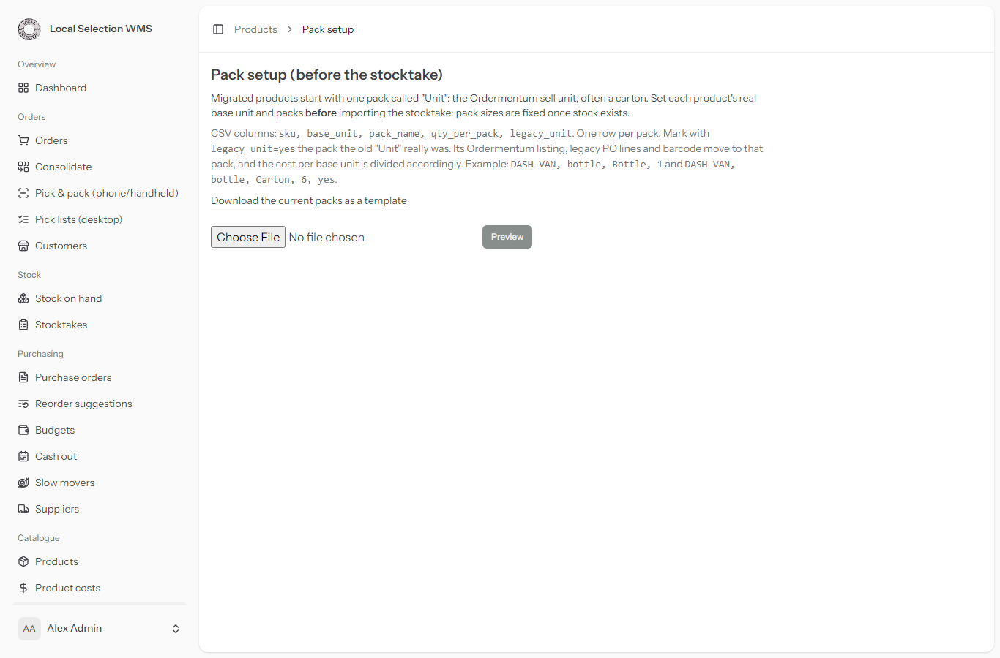

1. Click **Download the current packs as a template**.
2. Fill in one row per pack: `sku, base_unit, pack_name, qty_per_pack, legacy_unit`.
3. On the pack that the old "Unit" really was, put `yes` in `legacy_unit`.
4. Choose the file and click **Preview**.
5. Check the preview, including the cost per base unit before and after.
6. Click **Apply**.

The amber box lists products still on the single "Unit" pack. That's fine if they really are bought, counted and sold as one unit.

### 4.5a Capture barcodes

**Catalogue → Capture barcodes** is made for a handheld. Admins and warehouse managers can use it. Walk the warehouse and give each pack its barcode.

1. Scan a product's barcode or SKU, type a search, or tap it in **Missing barcodes**, which runs in bin walk order.
2. Scan the barcode for the highlighted pack. It saves straight away, the next pack without a barcode is highlighted, and the scan box is ready again. Tap a pack to scan that one instead.
3. When every pack is done, the next scan finds the next product. **Done** leaves the product early.

**N of M have barcodes** counts active stock-tracked products with a barcode on at least one pack. A wrong check digit is refused, and so is a barcode already in use, with the product that has it. A bin label scanned by mistake is refused too.

### 4.6 Costs

**Catalogue → Product costs** shows each product's cost per base unit. Costs drive stock valuation (weighted average). Receipts update the cost automatically.

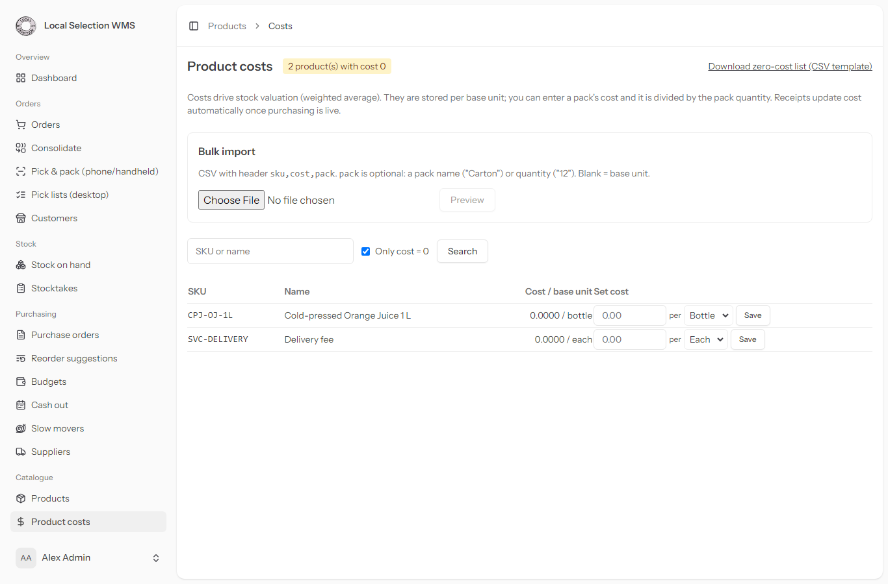

**Set one cost**

1. Find the product.
2. Enter the cost and choose the pack it's for, for example "per Carton ×24". The app divides by the pack quantity.
3. Click **Save**.

**Import costs from a CSV**

1. Click **Download zero-cost list (CSV template)**. It lists every product with a cost of 0.
2. Fill in the `cost` column. The `pack` column is optional: a pack name ("Carton") or a quantity ("12"). Blank means the base unit.
3. Under **Bulk import**, choose the file and click **Preview**.
4. Check the rows. Rows with problems are red and show why.
5. Click **Apply N change(s)**. Only valid rows are applied.

A preview expires after 30 minutes. If it has expired, upload the file again.

### 4.7 Import products

**Catalogue → Import products** brings products, packs and channel mappings into the catalogue in bulk. Admins and warehouse managers can use it. It changes the catalogue only: **stock never changes**, and new listings start with sync off, so pushing stock is still a separate choice on the Sync screen.

**Start an import**

- **Fetch from Ordermentum** reads the live catalogue. Nothing is sent to Ordermentum. The preview appears by itself when the fetch finishes, usually within a few seconds.
- **Preview file** reads a CSV or XLSX. Click **Download template** for the columns. Use this for the portal: see below.

**Read the preview**

Rows are grouped, each with its reason:

| Group | Meaning |
|---|---|
| **Conflict** | Not imported. For example, the SKU is one product and the channel item is mapped to another. |
| **New** | Creates the product, its packs and the mapping, and sets **Sold on**. |
| **Update** | Fills fields that are empty in the WMS, and adds a missing pack, mapping or barcode. |
| **Mapping only** | Adds a channel mapping to an existing product. |
| **Skipped** | Nothing to do, deactivated at the source, or excluded by you. |

A product is matched by SKU, then by its channel mapping, then by barcode.

**Change what happens**

- **Amber rows say "Check pack".** The app couldn't read the pack for certain, so enter the pack name and size, or untick **Include**. **Accept suggested packs** fills in the rows where the name gives a single size, such as "Syrup 750ml" (Each × 1).
- **Overwrite** appears on a row whose WMS values differ from the source. Without the tick, the WMS keeps its name, pack and flags.
- **Pack sizes never change.** With Overwrite ticked on a different pack size, the app adds the new pack and moves the channel listing to it. The old pack stays as it was.
- **Apply to whole range** sets batch tracking on every row in a range at once, such as Kombucha, new and existing. It overwrites batch tracking only: a row's other differences keep their own Overwrite tick. Products with stock movements are skipped and listed, because batch tracking can't change once stock has moved.
- A product still on the default "Unit" pack gets no extra pack. Set it up on **Pack setup** ([4.5](#45-pack-setup-before-go-live)).

Click **Re-check** to see what your edits do, then **Apply**. Conflicts stay out, and Apply checks everything again first. Each product gets one entry in the audit log. Held Ordermentum orders containing a newly mapped item are processed again, as with **Map** ([12.4](#124-map-a-channel-item)).

A preview expires after 30 minutes. If it has expired, start the import again.

**Import from the portal**

The app can't read the portal catalogue directly. Export the portal's products to the template, then upload that file. The fields are listed in `docs/PORTAL.md` under "Importing portal products".

### 4.8 Turn on batch tracking for stock on hand

**Catalogue → Batch tracking** is for products that already hold stock, such as milks and juices after the stocktake. Admins and warehouse managers can use it. A product holding stock can't be switched on the product page: it links here instead.

1. Add products: **Apply to whole range**, one product at a time, or from the import preview, where **Turn on batch tracking for N of these** brings across the products it skipped for having stock movements.
2. For each bin, enter the best-before, or leave **Unknown** ticked. Unknown stock never expires and is picked first, so it clears before anything received later.
3. Click **Turn on**.

Each bin's stock goes into a batch with lot `UNKNOWN`, through stock movements with the reason **Batch tracking enabled**. **On-hand quantities don't change.** It's in the audit log. From then on, receiving asks for a lot and best-before as normal.

A product is refused while it's on an open pick list or a stocktake in progress, or has a bin below zero. The rest of the selection still goes ahead, and you're told which ones didn't.

---

## 5. Locations and bins

**Catalogue → Locations** shows your sites, zones and bins as a tree.

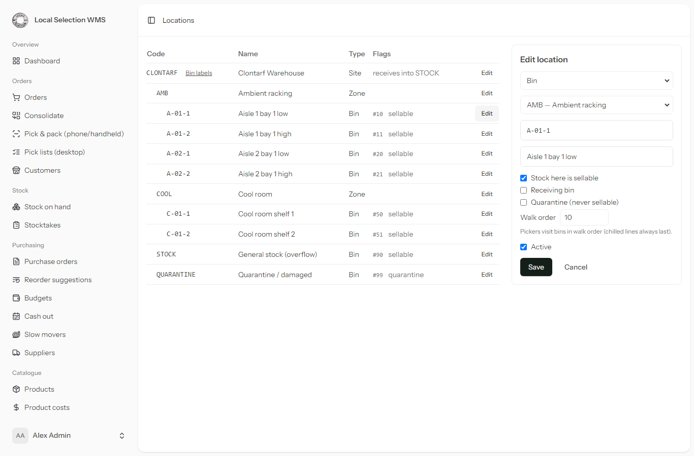

- **Site:** a warehouse, for example Clontarf Warehouse.
- **Zone:** an area inside a site, for example the cool room. Optional.
- **Bin:** a shelf location. Stock always sits in a bin.

### 5.1 Add or edit a location

1. Click **Edit** on a row, or use the **Add location** form on the right.
2. Choose **Site**, **Zone** or **Bin**. Zones and bins need a parent.
3. Enter a **Code** (capital letters, numbers, `.`, `_` or `-`, for example `COOL-A1`) and a **Name**.
4. For a bin, set:
   - **Stock here is sellable:** untick for stock that shouldn't be sold.
   - **Receiving bin.**
   - **Quarantine (never sellable):** for damaged stock. Each site needs one for damaged goods at receiving.
   - **Walk order:** the order pickers visit bins, lowest first.
5. For a site (when editing), **Received stock goes into** picks the bin that deliveries land in. "Automatic" uses the first sellable bin. A bin marked "not sellable: needs put-away" makes received stock show on the dashboard until it's moved.
6. Untick **Active** to retire a location.
7. Click **Add** or **Save**.

### 5.2 Walk order

Pickers are sent through bins in walk order, lowest number first. Chilled products are always picked last, whatever their bin. The walk order shows as `#10` and so on in the list.

### 5.3 Print bin labels

1. On the site row, click **Bin labels**.
2. An A4 PDF opens with every active bin of that site, in walk order. Labels are 90 × 38 mm and carry the bin code and a barcode (for example `B000042`).
3. Print it and stick each label on its bin.

Pickers scan these labels, so every bin needs one.

---

## 6. Purchasing and receiving

### 6.1 Suppliers

**Purchasing → Suppliers** lists your suppliers.

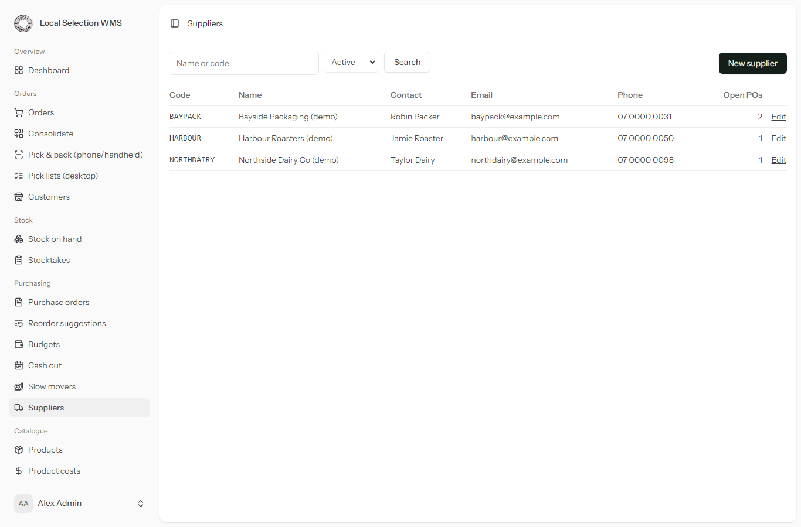

Each supplier has a code, name, contact, phone, **order email** (POs are emailed here), **CC emails**, address and notes, and these purchasing details:

| Field | What it does |
|---|---|
| **Payment terms** | Free text printed for reference, for example "30 days EOM". |
| **Payment terms (days after delivery)** | The number the app uses: each approved PO's **payment due date** is its delivery date plus this many days. **0 = COD** (paid on delivery). |
| **Lead time (days)** | Days from ordering to delivery. Sets the expected date on suggested POs. |
| **Order days (for reorder suggestions)** | The weekdays you order from them. Used by reorder suggestions to know when the next order is. |
| **Review period (days)** | Used instead of order days: how often you order from them. |
| **Minimum order ($ ex GST)** | A PO below this is flagged, not blocked. |
| **MOQ per line (supplier packs)** | The least you can order of any one product. |

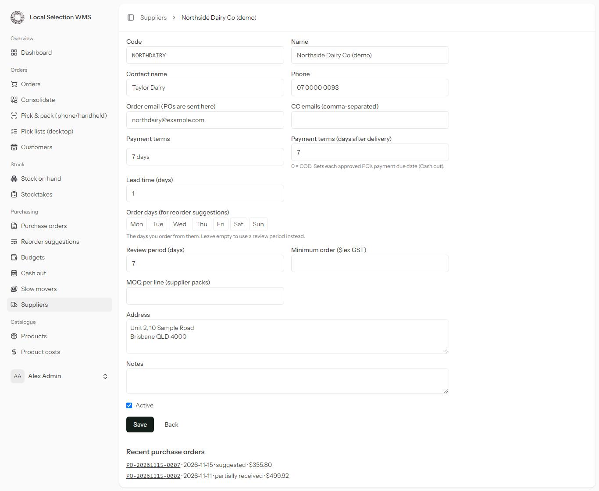

### 6.2 Create a purchase order

**Purchasing → Purchase orders** lists POs. Filter by **Open**, **All** or a status, and by supplier. The bar above the list shows this week's purchasing budget ([6.2a](#62a-approve-the-po)), and the **Payment due** column shows when each approved PO has to be paid.

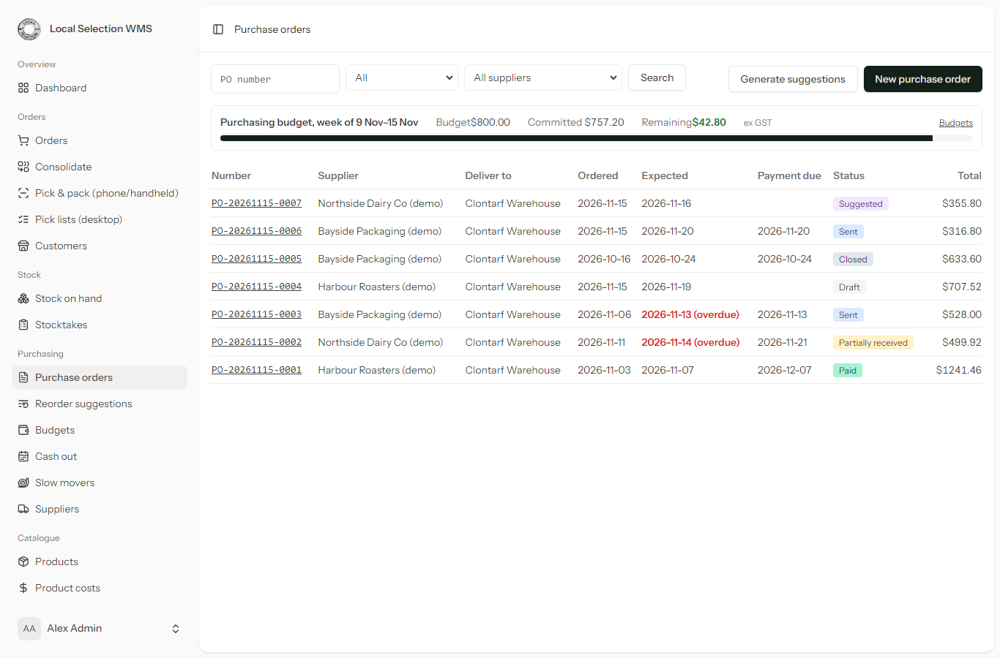

PO numbers look like `PO-20261116-0001`: the date the PO was created, then a number that starts again at 0001 each day.

1. Click **New purchase order**.
2. Choose the **Supplier** and **Deliver to** site. Add the **Supplier reference**, **Order date** and **Required by** date.
3. Search for each product and add it.
4. For each line, choose the **Pack**, then enter the **Qty**, the **Cost / pack (ex GST)** and the **GST %**. The base-unit quantity shows under the pack. **GST %** starts at 0 for a GST-free product and 10 for anything else. Change it if the supplier's invoice says otherwise.
5. Add **Notes** if needed. They're printed on the PO.
6. Click **Create draft**.

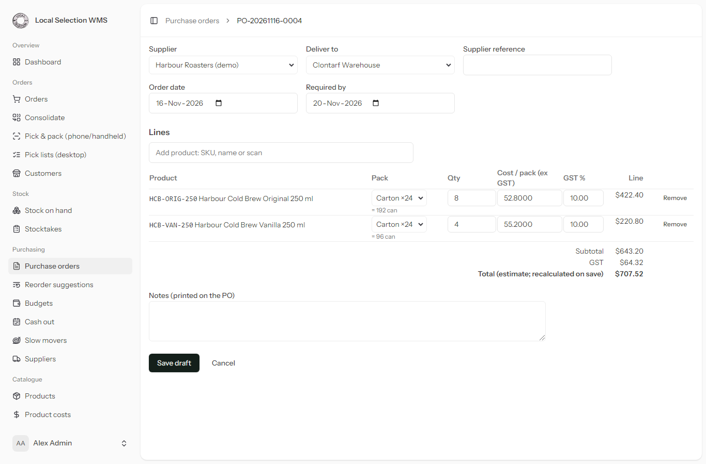

You can change a PO only while it's **Suggested** or **Draft**. Once approved, it can't be edited: cancel it and make a new one.

PO statuses: **Suggested** or **Draft → Approved → Sent → Partially received → Received → Paid**. A PO can also be **Closed** (closed short) or **Cancelled**.

### 6.2a Approve the PO

Every PO, suggested or made by hand, has to be approved before it can be sent. Approving checks it against this week's purchasing budget. You can approve your own POs. For admins, warehouse managers and purchasing.

The PO page shows the budget bar:

- **Budget:** this week's budget, ex GST ([6.7](#67-budgets)). "not set" if nobody has set one.
- **Committed:** the total (ex GST) of POs approved this week that are still going ahead, whatever happens to them after (sent, received or paid). Cancelled POs drop out.
- **Remaining:** budget minus committed. Red when below zero.
- **This PO:** the PO's subtotal, ex GST.

**Within budget**

1. Open the PO. Check the lines, including **Sell/pack** and **GM %**: lines under 26% gross margin are highlighted in red.
2. Click **Approve**.

**Over budget, or no budget set for the week**

The box turns red and says by how much the PO is over.

1. Decide whether it really has to go this week. If not, leave it, or **Cancel** it.
2. To go ahead, tick **Approve over budget anyway**.
3. Type the reason, for example "Christmas stock-up" or "Supplier price rise from Monday". It's kept on the PO and shown as **Approved over budget**.
4. Click **Approve**.

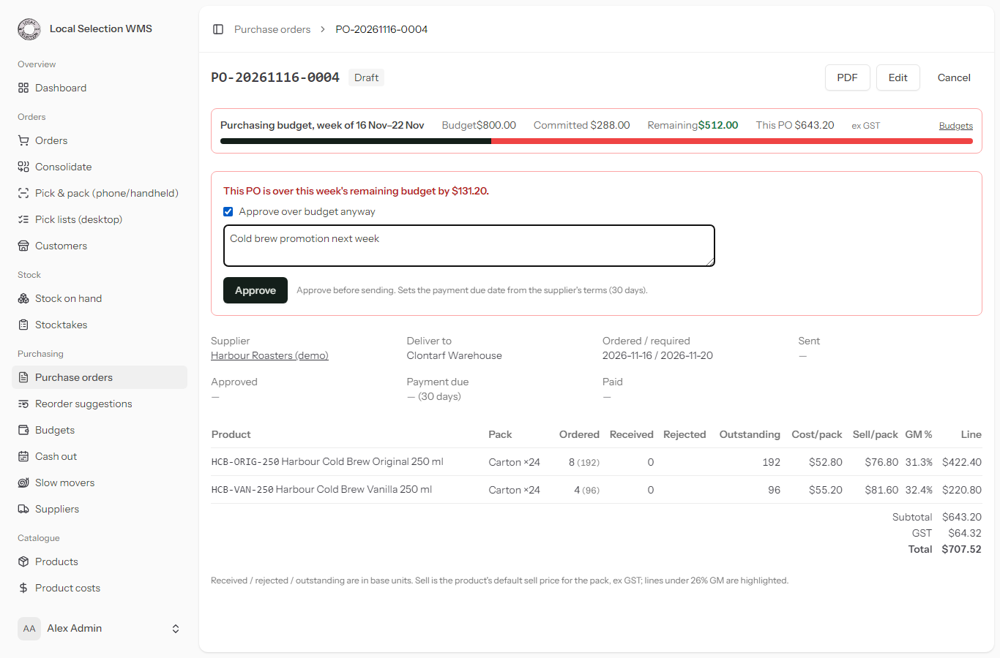

Approving sets the **Payment due** date: the expected delivery date plus the supplier's payment terms in days ([6.1](#61-suppliers)). With no expected date, it counts from today plus the supplier's lead time. The PO list then marks over-budget approvals with **over budget**.

### 6.3 Send the PO

The PO must be **Approved** first ([6.2a](#62a-approve-the-po)).

**By email**

1. Open the PO and click **Email supplier**.
2. Check **To**, **CC**, **Subject** and the optional message. The PDF is attached automatically.
3. Click **Queue email**.

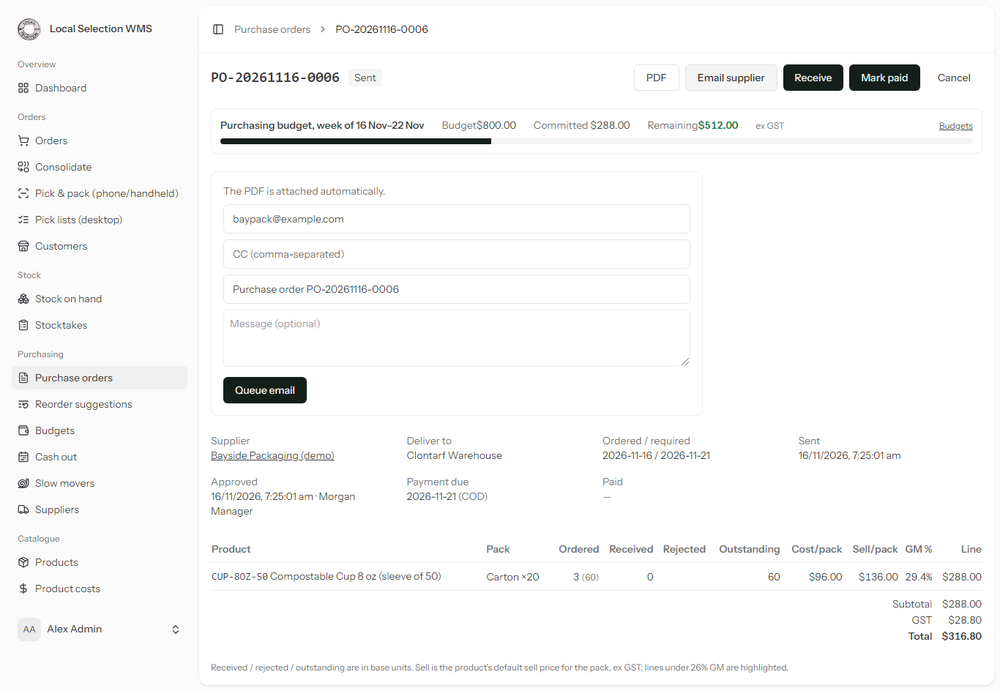

Sending an approved PO marks it as **Sent**. The **Emails** section on the PO shows each email as queued, sent or failed. A failed email shows a red box at the top of the PO with the reason, and **email failed** in the PO list. Fix the address if it's wrong, then click **Retry**.

**Another way** (phone, supplier portal): click **Mark as sent**.

**PDF** opens the PO as a PDF at any time.

### 6.4 Receive a delivery

You can receive against a PO that is Sent or Partially received.

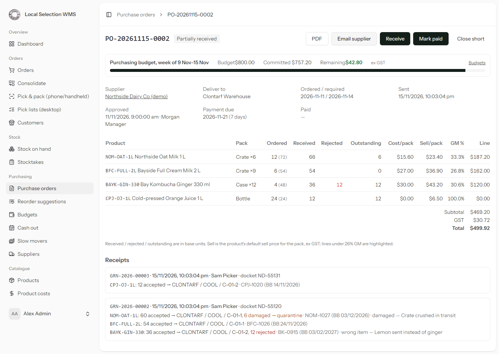

1. Open the PO and click **Receive**.
2. Enter the **Delivery docket / invoice no.** and any notes.
3. For each line, enter what arrived:
   - **Accepted:** good stock, in the line's pack plus loose units, for example 2 Case + 0 bottles.
   - **Damaged:** booked into quarantine. It's counted but not sellable. Packs plus loose units, like Accepted.
   - **Rejected:** went back with the driver. It isn't stocked. Packs plus loose units. **A reason is required.**
   - **Bin:** where accepted stock goes. The site's receiving bin is chosen first.
   - **Lot / best-before:** required for batch-tracked products. Click **+ lot** to split a line over several lots.
   - **Reason / note:** damaged, wrong item, expired, short dated, quality, over or other. Damaged stock gets "damaged" automatically.
4. **Fill all outstanding** fills in everything still owed. Change any line that's different.
5. Click **Post receipt**.

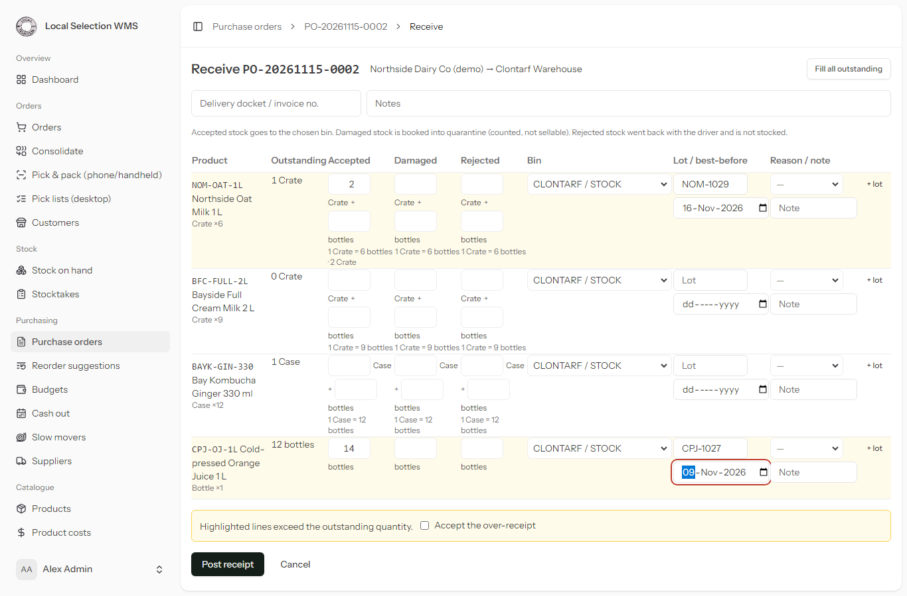

**More than ordered?** The line turns amber. Only a user who manages POs (admin, manager or purchasing) can tick **Accept the over-receipt**. Without that tick, the receipt is refused.

After posting:

- Stock goes up straight away.
- The PO becomes **Partially received** or **Received**.
- The receipt is listed on the PO with who, when and the docket number.

Clicking **Post receipt** twice doesn't book the stock twice.

### 6.5 Close short or cancel

- **Close short:** for a partly received PO when the rest won't come. Enter why (required). The PO becomes **Closed**.
- **Cancel:** for a suggested, draft, approved or sent PO with nothing received. The reason is optional. A cancelled PO no longer counts against the week's budget.

### 6.5a Mark paid

The app doesn't talk to Xero. When you pay a supplier in Xero, record it on the PO so **Cash out** stops showing it as owed.

1. Open the PO.
2. Click **Mark paid** and confirm. Who and when are recorded.

You can mark a PO paid once it's **Approved**, **Sent**, **Partially received**, **Received** or **Closed** (short-shipped POs get paid too). Not while it's suggested, a draft, or cancelled.

- **Received** POs become **Paid**.
- **Paid up front?** An approved, sent or partly received PO keeps its status, so it can still be sent and received as normal, and shows **paid** next to its status in the list. It becomes **Paid** once it's fully received.

### 6.6 Suggested POs and reorder suggestions

**Suggested POs.** Every Monday at 6 am the app looks at what each product has sold and what's on hand and on order, and drafts one **Suggested** PO per supplier for what's needed. If the week has no budget yet, it also sets one from the estimate ([6.7](#67-budgets)).

- Only products with **Include in suggested POs** ticked go on them ([4.4a](#44a-purchasing-fields)), and only suppliers that are active.
- The quantity covers the supplier's lead time plus the time to the next order, plus safety stock, less what's available and already on order, rounded up to the supplier's pack and MOQ.
- Each line's cost is the last price paid for that pack (else the product's average cost). GST starts at 0% for GST-free products and 10% otherwise.
- A PO below the supplier's minimum order gets an amber note. It's still made: you decide.

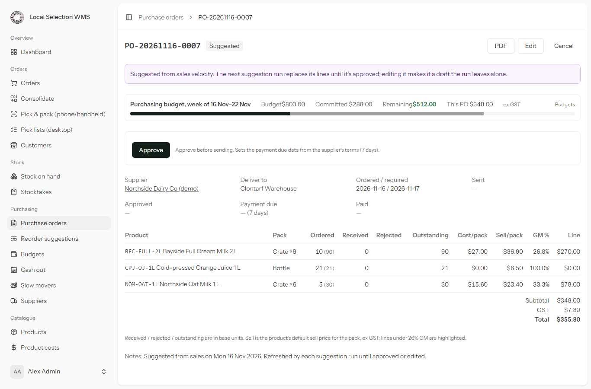

What to do with them:

- **Approve** to go ahead ([6.2a](#62a-approve-the-po)).
- **Edit** to change quantities. Once you save, it becomes a **Draft** and the next run leaves it alone. Its quantities count as on order, so the next run won't suggest them again.
- **Leave it.** Until it's approved or edited, each run replaces its lines with fresh figures. If nothing is needed any more, it's cancelled.

**Generate suggestions** on **Purchase orders** runs the same check straight away, for example on a Thursday after a big week. It updates the existing suggested POs, so pressing it twice doesn't double up.

**Reorder suggestions** (**Purchasing → Reorder suggestions**) shows the working behind it, product by product, grouped by supplier: average sales a day, cover days, safety stock, available, on order, what's needed and the suggestion. Hover over a line to see how it was worked out.

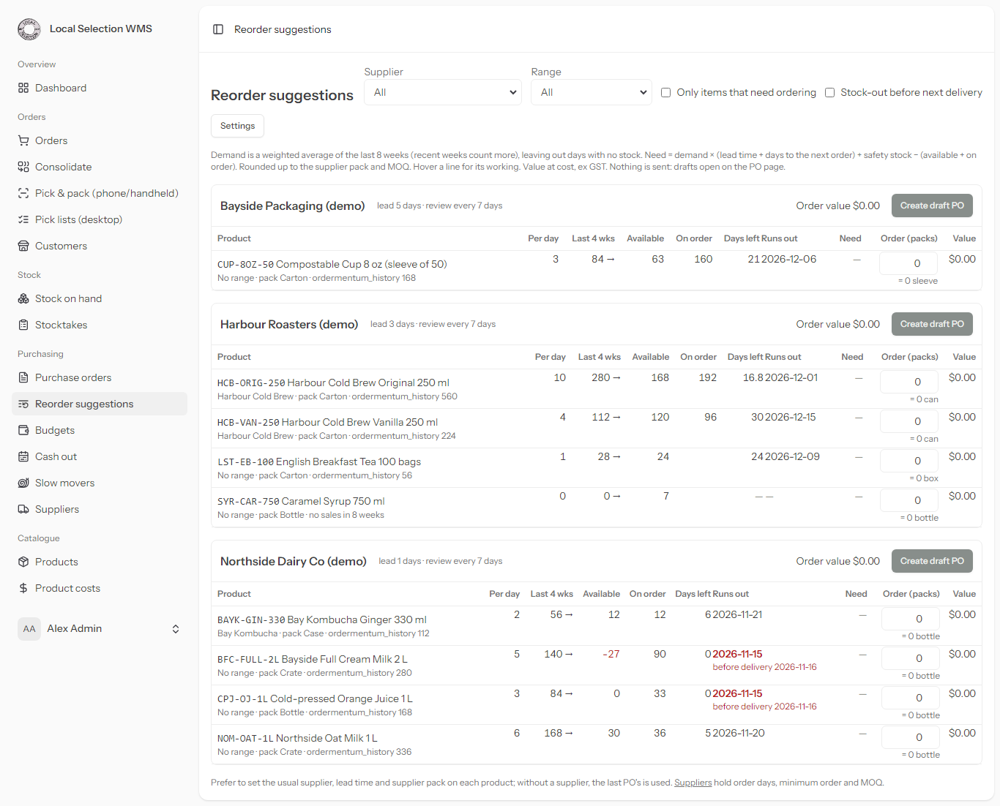

- **Only items that need ordering** (ticked to start with) and **Stock-out before next delivery** filter the list.
- **Create draft PO** on a supplier makes a draft from the quantities on screen.
- **Settings** (admins, managers, purchasing): safety stock (**Days of demand** or a z-score), the lead time and review period for suppliers that have none, and **Email the summary at 7am**. It goes only to the addresses in **Company settings → Reorder email recipients** ([13.4](#134-company-settings)). It also lists batches that won't sell before their best-before, unless that's switched off on **Expiring soon** ([7.7](#77-expiring-soon)).

Sales are what was dispatched in the app, plus sales history brought in from before the app went live, over the last 8 weeks. Recent weeks count more. Days when the product was out of stock are left out, so a stock-out doesn't make it look like it doesn't sell.

### 6.7 Budgets

**Purchasing → Budgets** sets how much can be approved in POs each week, ex GST. It shows 4 weeks back and 8 ahead.

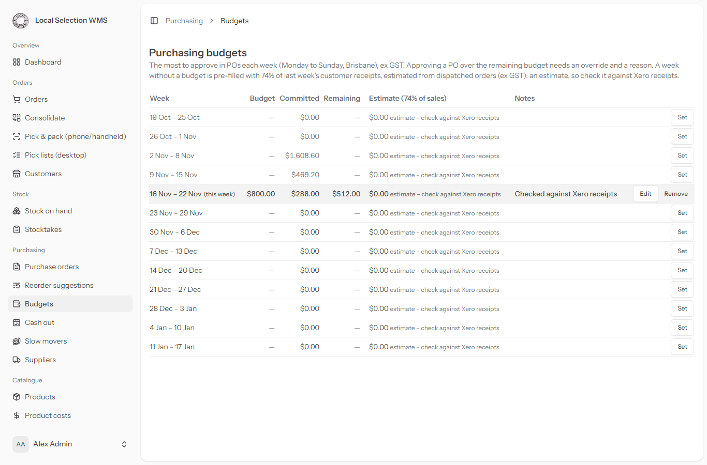

| Column | Meaning |
|---|---|
| **Budget** | The week's budget. — if not set. |
| **Committed** | POs approved that week ([6.2a](#62a-approve-the-po)). |
| **Remaining** | Budget minus committed. Red when below zero. |
| **Estimate (74% of sales)** | 74% of the previous week's sales, worked out from what was dispatched (ex GST). It's an estimate: check it against Xero receipts. |

**Set or change a week's budget** (admins, managers, purchasing)

1. Click **Set** (or **Edit**) on the week. A new week starts with the estimate filled in.
2. Change **Budget ($ ex GST)** to the figure you want, and add **Notes** if you like.
3. Click **Save**.

**Remove** deletes a week's budget.

When the Monday suggestions run (or someone clicks **Generate suggestions**) and the week has no budget, one is set from the estimate, with the note "auto-estimate – check against Xero". Check it and correct it. A week with no budget at all counts as having nothing to spend: every approval needs an override.

### 6.8 Cash out

**Purchasing → Cash out** shows what has to be paid to suppliers in each of the next 13 weeks, from this Monday, against an indicative figure for money coming in.

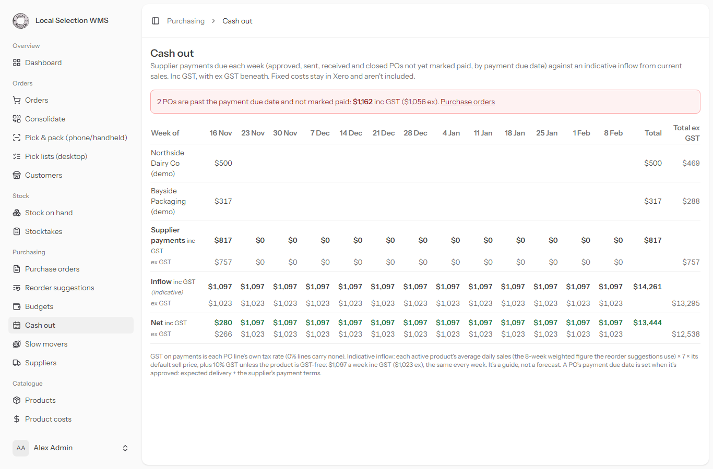

- **One row per supplier:** the POs due that week, inc GST, by their **Payment due** date. Approved, sent, received and closed POs not yet marked paid are counted. Drafts and suggested POs aren't: approve them first.
- **Total** is inc GST; **Total ex GST** is alongside.
- **Supplier payments:** each week's total inc GST, with the ex GST figure underneath.
- **Inflow (indicative):** what current sales would bring in each week: each product's average daily sales × 7 × its sell price, plus 10% GST unless it's GST-free. The same every week. It's a guide, not a forecast.
- **Net:** inflow minus supplier payments, inc GST and ex GST. Red weeks pay out more than they bring in.
- **Overdue:** a red box at the top counts POs past their payment due date and not marked paid.

Wages, rent and other fixed costs stay in Xero and aren't in these figures.

### 6.9 Slow movers

**Purchasing → Slow movers** lists stock that's barely selling: under 0.1 base units a day (for example, fewer than 3 cans a month), with stock on hand. The most money tied up comes first.

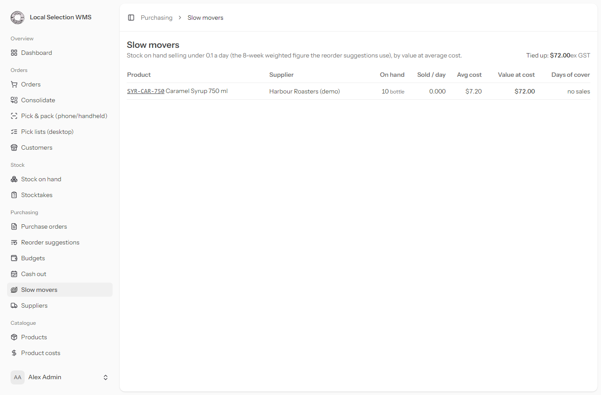

- **Sold / day:** the same average the reorder suggestions use.
- **Value at cost:** on hand × average cost. **Tied up** at the top is the total.
- **Days of cover:** how long the stock lasts at that rate. "no sales" means nothing sold in 8 weeks.

Inactive products are marked **inactive**. Click the SKU to see the product's stock.

### 6.10 Supplier credits

**Purchasing → Supplier credits** lists stock returned to suppliers from quarantine ([7.8](#78-quarantine)) and the credit expected for each return: the quantity at the average cost when it went back, ex GST.

- **Open** (the default) shows what's still owed, with a total per supplier and the age of the oldest return, so you know who to chase.
- When the credit note arrives, click **Mark received** and type the supplier's credit note number (optional). Purchasing, managers and admins can do this.
- **Received** and **All** show past credits, with who marked them and when.

---

## 7. Stock

### 7.1 On hand, sellable, reserved and available

| Figure | Meaning | Where you see it |
|---|---|---|
| **On hand** | Everything in every bin, including quarantine and expired batches. | Stock on hand, product stock page |
| **Sellable** | On hand in sellable bins, not quarantine, not past best-before. | Stock on hand, product stock page |
| **Reserved** | Promised to open orders, not yet dispatched. | Stock on hand, product stock page, each order's lines |
| **Available** | Sellable minus reserved. This is what Ordermentum and the portal see. Can be negative after an oversold order. | Stock on hand, product stock page |

Stock leaves the system at dispatch. Until then it's reserved.

### 7.2 Stock on hand

**Stock → Stock on hand** lists every product with **On hand**, **Sellable**, **Reserved** and **Available**, in base units. Hover over **Available** to see "What Ordermentum and the portal see".

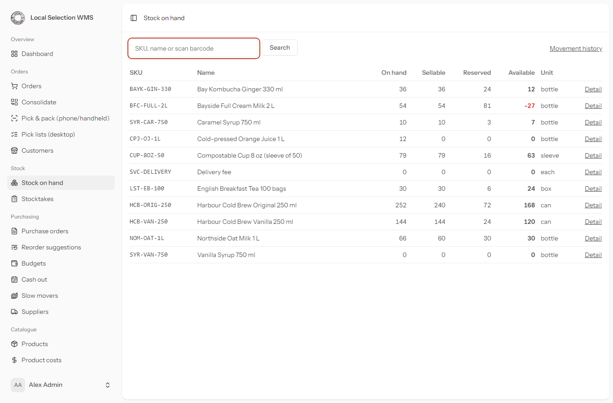

- A **red** on-hand figure is below zero.
- An **amber** sellable figure is at or below the product's reorder point.
- A **red** available figure is below zero: more is promised to orders than you have to sell.

Click **Detail** for one product:

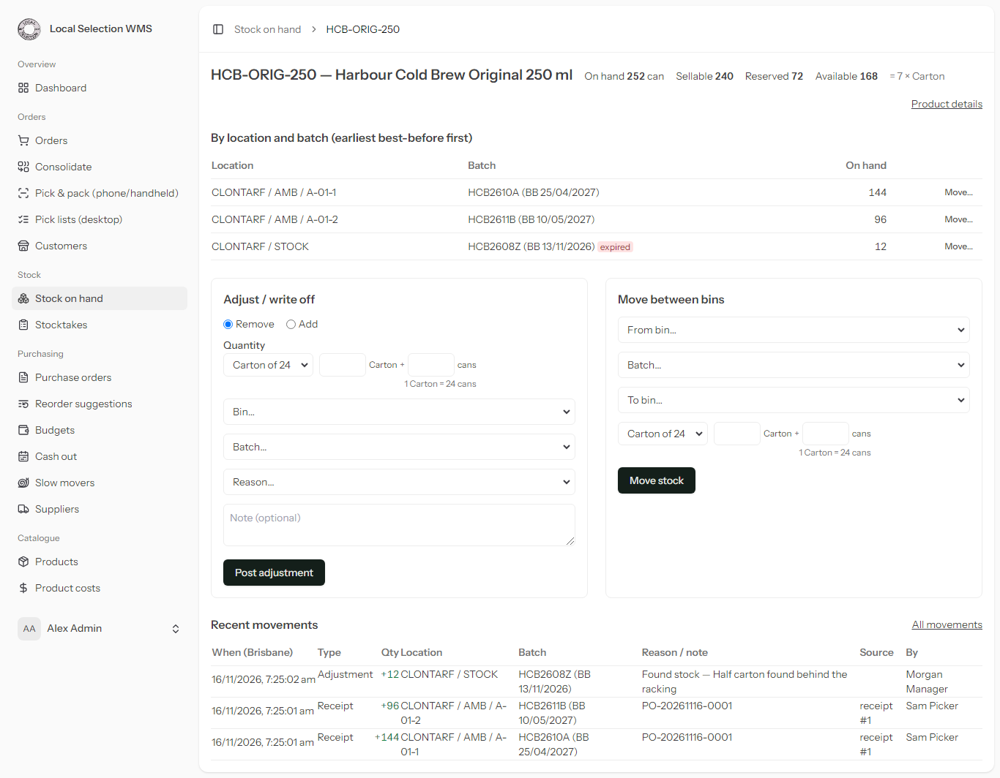

- **By location and batch:** each bin and batch, earliest best-before first. **quarantine**, **not sellable** and **expired** tags show why stock isn't sellable.
- **Recent movements:** the last changes. **All movements** opens the full history.

**Typing a quantity.** Every quantity box comes as two: packs and loose units, for example `[1] Case + [5] bottles`, with the pack spelled out underneath ("1 Case = 12 bottles"). Leave a box empty if it's 0. The app saves the total in base units: 1 Case + 5 bottles is 17 bottles. Which pack you count in:

| Screen | Pack |
|---|---|
| Pick lists (desktop), handheld **Enter quantity** and **Short / not found** | The order line's pack |
| Stocktake counts | The product's largest pack, the same one the count sheet prints |
| Adjust, move between bins | You choose. It starts on the largest pack |

### 7.3 Adjust or write off stock

For admins and warehouse managers.

1. Open the product's stock page.
2. Under **Adjust / write off**, choose **Remove** or **Add**.
3. Choose the pack and enter the quantity, for example 2 Case + 0 bottles.
4. Choose the bin. For batch-tracked products, choose the batch. When adding, you can create a new batch with a lot code and best-before date.
5. Choose a reason:

   | Reason | Direction | Note required |
   |---|---|:-:|
   | Damaged / broken | Remove | |
   | Past best-before | Remove | |
   | Spoiled (cold chain / quality) | Remove | ✓ |
   | Recall | Remove | |
   | Other | Remove | ✓ |
   | Samples / tastings | Remove | |
   | Internal use | Remove | ✓ |
   | Lost / missing | Remove | ✓ |
   | Found stock | Add | ✓ |
   | Data-entry correction | Either | ✓ |

6. Add a note if needed, and click **Post adjustment**.

Adjustments can't be edited or deleted. To undo one, post the opposite adjustment.

A write-off keeps the product's average cost at that moment, so the spoilage report ([14.3](#143-spoilage)) values it at what it cost then, not what it costs later.

### 7.4 Move stock between bins

Warehouse staff can do this too.

1. Open the product's stock page.
2. Click **Move…** on the row you're moving from, or fill in **Move between bins**:
   - **From bin**
   - **Batch** (batch-tracked products)
   - **To bin**
   - **Quantity**, in the pack you choose plus loose units
3. Click **Move stock**.

Use this to put away stock from a receiving bin, or to move damaged stock to quarantine.

Moving stock **into a quarantine bin** asks why: **Past best-before**, **Damaged**, **Recall** or **Quality**, with an optional note. The quarantine register shows it ([7.8](#78-quarantine)). Damaged stock from a delivery goes to quarantine on its own, marked **Damaged**.

### 7.5 Movement history

**Stock on hand → Movement history** lists every stock change. Filter by SKU, type and dates.

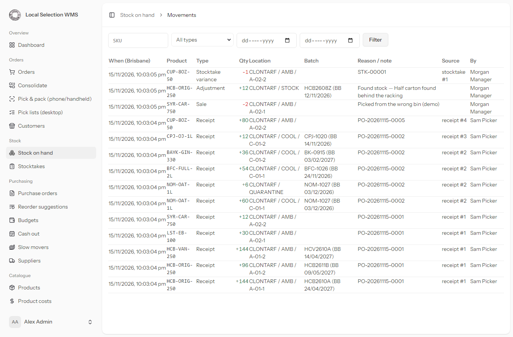

Types include receipt, sale (dispatch), adjustment, write-off, transfer out/in, stocktake variance and opening balance. Each row shows who did it and why.

### 7.6 Expiry

For batch-tracked products:

- Each batch has a lot code and a best-before date, entered at receiving.
- Picking takes the earliest best-before first.
- A batch is sellable up to and including its best-before date (Brisbane date). From the next day it stops being sellable and isn't picked. It stays on hand with an **expired** tag.
- Write expired stock off with the reason **Past best-before** ([7.3](#73-adjust-or-write-off-stock)), or move it to quarantine first ([7.8](#78-quarantine)).

### 7.7 Expiring soon

**Stock → Expiring soon** lists batches in sellable bins whose best-before is within the next 14 days, or has already passed, soonest first. Everyone who can see stock can open it.

- **Ahead:** sellable stock of the same product that picking takes first (earlier best-before). A batch only starts selling once that's gone.
- **Sells / day:** the same 8-week average the reorder suggestions use.
- **Expected to sell:** sells a day × days left (today and the best-before day included), less the stock ahead.
- **Won't sell:** what's left of the batch at its best-before. **Sells in time** when nothing is. **Past best-before** batches can't be sold at all: move them to quarantine.
- **At cost:** what won't sell, at average cost (for roles that see costs).

Managers and admins can change **Expiring within (days)** and whether the 7am reorder email lists the batches that won't sell in time (on by default; the email itself is switched on in the reorder settings).

### 7.8 Quarantine

For admins and warehouse managers. **Stock → Quarantine** lists everything in quarantine bins: product, bin, batch, best-before, quantity, value at today's average cost, **days** in quarantine (since the line last arrived in an empty bin) and the **reason** it went there.

Each line has three actions. Each can take part of the line.

| Action | What it does | Needs |
|---|---|---|
| **Write off** | Removes the stock as a write-off. Counts as spoilage ([14.3](#143-spoilage)). | A reason (a note for Spoiled and Other) |
| **Return** | Sends the stock back to a supplier and opens a supplier credit for it at cost ([6.10](#610-supplier-credits)). Not spoilage: the money comes back. | The supplier (the batch's, else the product's usual supplier, is chosen for you) |
| **Release** | Moves the stock back to a sellable bin. Not possible once past its best-before. | Why it's fit to sell again, and the bin |

---

## 8. Stocktakes and count tasks

**Stock → Stocktakes.** Warehouse staff can count. Managers and admins start, post and cancel.

### 8.1 Start a stocktake

1. Under **Count what**, choose a site, zone or bin.
2. Add a note if you want, for example "Monthly cycle count".
3. Click **Start stocktake**.

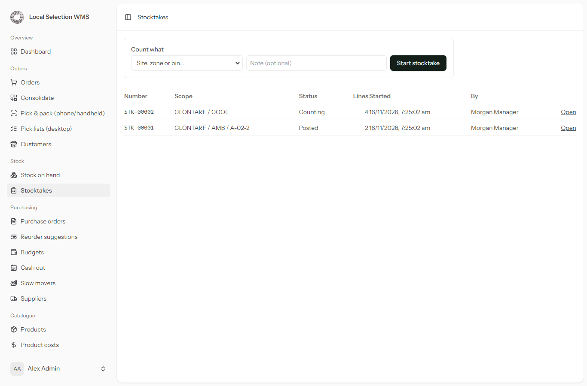

The app lists every product and batch in that area, with its quantity at that moment (the **Snapshot**).

### 8.2 Count

1. Open the stocktake.
2. Count each line and type it into **Counted**, in the product's largest pack plus loose units, for example 3 Case + 4 bottles. It saves when you press Enter or leave the boxes.
3. Found something that isn't listed? Under **Found something not listed?**, enter the SKU and bin (plus lot and best-before for batch-tracked products) and click **Add line**.

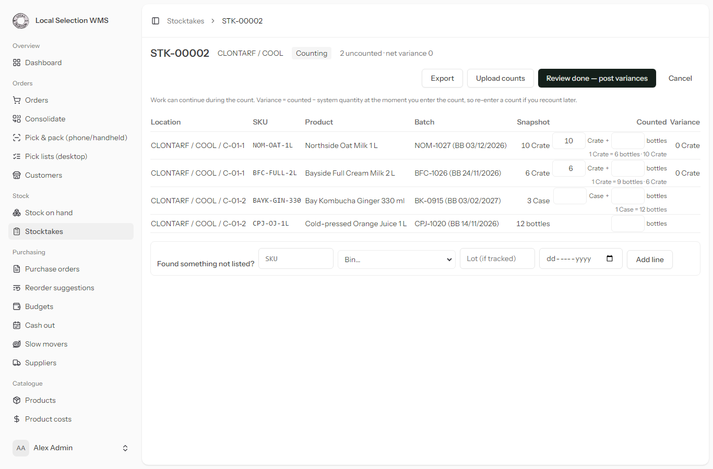

Work can carry on during the count. The **Variance** is your count minus the system quantity at the moment you enter it. If stock moves after you count a line, count it again and re-enter the figure.

### 8.2a Upload counts

For managers and admins, while the stocktake is counting. Instead of typing counts in, fill in a spreadsheet and upload it.

1. **Export → Count sheet (Excel)**, and fill in **Counted (packs)** and **Counted (each)**. You can also fill in **Counted (base)** on a **Results** export. Add a row for anything found that isn't listed: bin, SKU, and lot and best-before for batch-tracked products. Other columns are ignored.
2. Click **Upload counts** and choose the file (Excel or CSV).
3. Check the preview:
   - **Counts:** each line's count now, the new count and the variance it will make.
   - **New lines:** stock in a bin that wasn't in the snapshot. These are added as found.
   - **Errors**, by row: an unknown SKU or bin, a bin outside the stocktake, a batch-tracked product without a lot, a negative or part number, or packs and base that don't agree. **Any error holds the whole file back.** Fix the file and upload it again.
   - **Blank rows** are left as they are: uncounted, or with the count they already have. A 0 is a count.
   - Two rows for the same bin, product and lot are **added together**, for example a bin counted in two parts.
4. Click **Apply counts**. The counts are recorded as if you typed them in, with "uploaded from" and the file name next to each. **Nothing is posted.** Review, then post as usual (8.3).

The preview lasts 30 minutes. If someone enters a count for one of the lines after you upload, applying is refused, so nothing is overwritten: upload the file again. A file exported from a different stocktake is refused. Each upload and each apply is recorded in the audit log.

### 8.3 Post or cancel

For managers and admins.

1. Check the variances. Red is less than the system, green is more.
2. Click **Review done — post variances**.
3. If some lines are uncounted, you're asked whether to post them as **zero**. Say no if you haven't counted them yet.
4. Confirm. **Posting can't be undone.** Each variance becomes a stock movement.

**Cancel** closes the stocktake without changing any stock.

### 8.3a Export

**Export** on a stocktake works in any status: counting, posted or cancelled.

- **Results** (Excel or CSV): the stocktake's details at the top, then one row per line in bin walk order. Each row has the snapshot, the count in base units and in packs (for example "3 Carton + 4 Each"), the variance, who counted it and when. The last row has the totals. An uncounted line has a blank count, not 0. Managers and admins also get the unit cost and the variance in dollars. Costs are per base unit, at the cost each variance was posted at. For a stocktake still counting, a line with no variance, or one posted before 8 November 2026, it's today's product cost.
- **Count sheet** (Excel or PDF to print): the same lines in walk order, with boxes to write the count in packs and in each, and a signature and date line on every page. It doesn't show the system quantities, so counters count what's there.

The file is named after the stocktake, for example `STK-00003-results-2026-11-08.xlsx`. Each export is recorded in the audit log.

### 8.4 Count tasks

A count task asks someone to count one bin. The app raises one when:

- a dispatch takes a bin below zero, or
- a picker reports a short pick.

If it's raised again before it's done, **Times** goes up.

Count tasks show on the dashboard under **Bins to count** ([3](#3-dashboard)). Managers and admins can:

- **Start count:** starts a stocktake for that bin. Posting a stocktake that covers the bin closes the task.
- **Dismiss:** when no count is needed. You must say why.

---

## 9. Orders

**Orders → Orders.** Filter by status, channel (Manual, Portal, Ordermentum) and flag (Oversold, Needs review).

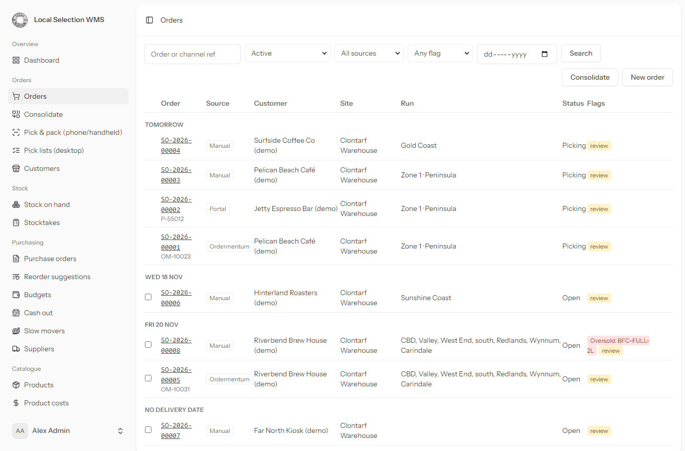

### 9.1 Where orders come from

| Channel | How it arrives | If there isn't enough stock |
|---|---|---|
| **Ordermentum** | Automatically, when Ordermentum order ingestion is switched on. Ordermentum has already taken the stock off its own count. | Always accepted, and flagged **oversold** if beyond available stock. |
| **Portal** | Automatically, when a café checks out on the portal (if the portal link is switched on). | Refused. The portal shows the café what's available. |
| **Manual** | Created here by a manager or admin. | Refused, unless you tick **Accept even if not enough stock is available**. It's then flagged oversold. |

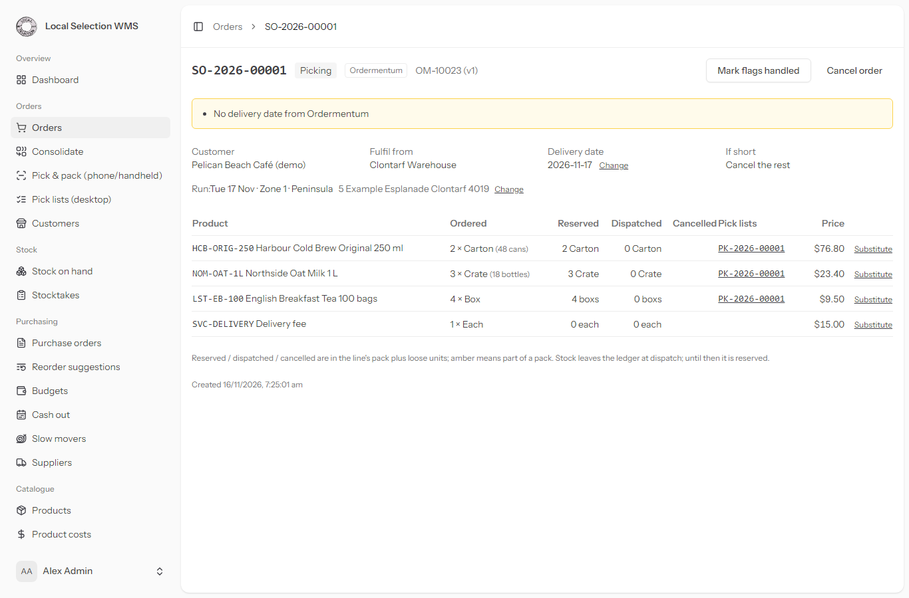

### 9.2 Reservations

When an order is created, its stock is **reserved**. Reserved stock stays in the bin but is no longer available to other orders or channels.

- Dispatch removes the stock and clears the reservation.
- Cancelling an order releases what wasn't dispatched.

The order page shows **Reserved**, **Dispatched** and **Cancelled** per line, in base units.

### 9.3 Create a manual order

For managers and admins.

1. Click **New order**.
2. Choose the **Customer** and the **Fulfil from** site.
3. Check the **Delivery date**. It's required, and fills in with the next delivery day for the customer's area once you choose the customer.
4. Choose **If short at picking**: **Backorder the rest** or **Cancel the rest**.
5. Search for each product and add it. Choose the pack, quantity and unit price.
6. Tick **Accept even if not enough stock is available** only if you want the order anyway. It will be flagged oversold.
7. Click **Create order & reserve stock**.

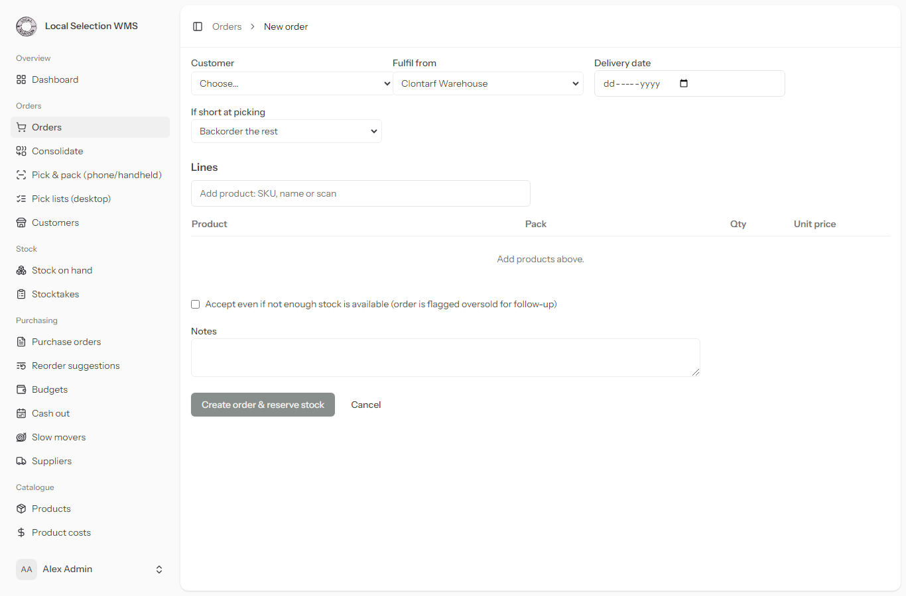

### 9.4 Backorders

If a picker can't find everything, the order's **If short** rule applies at dispatch:

- **Backorder** (the default for manual orders): what was picked is dispatched. The order becomes **Partially dispatched**, and the rest stays reserved for a later pick.
- **Cancel the rest** (the default for Ordermentum and portal orders): what was picked is dispatched, and the rest is cancelled and its stock released. The portal credits the café for what didn't go. Ordermentum orders that arrived before this became the default keep the rule they came with.

Order statuses: **Open** (reserved, waiting) → **Picking** (on a pick list) → **Partially dispatched** or **Dispatched**. An order can also be **Cancelled**.

### 9.5 Oversold and review flags

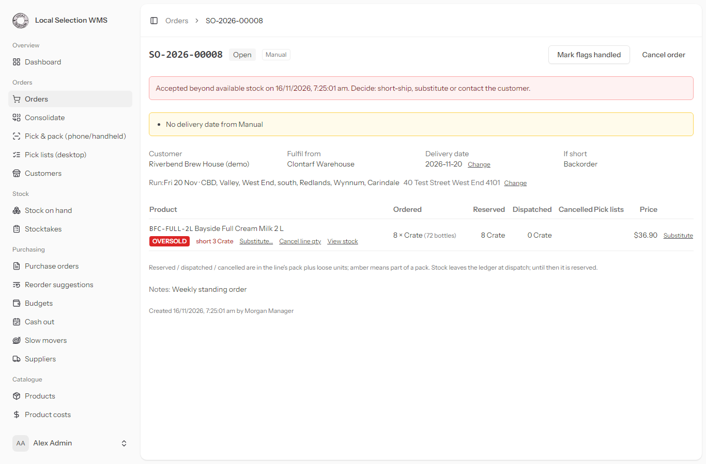

- **Oversold:** the order was accepted beyond available stock. Each short line has an **OVERSOLD** badge and says how much it's short, for example "short 1 Case". On that line, managers can:
  - **Substitute…** another product for what's short ([9.5b](#95b-substitutions)),
  - **Cancel line qty**: cancel part of the line, with a reason (for example "customer declined"). The stock is released,
  - **View stock** for the product,
  - or contact the customer and leave it to be backordered.

  The flags come off by themselves, line by line, with an entry in the audit log, once stock covers them: after a delivery is received, an adjustment, a posted stocktake, or another order is cancelled, reduced or substituted. When stock is short, the oldest orders are covered first. The order's flag comes off when no line is short.
- **Review:** the order page says why. For example, the channel changed the order while it was being picked, it was reduced below what was already dispatched, or its delivery date needs a look ([11.1](#111-how-an-order-gets-its-run)).

When it's dealt with, click **Mark flags handled**.

### 9.5a Orders held for payment

A portal order paid by card arrives unpaid: at checkout it has about 30 minutes to pay, and on a payment link it has until its pay-by date. Its stock is reserved, but it's held out of picking: it has a **HELD** badge on the order and in the queue, and **Pick N new order(s)** skips it.

- **When the portal says it's paid,** the hold lifts by itself.
- **If it isn't paid in time,** the portal cancels it and the stock is released. If that doesn't happen, the badge reads **pay-by passed**, and the order stays held until someone decides.
- **Release to pick** on the order lets a manager send it for picking unpaid. It's recorded in the audit log, and a later message from the portal won't put the hold back.

### 9.5b Substitutions

When a café agrees to take another product instead of one that's short, a manager records a **substitution**. The original line is reduced (counted as "substituted", not short) and a new line is added for the substitute.

**On the order page** (managers and admins)

1. Click **Substitute** on the line (or **Substitute…** on an oversold line).
2. Enter how much of the original to replace, in packs plus loose units.
3. Search for the substitute product, choose its **Pack** and quantity. It starts at the same quantity.
4. Set the **Price per pack (ex GST)**. Leave it empty for the substitute's sell price, or tick **Keep original price** to charge what the café was paying. **Price difference** shows the change.
5. Enter a **Note**, such as "Accepted by Jane by phone 14/11". It's required.
6. Click **Substitute**.

[screenshot: Substitute dialog on the order page]

**On the handheld:** a manager picking a line that comes up short can tap **Substitute…** after **Short / not found**, and use the same steps.

The substitute shows as **SUB for** (original SKU and name) on the order, the pick list, the handheld, the packing slip and the manifest, so the picker and the café know why it's there. If the order is already being picked, the new line appears on the handheld by itself.

**Undo** under **Substitutions** on the order puts the original back and removes the substitute line. It's only offered while the substitute line isn't on a pick list yet.

All substitutions are listed on **Reports → Substitutions** ([14](#14-reports)).

### 9.6 Cancel an order

For managers and admins. Click **Cancel order** and give a reason. Undispatched stock is released. For a portal order, the portal is told what was cancelled and credits the customer.

### 9.7 Change a delivery date

Managers click **Change** next to **Delivery date** on the order. The audit log records it.

- **Not on a pick list yet:** the order moves to the run for the new date.
- **Already picking or packed:** it stays where it is and is flagged for review, with the old and new dates.

If the channel later sends a different date, that date wins. If it sends the same date as before, yours stays.

### 9.8 Consolidate runs

**Orders → Consolidate** (managers and admins) pulls orders from later runs onto an earlier day, to fill a delivery day. For example, next Monday's North of Brisbane orders onto this Friday.

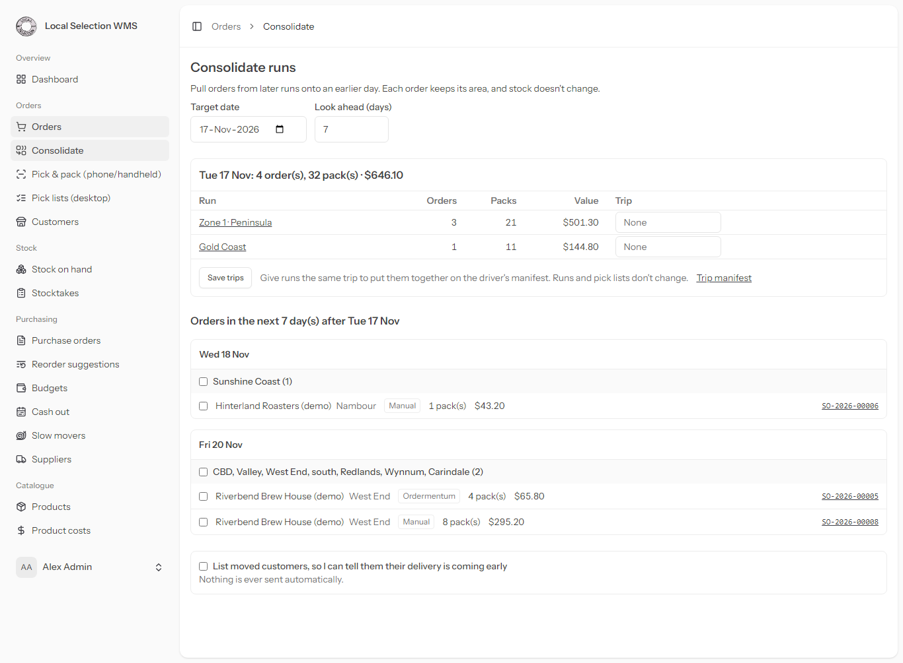

1. Choose the **Target date**. The top table shows how full that day is: each run's orders, packs and value, where orders carry prices.
2. Below are the orders from the next 7 days after it (change **Look ahead** for more), by date and area. Orders already on a pick list can't be selected.
3. Tick orders, or a whole run. Click **Move N to (date)** and confirm.

Each order keeps its own area and gets a **Moved from Mon 16 Nov** badge on the order, in the pick queue and on the run manifest. It isn't flagged "Not a delivery day": you chose that day on purpose. Stock doesn't change, and each move is in the audit log.

- **Undo** (on the order, or under **Moved to** on this screen) puts it back on its original date and run, unless it's on a pick list or that run has been dispatched.
- **If Ordermentum or the portal re-sends the same date,** the move stays. **A different date** flags the order for review with all three dates. It doesn't move.
- **Stock warning:** "Stock for X arrives Mon via PO-…; not available for Fri" means that stock is due on an open PO after the target day. The warning shows before you confirm, and you can still move the order.
- **Trips:** give several runs the same **Trip** to put them together on the driver's **Trip manifest**. This only changes the manifest's grouping. Runs and pick lists stay as they are.
- **Telling customers:** tick **List moved customers** to see their phone and email for the day. Nothing is ever sent automatically. It's off by default.

### 9.9 Customers

**Orders → Customers** lists customers. Managers and admins can add and edit them.

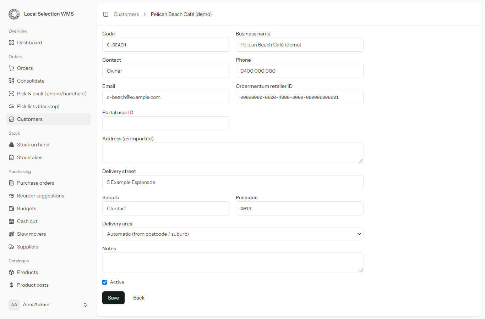

The delivery fields decide the delivery run:

- **Delivery street**, **Suburb**, **Postcode**.
- **Delivery area:** leave it on **Automatic (from postcode / suburb)**, or choose an area to override it.

Also on the customer: **Ordermentum retailer ID** and **Portal user ID**, which link channel orders to the customer.

**Reserved, Dispatched and Cancelled** on an order show in the line's pack plus loose units, for example 1 Case + 5 bottles. Amber means part of a pack.

### 9.10 Pick lists (desktop)

A pick list covers one delivery day: the app refuses a selection that mixes days.

Most picking is done on the handhelds ([10](#10-pick--pack-phonehandheld)). There is also a desktop pick list:

1. On **Orders**, tick orders from the same site and click **Create pick list**.
2. The pick list opens, sorted by bin, earliest best-before first. **Print** prints it.
3. Enter the quantity picked on each line, in the order line's pack plus loose units, for example 1 Case + 5 bottles. Less than asked is a short pick.
4. Click **Dispatch** when every line is confirmed. **Mark all picked** fills every line you haven't entered yet with the full quantity.

**Status reads the same here and on the handheld:** Not started, Picking 2/5, Picked, Packed, Dispatched or Cancelled, whichever screen did the work. A list made here also shows on the handheld queue. Open lists show by default, and dispatched and cancelled ones are under **History**. Both screens refresh every 30 seconds and when you come back to the window.

**Cancel** puts the orders back to ready-to-pick. All pick lists are under **Orders → Pick lists (desktop)**.

---

## 10. Pick & pack (phone/handheld)

For warehouse staff, managers and admins. Built for Android handhelds with a built-in scanner.

### 10.1 Before you start

- The scanner must be in keyboard mode with an Enter after each scan.
- Open Local Selection WMS on the handheld over **https**, and add it to the home screen.
- Every bin needs its label ([5.3](#53-print-bin-labels)), and every product its pack barcodes ([4.3](#43-pack-sizes-and-barcodes)).

The scan box has two buttons:

- **⌨** shows the phone's keyboard, if you need to type.
- **📷** uses the camera as a scanner. It only appears on phones and browsers that support it, and needs https.

**The scan box keeps the cursor.** After every scan, button or save, the cursor goes back to the scan box, so the next scan lands there. It only leaves when you tap into another box, such as a quantity.

**The bar at the top**

- **‹ (Back)** goes back one screen: from a pick list or a manifest to the queue, from packing to the pick list, from the queue to the dashboard.
- The title says where you are, for example the pick list number, day and run.
- **☰ (Menu)** opens the menu: **Dashboard**, **Pick & pack (phone/handheld)**, **Pick lists (desktop)**, **Orders** and **Capture barcodes** (those your role allows), and **Log out**.

[screenshot: handheld menu open]

**Leaving with lines still to pick.** If you tap Back, a menu link or Log out while lines are left to pick, **Leave this screen?** asks first, with how many lines are left. **Stay** is the first button, so a stray scan can't leave by accident. **Leave** goes; the list stays assigned to you, and **Continue** in the queue takes you back.

**The screens update themselves** every 30 seconds and whenever you come back to them, so a line added from another device (a substitute, say) appears without reloading. Your place and your scans are kept.

**Dark mode.** The pick and pack screens follow your **Appearance** setting ([1.7](#17-your-settings)) and stay readable in Dark.

### 10.2 The queue

Open **Pick & pack (phone/handheld)** from the menu. Runs are grouped by delivery day: **OVERDUE** in red at the top (anything before today, Brisbane time), then **Today**, **Tomorrow** and each later day. **Orders**, **Pick lists** and the pack screen show the day the same way, and each order has a badge for its source: Ordermentum, Portal or Manual.

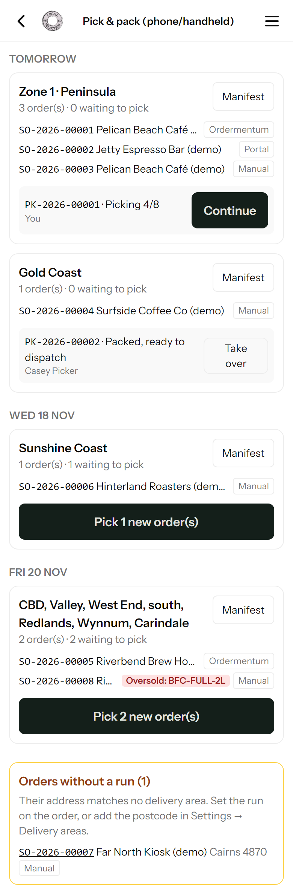

Each run shows how many orders it has and how many are waiting to pick.

- **Pick N new order(s):** makes a pick list from the waiting orders on that run and day only, and gives it to you.
- **Continue:** goes back to your own list.
- **Take over:** takes someone else's list. You're asked to confirm, and it's recorded.
- **Manifest:** the run's order list for dispatch ([10.6](#106-dispatch-the-run)).

**Orders without a run** at the bottom are orders whose address matches no delivery area. A manager sets the run on the order, or an admin adds the postcode to an area ([11](#11-delivery-runs-and-areas)).

### 10.2a Waiting for stock

An order line with no stock in any bin goes on the pick list as **No stock — short**. Tap **Confirm short**: there's nothing to walk to, and no scan or reason is needed. These lines come last, and don't need ticking when you pack.

**Orders in packs are picked in whole packs.** A Case of 12 is picked from a bin that has a full Case free. A bin with only loose bottles gives nothing, so the line waits for stock instead of going out loose. The exception is a Case that already went out partly, from before this rule: the rest of that Case can be picked loose, to finish it.

**Pick N new order(s)** only counts orders with something to pick now. An order with nothing to pick shows under **Waiting for stock** on its run, in the queue and on **Orders**, with the lines it's short of.

- **It's ready to pick by itself** once stock is received or adjusted: it moves back into **Pick N new order(s)**. Someone still taps it.
- **Cancel rest** (managers) cancels what hasn't been dispatched and releases it. For a portal order, the portal is told what was cancelled and credits the customer. The same goes for **Cancel order**.

### 10.3 Pick a line

Admins can turn off **Require bin scan when picking** in **Company settings**. The product scan alone then confirms the line. The bin still shows in large letters, so walk to it first.

The screen shows one line at a time, in walk order. Chilled lines come last.

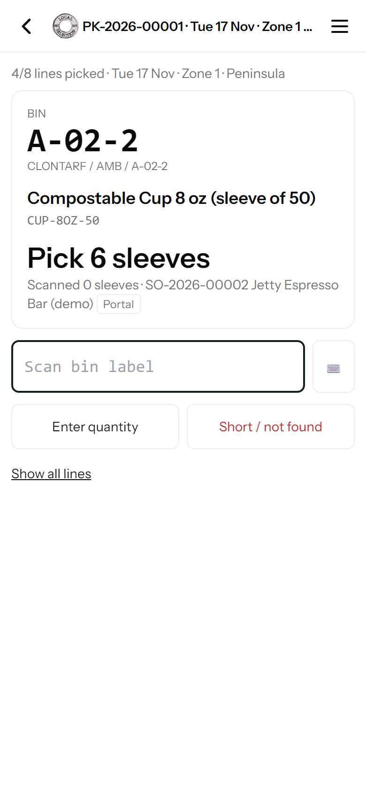

You see:

- the **bin** in large letters
- the product, with a **CHILLED** badge if it's chilled
- the lot and best-before date (batch-tracked products)
- how many to pick, in packs
- the order and customer
- **SUB for** (original product) on a substitute line ([9.5b](#95b-substitutions))

Then:

1. Go to the bin and **scan the bin label**. "Bin ✓" shows in green.

   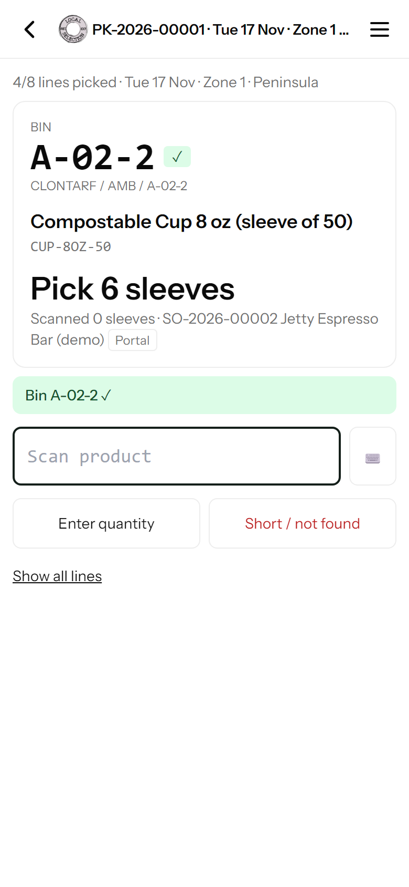

2. **Scan the product.** Each scan adds that pack's quantity.
3. When the count matches, the line confirms itself and the next one opens.

**Wrong scan?** A red message shows and the handheld buzzes twice. It says what was expected, for example "That is bin A-01-1; this line is in A-02-2", or "Not this product". Scanning more than needed gives "Too many".

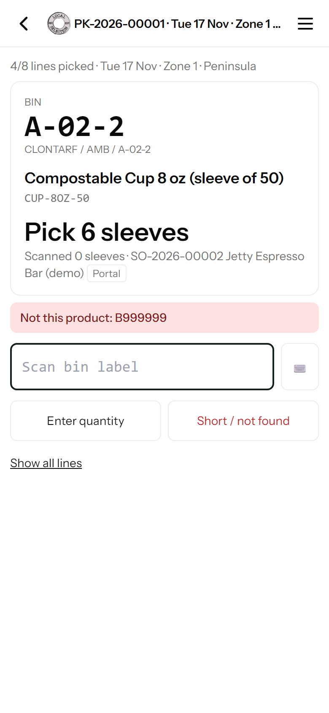

Both scans are checked by the server as well.

**Show all lines** lists the whole pick list. Tap a line to jump to it.

### 10.4 No scan, or not enough stock

**Label missing or scanner not working**

1. Tap **Enter quantity**.
2. Enter how many you picked, in the order line's pack plus loose units. For a Case of 12, 1 Case is 12 bottles, and 5 loose bottles go in the second box.
3. Choose why there was no scan: Label missing, Label damaged, Scanner not working, or Other. This is recorded.
4. Tap **Confirm**.

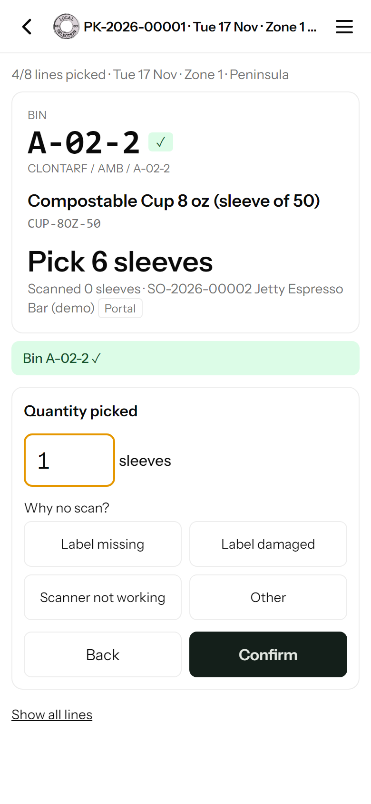

**Not enough in the bin**

1. Tap **Short / not found**.
2. Enter how many you actually found, in packs plus loose units (0 if none).
3. Tap **Confirm**.

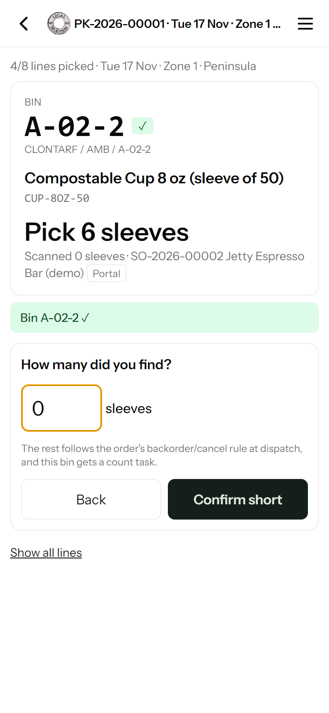

The bin gets a count task. At dispatch, the rest of the order follows its backorder or cancel rule ([9.4](#94-backorders)).

Managers also see **Substitute…** here, to give the café another product for what wasn't found, there and then ([9.5b](#95b-substitutions)).

**Enter quantity won't confirm?** It says why underneath, for example a quantity above what's to pick, or no reason chosen. If the server refuses it, the server's message is shown.

### 10.5 Pack

When every line is picked, "All lines picked" shows. Tap **Go to packing**.

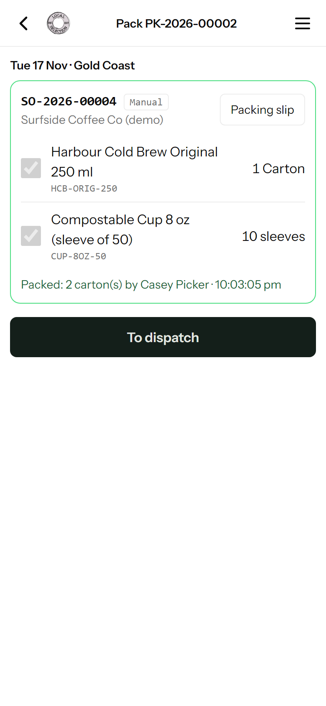

For each order:

1. Tick each line as it goes into the carton(s). Each tick saves straight away, so you can leave the screen, or swap handhelds, and come back to the same ticks. Untick a line to reverse it. You can't pack an order until all its lines are picked. Once an order is packed, its lines stay ticked and neither they nor the carton count can be changed.
2. Enter the number of **Cartons**. It saves as you type, and is there when you come back.
3. Tap **Packed**. Who and when are recorded.
4. Tap **Packing slip** to open an A5 PDF. Print it and put it in the carton.

When every order is packed, tap **To dispatch**.

### 10.6 Dispatch the run

The manifest lists every order on the run, with its address, carton count and whether it's packed.

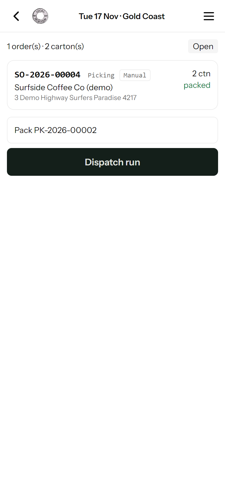

1. Check every order shows **packed**. Open lists show a **Pack PK-…** link.
2. Tap **Dispatch run** and confirm.

Dispatch:

- takes the picked stock off the system,
- completes or part-completes the orders,
- notifies the portal for portal orders (when portal dispatch events are switched on),
- closes the run when nothing is left on it.

Dispatch is refused until every order on the run's open pick lists is packed.

---

## 11. Delivery runs and areas

### 11.1 How an order gets its run

A run is a **delivery date** plus a **delivery area**.

1. **Area:** the customer's area override if set. Otherwise the postcode and suburb of the order's delivery address (Ordermentum and portal orders). Otherwise the customer's delivery address.
2. **Date:** the date from where the order came from: the café's choice on Ordermentum, the date chosen on the portal, or the date on the WMS order form. If the source sent none, or one that can't be read, it's the next run for that area after the cutoff, and the order is flagged "No delivery date from Ordermentum" (or Portal).
3. **No match:** the order has no run and shows under **Orders without a run**.

**A date the area doesn't run** is kept, never moved, and flagged "Not a delivery day for (area)". Change it on the order if it's wrong.

**When the source changes the date:** an order not yet on a pick list moves to the new run. One already picking or packed, or on a run set by hand, stays where it is and is flagged with both dates.

### 11.2 Cutoff

- Orders must be in by **1:00 pm on the business day before** delivery.
- Business days are Monday to Friday.
- Public holidays aren't taken into account yet.
- Areas marked **next-day** also deliver on any weekday.

**Change the run of one order** (managers and admins): on the order page, next to **Run**, click **Change**, choose the area and date, and click **Save**. A run set by hand stays put.

Runs are worked out again when an order changes, or when a customer's address or area changes. An order already on a pick list keeps its run.

### 11.3 Edit delivery areas

For admins: **Admin → Delivery areas**.

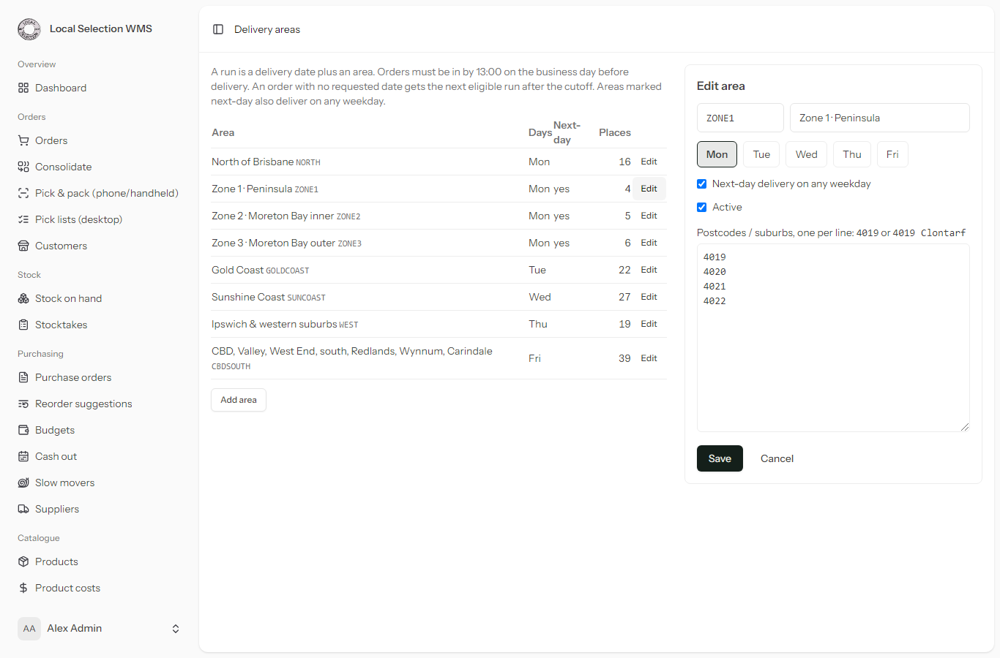

1. Click **Edit** on an area, or **Add area**.
2. Enter the **Code** and **Name**.
3. Tap the delivery weekdays.
4. Tick **Next-day delivery on any weekday** if it applies.
5. List the places, one per line:
   - `4019` for the whole postcode, or
   - `4019 Clontarf` for one suburb, when a postcode is split between areas.

   A suburb line beats a whole-postcode line. Each place can belong to only one area.
6. Untick **Active** to stop using an area.
7. Click **Save**.

---

## 12. Sync screen (Ordermentum and portal)

**Integrations → Sync** shows how Local Selection WMS is talking to Ordermentum and the portal.

- **Who sees it:** admins, managers, purchasing and read-only.
- **Who can press its buttons:** admins and warehouse managers only.

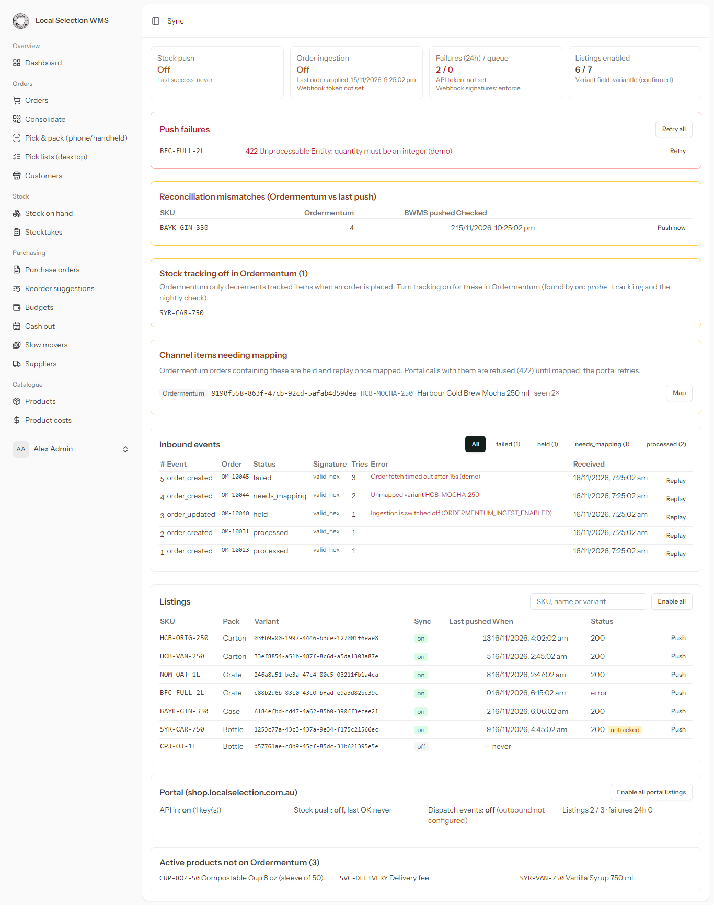

> **⚠ Take care.** Buttons on this screen change what cafés see and can order on Ordermentum and the portal. Each one first asks you to confirm, and the message says what will happen and how many items it affects. Read it before clicking **OK**. If you're not sure, click **Cancel** and ask an administrator.

### 12.1 The switches

The four boxes at the top show:

- **Stock push:** On or Off, and the last success.
- **Order ingestion:** On or Off, and the last order applied.
- **Failures (24h) / queue.**
- **Listings enabled.**
- **Variant field:** which field of an Ordermentum order line holds the product. It shows **(confirmed)** when it's the field checked on a live order. **(unconfirmed)** in amber means the server setting was changed: tell an administrator.

The switches are set on the server by an administrator, not on this screen. While **Stock push** is Off, nothing is sent to Ordermentum, whatever the buttons below say.

### 12.2 Sections

| Section | Meaning | Action |
|---|---|---|
| **Push failures** | Ordermentum refused or failed a stock update for these products. | **Retry** one, or **Retry all**. |
| **Reconciliation mismatches** | The nightly check found Ordermentum's figure differs from what was last pushed. | **Push now** sends the current figure. |
| **Stock tracking off in Ordermentum** | Ordermentum doesn't count stock down for these items. | Turn tracking on in Ordermentum (outside this app). |
| **Channel items needing mapping** | An Ordermentum or portal item that isn't linked to a product. Ordermentum orders with it are held; portal calls with it are refused until mapped. | **Map** ([12.4](#124-map-a-channel-item)). |
| **Inbound events** | Each Ordermentum order event received. Filter by status. | **Replay** processes it again. |
| **Listings** | Each product's link to Ordermentum: pack, variant, sync on/off, last figure pushed. | Toggle **on/off**, **Push**, **Enable all**. |
| **Portal** | Portal switches, listings, push failures, and refused or invalid portal calls. | **Enable all portal listings**. |
| **Active products not on Ordermentum** | Products sold on Ordermentum with no listing. | Map them, or change **Sold on** ([4.4](#44-flags-and-sell-channels)). |

Inbound event statuses:

- **processed:** applied to an order.
- **held:** ingestion was off. Replay it once ingestion is on.
- **needs_mapping:** waiting for an item to be mapped.
- **failed:** an error. Read it, then **Replay**.

A refused portal call may be for an order the portal already accepted while Local Selection WMS was unreachable. Decide: short-ship, substitute, or contact the café.

### 12.3 Risky actions (admins and managers)

Every button below asks you to confirm first. The confirmation says what will happen and how many items it affects, and warns you if the server switch for that channel is off. For example, **Enable all** asks:

> Switch on stock sync for every Ordermentum listing that is off?
>
> Affects 1 listing(s). Their current available figures are sent to Ordermentum straight away, and cafés see them.

| Button | What it does | Risk |
|---|---|---|
| **Enable all** / **Enable all portal listings** | Switches stock sync on for every listing and queues a full push. | Every café sees new stock figures at once. |
| Listing **on/off** | Starts or stops pushing stock for one product. | Off: the channel keeps its last figure and can oversell. |
| **Push** / **Push now** / **Retry** | Sends the current available figure for one product. | Low if the figure is right; check stock first. |
| **Retry all** | Sends the current available figure for every product with a push error, on Ordermentum and the portal. | As above, for all of them at once. |
| **Replay** | Re-processes an Ordermentum order event. | Creates or changes that order and its reservation. |
| **Map** | Links a channel item to a product and pack. Tick **push stock** to start pushing for it. | A wrong product or pack means wrong orders and wrong stock figures. |

### 12.4 Map a channel item

1. Under **Channel items needing mapping**, click **Map**. A green **suggest** tag shows a likely match.
2. Search for the product.
3. Choose the pack the channel sells.
4. Tick **push stock** only if its stock should be pushed now.
5. Click **Confirm**, check the message, and click **OK**.

Held Ordermentum orders containing the item are processed again. The product's **Sold on** setting gains that channel.

---

## 13. Admin

### 13.1 Invite a user

**Admin → Users.** Managers can see this page but can't invite or change anyone.

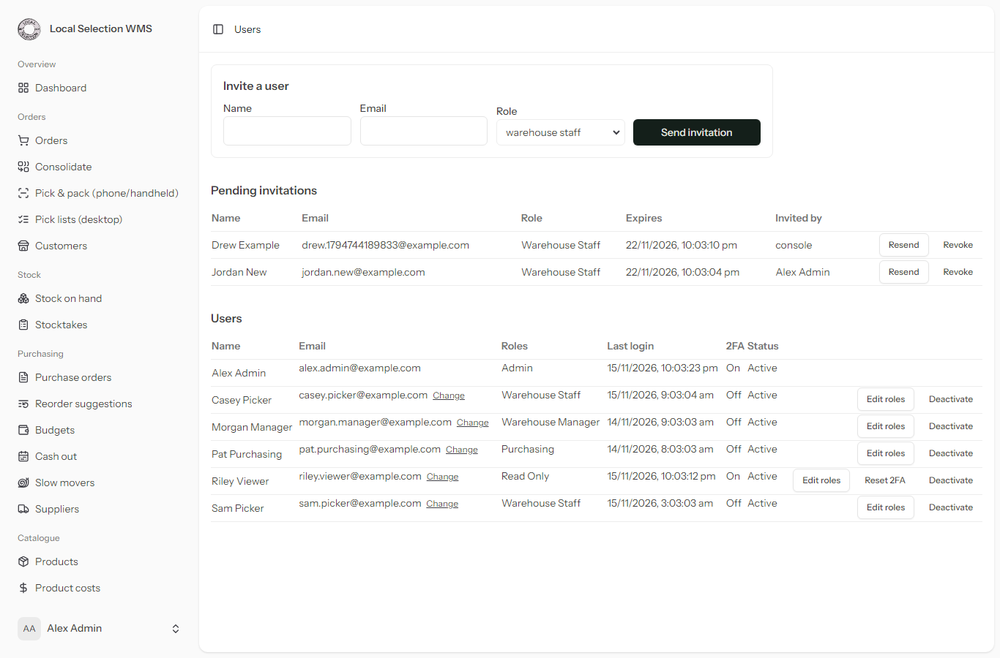

1. Under **Invite a user**, enter the name and email.
2. Choose the role. Only admins can invite admins.
3. Click **Send invitation**.

The invitation is listed under **Pending invitations** until it's accepted. It expires after 7 days.

- **Resend** sends a new link.
- **Revoke** cancels it.

### 13.2 Change roles, email or deactivate

On the user's row:

- **Edit roles:** tick the roles and click **Save**.
- **Change** (next to the email): type the new address, click **Save**, and confirm. The person logs in with the new address straight away, and password resets go there. The change is recorded in the audit log as `email_changed` with the old and new address. No confirmation email is sent to the new address, so check it carefully.

You can't change your own email. Ask another admin.
- **Deactivate:** the person is signed out at once and can't log in.
- **Activate:** lets them back in.

You can't change your own roles or deactivate yourself.

The **2FA** column shows **On**, **Off**, or **Required — not set up** for admins who haven't done it yet.

### 13.3 Reset someone's two-factor

When someone has lost their phone and their recovery codes:

1. Click **Reset 2FA** on their row and confirm.
2. They log in with just their password, and set two-factor up again ([1.3](#13-set-up-two-factor-authentication)). An admin is sent straight to the set-up page.

You can't reset your own two-factor. Ask another admin.

### 13.4 Company settings

**Admin → Company settings.** For admins.

1. **Company details** (name, ABN, address, phone, email, default delivery address, PO terms) are printed on purchase orders. The email is the reply-to address for PO emails. Click **Save**.
   - **Reorder email recipients:** who gets the 7am reorder summary, comma-separated. It starts as the owner only. Leave it empty to send it to no one. The email itself is switched on or off in **Reorder suggestions → Settings**. Changes are in the audit log.
   - **Spoilage loss reasons:** which write-off reasons count as spoilage in **Reports → Spoilage** ([14.3](#143-spoilage)). It starts as Past best-before, Damaged / broken, Spoiled (cold chain / quality), Recall and Other. Samples, gifts, favours, staff and internal use can't be chosen: they're never loss. Changes are in the audit log.
2. **Logo:** shown on purchase orders, packing slips, bin labels and emails.
   - Choose a PNG or JPEG of up to 1 MB. A square image of at least 300 px prints best.
   - Click **Upload logo**.
   - **Use the bundled logo** goes back to the standard Local Selection logo.
3. **Email:** click **Send test email** to send one to yourself. "Sent." means supplier POs, invitations and reports will be delivered. If it says **Failed to send to …**, the reason follows: pass it to whoever looks after the server. A red warning above the button means the server isn't set up to deliver email at all.

### 13.5 Audit log

**Admin → Audit log** (admins and managers) lists important actions with who, when, before and after. Examples: role changes, stock adjustments, pick overrides and take-overs, two-factor resets.

Filter by event (for example `roles_changed`) or subject (for example `User`).

---

## 14. Reports

For admins and warehouse managers, under **Reports** in the menu; the drop reports are mainly for the owner. All money is ex GST.

### 14.1 Stock value & margin

**Reports → Stock value & margin** has three tabs. Each can be exported (**XLSX** or **CSV**, top right).

- **Stock value:** each product's stock at cost and at sell price, gross profit and GM %, per pack (the default sale pack). Choose **Quantity**: **On hand**, or **Available (sellable, not reserved)**. **Sellable products only** and **Hide zero stock** narrow the list. Products with no cost or no sell price are flagged, with a link to fill in costs.
- **Drop profitability:** what one delivery of a product makes, for **Packs per drop** of it, against the **Delivery cost per drop ($)**. **Break-even** is how many packs one drop needs to cover the delivery. Products that lose money at that drop size are counted at the top.
- **Real drops:** each dispatched order by delivery date, with its sales, cost, gross profit and net after delivery, by area. Orders under **Free delivery from ($)** are marked.

**Save delivery settings** saves the delivery cost and free-delivery figure for everyone.

[screenshot: Reports → Stock value & margin]

### 14.2 Substitutions

**Reports → Substitutions** lists the substitutions ([9.5b](#95b-substitutions)) between two dates: date, order, customer, original, substitute, price difference and note. Export as **XLSX** or **CSV**.

### 14.3 Spoilage

**Reports → Spoilage** shows every write-off for loss between two dates (the last 90 days unless you change them).

- **Written off:** the total at cost. Each write-off is valued at the average cost when it was written off. Write-offs from before this report kept no cost: they're valued at today's cost and marked **today**.
- **Units** written off, and **Of cost of goods sold:** write-offs as a % of the cost of goods dispatched in the same dates.
- **Written off per week** (or **month**): the trend. Hover a bar for its figure.
- **By reason / product / range / supplier:** the totals and share of each. Supplier is the batch's supplier, else the product's usual one.
- **Top 10 products by $ lost.**
- **Show every write-off** lists each one with its bin, batch, cost and note.

Export as **XLSX** or **CSV** (the summary is grouped the way the screen is). Returns to suppliers aren't spoilage and aren't counted.

Only the **loss reasons** set in **Company settings** ([13.4](#134-company-settings)) count. Samples, tastings, gifts, favours, staff use and internal use are not spoilage. They keep their reason and are left out of the totals, the % and the trend. A write-off with no reason still counts.

### 14.4 Stock insight reports: the filters

The stock insight reports (14.5 onwards) are for managers and admins. Each has the same filter bar:

- **From / To** (the last 30 days unless you change them, up to two years).
- **Site** (shown when there's more than one).
- **Range** and **Supplier** (the product's usual supplier, except where a report says otherwise).
- **SKU:** search or scan one product. Click **×** to clear it.

Money is ex GST and at cost unless a report says otherwise. **Export** gives the same figures as **XLSX** or **CSV**. Exports are recorded in the audit log.

### 14.5 Stock received

**Reports → Stock received** shows what came in on receipts in the dates, at the PO cost. Supplier is the PO's supplier.

- **Tiles:** cost received, units, damaged / rejected at receipt (and what the damaged stock cost), and short / over against the POs.
- **By SKU / Supplier / PO:** packs, units, cost, number of receipts, damaged, rejected, ordered, over, short and outstanding.
  - **Over:** received beyond what the PO line ordered.
  - **Short:** ordered but never received, counted once the PO is finished (received, paid or closed short). Until then it shows as **Outstanding**.
- **Supplier performance:** each PO whose first delivery falls in the dates.
  - **On time:** the first delivery came on or before the expected date. POs without an expected date aren't counted.
  - **Avg days late.**
  - **Lead time:** days from sending the PO (or its order date) to the first delivery, beside the lead time set on the supplier.
  - **Fill rate:** good stock received ÷ ordered, on finished POs. Damaged, rejected and over-delivered stock don't count towards it.
- **Show every receipt line** lists each line with its receipt, PO, accepted, damaged, rejected and the reason.

### 14.6 Stock sold

**Reports → Stock sold** shows stock dispatched in the dates. A sale counts on the day its pick list was dispatched.

- **Sales:** the packs dispatched at the order line's price. Lines with no price use the default (or Ordermentum) price, and the note above the tiles says how many.
- **Cost:** the cost when it was dispatched. Older dispatches use today's average cost.
- **GP** = sales − cost. **GM %** = GP ÷ sales.
- Services (non-stock lines) aren't included.

On the page:

- **Tiles:** sales, cost of goods, gross profit and gross margin.
- **Sales per week:** hover a week for its GP and the change on the week before.
- **By SKU / Range / Customer / Channel** (Manual, Portal, Ordermentum).
- **Top / bottom products and customers**, ranked by GP.
- **Stopped ordering a product they used to buy:** customers who bought a product on 3 or more orders in the 26 weeks to the end date, then stopped. "Stopped" means it's been more than twice their usual gap, and at least 4 weeks. **Still orders other things** means they're still a customer, just not for that product.

### 14.7 Stock reconciliation

**Reports → Stock reconciliation** accounts for every unit of each SKU over the dates (base units):

> opening + received − dispatched − write-offs − give-aways ± adjustments ± stocktake variances ± other = **expected closing**

**Other** is transfers into or out of the site, returns to suppliers, customer returns and opening balances. Transfers between bins of one site cancel out.

- **Actual** is the stock on hand at the end date. It should match **Expected**. If any SKU differs, it's highlighted and the **Books vs balances** tile says so. Tell support: it means the stock records disagree.
- **Unexplained loss** is the shrinkage (theft) indicator:
  - every stock count that came up short (negative stocktake variance), plus
  - every adjustment that took stock out with no supporting reason: **Lost / missing**, or no note.
  - It's valued at the cost on each movement, else today's cost. Click the figure to see the movements behind it.
- **Shrinkage %** = unexplained loss ÷ cost of goods sold in the same dates, per range and overall.
- SKUs are listed biggest unexplained loss first. Tick **Only SKUs with a loss or difference** to hide the rest.

---

## 15. Troubleshooting and FAQ

**I can't see a menu item a colleague has.**
Your role doesn't include it. See [2](#2-roles-who-can-do-what), and ask an admin to change your roles.

**I'm an admin and every page sends me to Two-factor.**
Admins must set up two-factor first ([1.3](#13-set-up-two-factor-authentication)).

**I lost my phone.**
Log in with a recovery code ([1.5](#15-log-in-with-two-factor)). No codes left? Ask an admin to **Reset 2FA**.

**My invitation link doesn't work.**
It has expired (7 days) or was already used. Ask an admin to **Resend** it.

**The scanner types into the wrong place, or nothing happens.**
Tap the scan box first. Check the scanner adds Enter after each scan. Use **Enter quantity** with a reason if you can't scan.

**"Wrong bin" or "Not this product".**
You're at the wrong bin, or the product's barcode isn't on file. Check the bin code on screen. If the barcode really is missing, use **Enter quantity**, choose **Label missing**, and ask a manager to add the barcode to the product.

**"… is being picked by someone else".**
Another picker has the list. Use **Take over** if they've stopped.

**"Finish picking every line of this order first" when packing.**
Go back and pick, or short-pick, the remaining lines.

**"Pack every order on … before dispatch".**
Open the **Pack** link on the manifest and pack the orders shown as "not packed".

**An order is under "Orders without a run".**
Its postcode isn't in any delivery area. A manager can set the run on the order, or an admin can add the postcode ([11.3](#113-edit-delivery-areas)).

**A bin shows a negative quantity.**
Goods left that the system didn't know were there, usually stock put in a different bin. Count the bin ([8.4](#84-count-tasks)), and move or adjust as needed.

**"… is batch-tracked: enter lot and best-before" when receiving.**
Enter the lot code and best-before date from the carton.

**"More than ordered … Confirm the over-receipt".**
Check the delivery. If you're keeping it, someone who manages POs ticks **Accept the over-receipt**.

**"… has no quarantine bin for damaged stock".**
Damaged stock needs a quarantine bin at that site. Ask a manager to add one ([5.1](#51-add-or-edit-a-location)).

**"… must be sent before receiving".**
The PO hasn't been sent. Approve it if needed ([6.2a](#62a-approve-the-po)), then click **Mark as sent** or **Email supplier**.

**I can't send a PO, or "Approve … before sending it".**
Every PO needs approving first. Open it and click **Approve** ([6.2a](#62a-approve-the-po)). The **Email supplier** button only appears once it's approved.

**The Approve button is greyed out.**
The PO is over this week's remaining budget, or the week has no budget. Tick **Approve over budget anyway** and type a reason, or set the week's budget first ([6.7](#67-budgets)).

**I can't edit an approved PO.**
Approved POs are locked so the budget check stays true. Cancel it and make a new one, or ask the supplier to adjust the delivery and receive what comes.

**My changes to a suggested PO were overwritten.**
Suggested POs are refreshed by each suggestion run until approved or edited. Use **Edit** and **Save**: that makes it a draft, which the run leaves alone ([6.6](#66-suggested-pos-and-reorder-suggestions)).

**A product never appears on the suggested POs.**
Check on the product that **Include in suggested POs** is ticked and it has a **Preferred supplier** (or a past PO), and that the supplier is active. Check **Reorder suggestions** to see whether anything is needed: stock on hand and on order may already cover it.

**There's no Mark paid button.**
A PO can be marked paid once it's approved, and not when it's cancelled. If it's already marked, **Paid** shows who and when.

**Cash out shows a PO I've already paid.**
Mark it paid ([6.5a](#65a-mark-paid)). Cash out only knows what's recorded here, not what's in Xero.

**Cash out doesn't show a PO.**
Only approved POs have a payment due date. Drafts and suggested POs aren't shown until they're approved.

**The GST on a PO line is wrong.**
Change the **GST %** on the line while it's a draft. To fix it for good, tick or untick **GST-free** on the product ([4.4](#44-flags-and-sell-channels)).

**GM % on a PO line looks far too low (or negative).**
The product's sell price was probably entered per unit instead of per sale pack. Check **Products** for the amber sell price note, or the label on the product (**Sell price per Case (12)**, for example), and enter the price of the whole pack ([4.1](#41-create-or-edit-a-product)).

**Leave this screen? keeps appearing on the handheld.**
You have lines left to pick. Tap **Stay** and finish, or **Leave**: the list stays yours ([10.1](#101-before-you-start)).

**The cost import says the preview expired.**
Previews last 30 minutes. Upload the file again.

**A PO email shows "failed".**
Check the supplier's email address, then click **Retry**.

**Ordermentum and the app show different stock.**
Check the **Sync** screen ([12](#12-sync-screen-ordermentum-and-portal)) for push failures and mismatches. Remember Ordermentum is told the **available** figure (sellable minus reserved), in the pack it sells.

**Can I undo a stocktake, adjustment or dispatch?**
No. Stock movements can't be edited or deleted. Post a correcting adjustment with the reason **Data-entry correction** ([7.3](#73-adjust-or-write-off-stock)).

**How do I change my email address?**
Ask an administrator. They change it on **Admin → Users** ([13.2](#132-change-roles-email-or-deactivate)).

---

## Appendix: Admin setup

One-off and server jobs for an administrator, or whoever runs the server. Warehouse staff don't need this page.

**Before the first Monday run**

1. **Supplier payment terms.** On each supplier, fill in **Payment terms (days after delivery)** (0 for COD), and check **Lead time**, **Order days** or **Review period**, **Minimum order** and **MOQ** ([6.1](#61-suppliers)).
2. **GST-free products.** Either tick **GST-free** product by product ([4.4](#44-flags-and-sell-channels)), or have the server administrator import the flags for the whole catalogue from a list of SKUs exported from Xero item tax codes. The import lists any SKUs it can't match and leaves them alone, and can be run as a trial first.
3. **Payment due dates for POs already open.** POs that were sent or received before approvals existed have no payment due date, so Cash out can't place them. After step 1, the server administrator fills them in once: expected date (or the order date) plus the supplier's payment terms. It can be run as a trial first, and doesn't change POs already paid or cancelled.
4. **This week's budget** ([6.7](#67-budgets)), or let the first Monday run set it from the estimate.
5. **Purchasing fields on products:** preferred supplier, supplier pack, and any safety stock overrides ([4.4a](#44a-purchasing-fields)).

**The Monday run and other scheduled jobs**

The suggested POs (Mondays 6 am), the 7 am reorder email, nightly stock checks and Ordermentum checks only run if the server's scheduler is running. If suggested POs don't appear on a Monday, ask the server administrator to check it. **Generate suggestions** on **Purchase orders** works regardless.

**Email**

Use **Send test email** on **Company settings** ([13.4](#134-company-settings)) after any change to the server's email settings.
